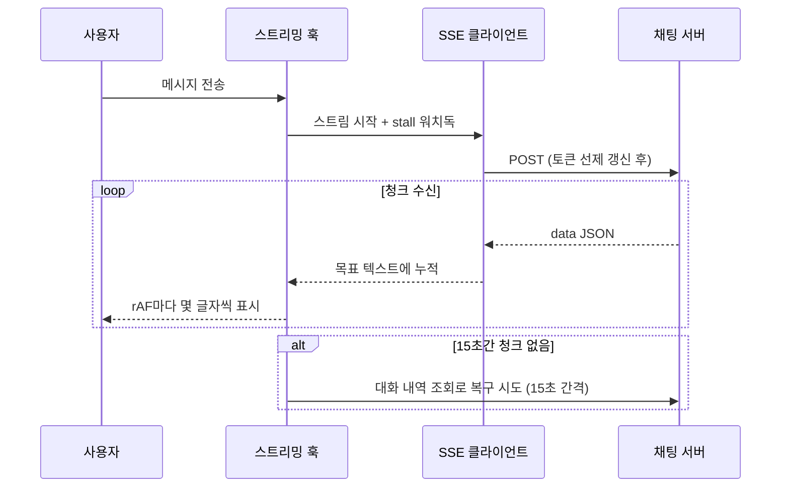
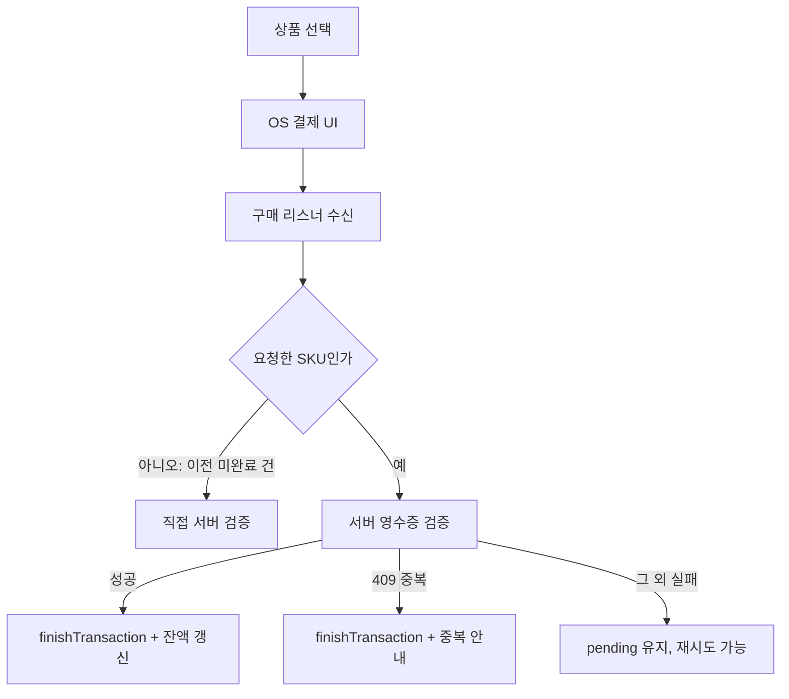
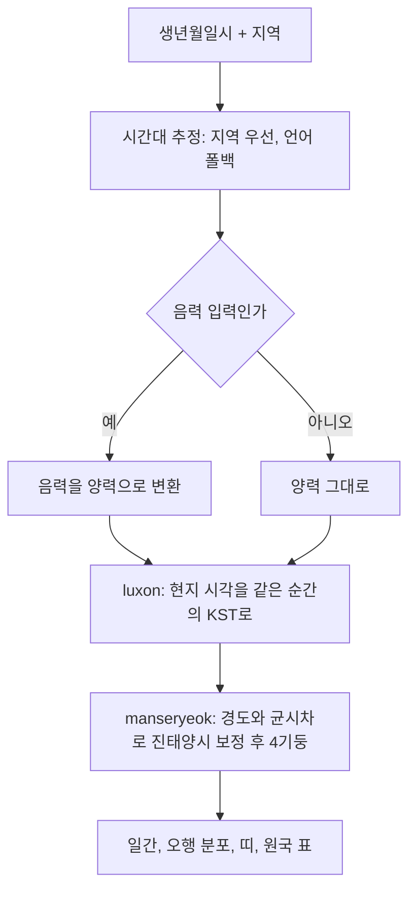

# React Native로 AI 운세·사주 상담 앱을 만들며 풀었던 문제들

> 실시간 AI 채팅(SSE), 인앱 결제, 클라이언트 사주 계산 엔진까지. 14개월 동안 모바일 앱 프론트엔드를 혼자 맡으며 겪은 문제와 해결 과정을 기술 스택별로 정리했습니다.

## 프로젝트 개요

**무엇을 만들었나.** AI 운세·사주 상담 모바일 앱입니다. 사용자가 콘텐츠(연애운, 재물운 같은 주제)를 고르고 분석 방식(타로·점성술·사주)을 선택하면, 서버의 AI가 결과를 만들어 줍니다. 결과를 본 뒤에는 AI와 채팅으로 "심층 대화"를 이어갈 수 있습니다. 코인을 인앱 결제로 충전하는 구조이고, 한국어와 영어를 지원합니다.

**기간.** 2025년 8월 ~ 2026년 10월 (첫 커밋 2025-08-13, 마지막 커밋 2026-10-14)

**역할.** 모바일 앱 프론트엔드 개발을 혼자 맡았습니다. 앱 저장소의 병합 제외 커밋 310건을 모두 제가 작성했습니다. 운영용 관리자 웹(CMS)도 별도 저장소에서 제가 혼자 만들었고, 그 이야기는 [관리자 CMS 글](./fortune-app-admin-cms.md)에 따로 정리했습니다. 백엔드 API와 AI 서버는 다른 팀이 담당했고, 이 글은 그 API를 쓰는 모바일 앱 쪽 이야기입니다.

**규모 (코드 기준).**

| 항목 | 수치 |
|------|------|
| 내비게이터에 등록된 화면(라우트) | 46개 (Stack 41 + Tab 5) |
| `*Screen.js` 파일 | 45개 |
| Zustand 스토어 | 12개 |
| 커스텀 훅 | 16개 |
| `src` JavaScript 코드 | 약 4만 줄 (테스트 제외) |
| 단위 테스트 | 9개 스위트, 102개 케이스 (전부 통과) |
| 커밋 | 310건 |

## 기술 스택 한눈에

| 영역 | 기술 | 이 프로젝트에서의 용도 |
|------|------|------------------|
| 프레임워크 | React Native 0.81 + Expo SDK 54 | iOS·Android를 한 코드로 혼자 개발하고, 네이티브 설정은 config plugin으로 관리하기 위해 |
| 빌드/배포 | EAS Build, Continuous Native Generation | `android/`, `ios/`를 커밋하지 않고 `app.json`을 유일한 설정 출처로 두기 위해 |
| 상태 관리 | Zustand 5 (+ `persist`) | 도메인별 전역 상태, 셀렉터 구독, AsyncStorage 영속화 |
| API 통신 | Axios 인스턴스 2개 + 인터셉터 | 일반 API와 AI 분석/채팅 서버를 나누고, 토큰 주입·갱신을 한 곳에서 처리하기 위해 |
| AI 채팅 | SSE (`expo/fetch` 스트림) | 응답을 토큰 단위로 받아 바로 보여주기 위해 |
| AI 텍스트 렌더링 | react-native-markdown-display (+ markdown-it 패치) | AI 응답이 마크다운이라서. 한국어 강조 문법 깨짐은 패치로 해결 |
| 인앱 결제 | react-native-iap 14 | StoreKit과 Google Play Billing을 하나의 API로 다루기 위해 |
| 푸시 알림 | Firebase Cloud Messaging + expo-notifications | 양 플랫폼 푸시와 알림 탭 딥링크 처리 |
| 사주 계산 | manseryeok + luxon | 만세력 기준 4기둥 계산과 출생지 시간대·서머타임 환산 |
| 모니터링 | Sentry (`@sentry/react-native`) | 운영 빌드의 에러를 기기·화면 맥락과 함께 수집하기 위해 |
| 다국어 | i18next + react-i18next + expo-localization | 한/영 번역과 OS 언어 추종 |
| 품질 | Jest(jest-expo), ESLint, Prettier, Husky, lint-staged, GitHub Actions | 혼자 개발해도 규칙이 지켜지도록 커밋·PR 단계에서 자동 검사 |

## 목차

1. [React Native + Expo: 빌드 환경과 프로젝트 구조](#1-react-native--expo-빌드-환경과-프로젝트-구조)
2. [SSE 스트리밍: AI 채팅](#2-sse-스트리밍-ai-채팅)
3. [인앱 결제: react-native-iap](#3-인앱-결제-react-native-iap)
4. [사주 계산 엔진: manseryeok + luxon](#4-사주-계산-엔진-manseryeok--luxon)
5. [FCM 푸시·딥링크와 분석 완료 감지](#5-fcm-푸시딥링크와-분석-완료-감지)
6. [Zustand + Axios: 상태와 데이터 레이어](#6-zustand--axios-상태와-데이터-레이어)
7. [Sentry와 통합 에러 처리](#7-sentry와-통합-에러-처리)
8. [i18n: 한국어/영어](#8-i18n-한국어영어)
9. [Jest · ESLint · CI: 품질 관리](#9-jest--eslint--ci-품질-관리)

---

## 1. React Native + Expo: 빌드 환경과 프로젝트 구조

### 왜 선택했나

프론트엔드 개발자가 저 혼자였기 때문에 iOS와 Android를 따로 만들 수는 없었습니다. React Native에 Expo를 더하면 소셜 로그인, 푸시, 인앱 결제 같은 네이티브 기능을 쓰면서도 네이티브 설정을 `app.json`과 config plugin으로 관리할 수 있습니다. 빌드는 EAS가 클라우드에서 해 주기 때문에 로컬 환경에 덜 묶인다는 점도 고려했습니다. **[확인 필요: 선택 당시 실제 이유]**

### 어떻게 적용했나

- **CNG(Continuous Native Generation).** `android/`, `ios/` 폴더는 `.gitignore`에 넣고 EAS 빌드 때 생성합니다. Android는 `eas-build-post-install` 훅에서 `expo prebuild`를 명시적으로 실행합니다. Android 매니페스트 수정이나 Gradle 의존성 제외처럼 네이티브 쪽에 손대야 하는 작업은 모두 커스텀 config plugin(`app.plugin.js`)에 코드로 남겼습니다.
- **EAS 프로필.** `development`(dev client), `preview`(내부 배포), `production`(스토어) 세 개로 나눴습니다.
- **폴더 구조.** 처음에는 `screens/`, `components/` 아래에 파일을 대부분 평평하게 두었습니다. 화면이 늘어난 뒤 도메인별 폴더(`account`, `playing`, `payment`, `notice` …)와 `index.js` 배럴 파일 구조로 바꿨습니다(`072e0c5`, `1381639`). 836줄짜리 `endpoints.js`도 도메인별 API 파일로 나눴습니다(`3691c16`, 현재 15개).

### 해결한 문제

**첫 개발 빌드가 나오기까지 사흘, 커밋 57건.** 2025년 10월 15~17일에 처음으로 EAS 개발 빌드를 만들 때 Android 빌드가 계속 실패했습니다. 이 사흘 동안의 커밋 57건은 대부분 빌드 설정과 의존성 수정입니다. 원인은 크게 세 가지였습니다.

1. AndroidX 라이브러리와 레거시 Support 라이브러리가 함께 들어오면서 `appComponentFactory` 매니페스트 병합 충돌이 났습니다. config plugin에서 main·debug 매니페스트 양쪽에 `tools:replace`를 넣어 해결했습니다(`3e7136e`).
2. 일부 서드파티 패키지가 `com.android.support`를 끌고 와서 클래스 중복이 생겼습니다. 루트 `build.gradle`에 전역 exclude 블록을 넣는 코드를 plugin에 추가했습니다(`441ea5c`).
3. 네이티브 폴더를 직접 고치는 방식과 `app.json` 설정이 따로 관리되고 있었습니다. 그래서 `app.json`을 유일한 설정 출처로 정하고 네이티브 폴더는 커밋하지 않기로 했습니다(`3316fd2`, `94189fe`).

### 결과

- 네이티브 폴더를 커밋하지 않아도 같은 빌드를 재현할 수 있게 됐습니다. 이후 R8 설정처럼 네이티브 옵션을 바꿀 때도 `app.json`만 고쳤습니다(`8152ba9`).
- 빌드 소요 시간·스토어 심사 통과 횟수: **[수치 입력: EAS 빌드 평균 소요 시간, 출시한 스토어 버전 수 등]**

---

## 2. SSE 스트리밍: AI 채팅

### 왜 선택했나

AI 답변은 수백 자가 넘는 경우가 많습니다. 끝까지 기다렸다가 한 번에 보여주면 사용자는 몇십 초 동안 빈 화면만 보게 됩니다. 서버가 SSE로 토큰을 흘려 보내 주기 때문에, 앱도 청크가 도착하는 대로 화면에 그리는 구조가 필요했습니다.

### 어떻게 적용했나



핵심은 **수신과 표시를 분리한 것**입니다. 청크는 "목표 텍스트"에 쌓기만 하고, 화면에는 `requestAnimationFrame` 루프가 프레임마다 몇 글자씩 흘려 보여줍니다. 남은 글자가 많으면 한 번에 보여주는 양을 늘려 따라잡습니다.

```js
// 단순화한 예시
function tick() {
  const target = state.received;
  if (state.shown < target.length) {
    const remaining = target.length - state.shown;
    const step = remaining > 240 ? 12 : remaining > 80 ? 5 : 2;
    state.shown = Math.min(target.length, state.shown + step);
    render(target.slice(0, state.shown));
  }
  if (state.ended && state.shown >= target.length) return finish();
  requestAnimationFrame(tick);
}
```

### 해결한 문제

- **청크가 마지막에 한꺼번에 오는 문제.** 처음에는 `XMLHttpRequest`의 `onprogress`로 SSE를 읽었습니다. 그런데 환경에 따라 응답이 버퍼링되어 스트리밍처럼 보이지 않았습니다. `expo/fetch`의 `ReadableStream` 기반으로 클라이언트를 다시 작성했습니다. 불완전한 마지막 줄을 버퍼에 남겨 다음 청크와 합쳐 파싱하는 줄 단위 처리는 그대로 유지했고, 스트림을 지원하지 않는 환경에서는 전체 응답을 한 번에 파싱하는 폴백을 두었습니다(`f293e67`).
- **청크마다 화면이 깜빡이는 문제.** 청크마다 `setMessages`로 새 배열을 만들고 있었고, 그 때문에 메시지 목록이 청크 수만큼 다시 렌더링됐습니다. 업데이트를 한 프레임에 한 번으로 모았고, 텍스트가 같으면 이전 배열 참조를 그대로 돌려줬습니다. `MessageItem`에 넘기던 `new Set()`과 인라인 함수는 모듈 상수로 빼서 `memo`가 제대로 동작하게 했습니다(`70936a4`).
- **스트림이 멈추거나 앱이 백그라운드로 가는 경우.** 15초 동안 청크가 없으면 스트림은 그대로 둔 채 대화 내역 API를 15초 간격으로 함께 조회합니다. 둘 중 먼저 응답이 오는 쪽으로 화면을 채웁니다. 백그라운드로 가면 스트림 "세대(generation)" 번호를 올려서, 연결이 끊긴 스트림이 뒤늦게 보내는 에러 콜백은 무시합니다. 포그라운드로 돌아오면 내역 조회로 복구합니다(백그라운드 처리 `8330bc1`, stall 감지와 내역 조회 복구 `dda4a20`). iOS에서 알림 센터를 잠깐 내릴 때 생기는 `inactive` 상태는 연결이 유지되므로 중단 대상에서 뺐습니다.
- **무한 로딩.** 응답이 끝내 오지 않으면 로딩이 끝나지 않던 문제는 전송 시점부터 최대 대기 시간을 두는 것으로 막았습니다(`dda4a20`). 이후 stall 판정(30초→15초)과 최대 대기 시간(2분→45초→100초)을 두 차례 조정했습니다(`243ac11`, `6d11ca4`).
- **요청 직전 토큰 만료.** SSE 요청을 보내기 전에 만료가 30초 이내로 남은 토큰은 미리 갱신하도록 했습니다. 서버에 도착하는 시점에 토큰이 만료되는 경계 상황을 줄이려는 것입니다. 여러 SSE 요청이 동시에 시작돼도 갱신은 한 번만 합니다(`5b1f15b`).
- **한국어 굵게 표시가 깨지는 문제.** CommonMark 규칙에서는 `**대운(大運)**입니다`처럼 닫는 `**` 앞이 문장부호이고 바로 뒤에 조사가 붙으면 강조가 닫히지 않습니다. 영어는 강조 뒤에 공백을 두니 이 패턴이 드물지만, 한국어는 조사가 붙어서 자주 생깁니다. markdown-it의 delimiter 판정에서 CJK 문자를 문장부호처럼 취급하도록 패치했습니다. 이때 `_`는 원래 규칙대로 두어 `파일_이름` 같은 표기가 기울임꼴로 바뀌지 않게 했습니다(`f3f45ca`).

### 결과

- 백그라운드 전환, 네트워크 지연, 토큰 만료가 있어도 대화가 비거나 무한 로딩에 빠지지 않는 흐름을 만들었습니다.
- 첫 글자가 보이기까지 걸리는 시간 / 채팅 실패율: **[수치 입력: 첫 토큰 표시까지 평균 시간(ms), 채팅 실패·지연 안내 노출 비율]**

---

## 3. 인앱 결제: react-native-iap

### 왜 선택했나

앱 안에서 쓰는 코인은 디지털 재화라서 스토어 인앱 결제를 써야 합니다. react-native-iap를 쓰면 StoreKit과 Google Play Billing을 하나의 API로 다룰 수 있습니다. 코인 차감과 환불은 백엔드가 처리하고, 앱은 **결제 → 서버 영수증 검증 → 트랜잭션 종료**까지를 책임집니다.

### 어떻게 적용했나

결제 로직은 싱글턴 매니저(연결, 상품 조회, 구매 리스너)와 화면용 훅(UI 상태, 서버 검증, 에러 안내) 두 층으로 나눴습니다. 결제 결과는 구매 함수의 반환값이 아니라 전역 구매 리스너로 들어옵니다. 그래서 "지금 요청한 상품"의 SKU를 기억해 두고, 앞서 남아 있던 미완료 트랜잭션과 구분합니다.



### 해결한 문제

- **iOS 영수증 불일치와 비밀번호 창이 두 번 뜨는 문제.** 빌드 버전에 따라 "영수증 불일치"가 나거나, 샌드박스 비밀번호를 두 번 입력해야 결제가 끝나는 현상이 있었습니다(`22673ca`). StoreKit 1 통합 영수증을 읽어 오던 방식을 버리고, StoreKit 2 기준으로 서버에 트랜잭션 ID를 보내는 방식으로 바꿨습니다(`afbf330`, `10c5c46`). 그리고 트랜잭션 ID를 읽던 필드가 라이브러리가 실제로 채우는 필드(`id`)와 달랐던 것을 찾아 매핑을 고쳤습니다(`fe31813`). ID가 없는 오래된 pending 트랜잭션은 바로 종료해서 큐를 비웠습니다.
- **검증이 실패하면 계속 pending에 걸리는 문제.** 트랜잭션을 종료하지 않으면 같은 상품을 다시 살 수 없습니다. 처음에는 검증이 실패하면 무조건 종료했고, 실패한 트랜잭션은 중복 처리 방지 Set에서 빼서 재시도가 막히지 않게 했습니다(`48a78f5`). 다음에는 5xx·네트워크 오류는 남겨 두고 4xx만 종료하도록 좁혔습니다(`afbf330`). 그런데 일시적인 서버 오류로도 4xx가 올 수 있어서, 결제가 됐는데 코인이 안 들어온 채 트랜잭션이 끝나 버릴 위험이 있었습니다. 그래서 결제 훅에서는 **409(이미 처리된 영수증)일 때만 종료**하고, 나머지는 pending으로 남겨 다시 시도할 수 있게 했습니다(`f208882`).
- **결제 응답이 오지 않는 iOS 케이스.** 60초 안에 콜백이 오지 않으면 안내를 띄우고 Promise를 끝냅니다. 그 뒤에 늦게 도착한 콜백은 `settled` 플래그로 무시합니다. 검증이 성공했는데 프로필 갱신만 실패한 경우에는 서버 응답의 잔액 값으로 스토어를 직접 갱신했습니다(`9d52bab`).
- **결제 에러 모달이 앱을 멈추게 하던 문제.** 훅이 돌려주던 `clearError`가 렌더마다 새 함수라서, 이를 의존성으로 가진 `useEffect`가 무한히 다시 실행됐습니다. `useCallback`으로 참조를 고정해 해결했습니다(`7be039d`).

### 결과

- 중복 영수증, 늦게 오는 콜백, 이전 미완료 건이 섞여 들어오는 경우까지 한 흐름에서 처리하도록 정리했습니다.
- 결제 성공률·결제 관련 문의 건수: **[수치 입력: 결제 시도 대비 검증 성공 비율, 수정 전후 결제 CS 건수]**

---

## 4. 사주 계산 엔진: manseryeok + luxon

### 왜 선택했나

사주 결과 화면과 마이페이지에서는 AI 응답과 별도로 일간, 대표 오행, 띠, 사주원국 표를 바로 보여줘야 했습니다. 서버를 기다릴 필요가 없는 값이라 클라이언트에서 직접 계산하기로 했습니다. 만세력 계산(음력 변환, 24절기, 진태양시)은 직접 구현하기보다 검증된 라이브러리를 쓰는 게 맞다고 판단했습니다.

### 어떻게 적용했나



manseryeok은 "입력 시각은 한국 시간(KST)"이라고 가정합니다. 그래서 해외에서 태어난 사용자의 시각은 luxon으로 출생지 시간대 기준의 절대 시각으로 해석한 뒤, 같은 순간의 KST로 바꿔서 넘깁니다. 과거 표준시 변경과 서머타임은 luxon이 반영합니다.

```js
// 단순화한 예시
function toKstWallClock(local, zone) {
  const kst = DateTime.fromObject(local, { zone }).toUTC().plus({ hours: 9 });
  return { year: kst.year, month: kst.month, day: kst.day, hour: kst.hour, minute: kst.minute };
}
```

### 해결한 문제

- **임시 로직을 실제 계산으로 교체.** 초기 화면에서는 `생일 % 10` 같은 나머지 연산으로 일간과 띠를 정하는 임시 코드가 있었습니다. 이를 `utils/saju/` 모듈로 분리하고 4기둥을 실제로 계산하도록 바꿨습니다. 처음에는 lunar-javascript를 썼습니다(`e177e1c`).
- **해외 출생자의 시간대.** 백엔드는 출생지 시간대를 저장하지 않습니다. 그래서 OS 지역 코드를 먼저 보고, 없으면 앱 언어로 시간대를 추정하게 했습니다. 영어 폰을 쓰는 한국 거주자처럼 언어와 거주지가 다른 경우가 있어서 지역을 우선했습니다(`b5b768c`).
- **만세력 라이브러리 교체.** lunar-javascript와, 지역별 고정 분 단위 오프셋으로 직접 하던 서머타임·경도 보정 계산을 지우고 manseryeok으로 바꿨습니다. 진태양시 보정(경도와 균시차)은 라이브러리에 맡기고, 앱은 시간대 환산만 하도록 역할을 나눴습니다. 천간·지지에서 오행을 찾는 매핑도 라이브러리 함수로 만들어 중복 정의를 없앴습니다(`100d822`).
- **경계 케이스 테스트.** 입춘 경계(1990-02-03은 己巳년, 02-05는 庚午년), 시간 미상일 때 시주를 비우는 처리, 음력 윤달, LA의 서머타임 기간과 표준시 기간 시지 차이를 테스트로 고정했습니다(`e177e1c`, `b5b768c`, `0c8047a`).

### 결과

- 사주원국 표(시·일·월·연 순, 오방색)와 오행 분포 도넛, 양력·음력 함께 표시 기능을 결과 화면과 마이페이지에 추가했습니다(`0c8047a`).
- 사주 엔진 관련 테스트 3개 스위트를 두고 있습니다.
- 계산 결과 관련 사용자 문의 변화: **[수치 입력: 교체 전후 "사주가 틀리다"는 문의 건수 등]**

---

## 5. FCM 푸시·딥링크와 분석 완료 감지

### 왜 선택했나

AI 분석은 서버가 백그라운드에서 처리합니다. 그래서 "분석이 끝났다"는 사실을 사용자에게 알려 주는 경로가 두 가지 필요했습니다. 앱 밖에서는 푸시 알림, 앱 안에서는 인앱 알림입니다. 양 플랫폼 푸시는 FCM으로 통일했고, 알림을 탭하면 해당 화면으로 이동하는 딥링크 처리를 붙였습니다.

### 어떻게 적용했나

- 알림 데이터에서 `linkType`/`linkTargetId`를 꺼내 화면을 정하는 처리를 한 곳(`NotificationManager.navigateToScreen`)으로 모았습니다.
- 앱 안에서는 루트에 한 번만 마운트하는 `useAnalysisWatcher` 훅이 분석 중인 항목이 있을 때만 5초마다 히스토리를 다시 조회합니다. 직전 조회 때 분석 중이던 항목의 상태가 완료나 실패로 바뀌면 인앱 알림을 띄웁니다. 같은 분석 ID로는 한 번만 알림을 보냅니다.

### 해결한 문제

- **앱이 꺼져 있을 때(콜드 스타트) 알림을 탭하면 이동하지 않는 문제.** 알림 데이터를 읽는 시점이 로그인 상태가 복원되기 전이라, 이동할 화면이 아직 내비게이터에 올라와 있지 않은 것이 원인으로 보였습니다. 앱이 시작될 때 Firebase의 초기 알림을 **pending으로 저장**해 두고, 사용자 정보가 로드된 뒤에 처리하도록 순서를 바꿨습니다(`754f90c`). 이미 실행 중인 상태에서 알림을 탭하는 경우는 바로 이동합니다.
- **히스토리 탭을 보고 있을 때만 완료 알림이 뜨던 문제.** 완료 감지 코드가 히스토리 화면 안에 있었기 때문입니다. 전역 훅으로 옮겨서 채팅 등 다른 화면에 있어도 알림을 받게 했습니다(`afdf65d`).
- **폴링이 5초마다 돌지 않던 문제.** 인터벌을 거는 `useEffect`의 의존성이 `history` 배열이었습니다. 조회할 때마다 배열이 바뀌니 인터벌이 계속 해제되고 다시 걸렸습니다. "분석 중인 항목이 있는가"라는 boolean만 따로 구독하도록 바꿔서 주기를 지켰습니다(`8db969a`).

```js
// 단순화한 예시: 배열 대신 boolean을 의존성으로
const hasPending = useHistoryStore((s) => s.items.some(isInProgress));
useEffect(() => {
  if (!hasPending) return;
  const id = setInterval(fetchHistory, 5000);
  return () => clearInterval(id);
}, [hasPending, fetchHistory]);
```

- 분석 중 항목이 남은 채 로그아웃하면 전역 훅이 토큰 없이 5초마다 조회해 401 에러를 계속 만들었습니다. 로그인 여부로 감지를 멈추고, 로그아웃 때 히스토리 로컬 상태를 비우도록 했습니다(`0e9b844`).

### 결과

- 콜드 스타트, 백그라운드, 포그라운드 세 가지 상태 모두에서 알림을 탭하면 해당 화면으로 이동합니다.
- 푸시 탭률·분석 완료 후 결과 확인률: **[수치 입력: 푸시 오픈율, 완료 알림 후 결과 화면 진입 비율]**

---

## 6. Zustand + Axios: 상태와 데이터 레이어

### 왜 선택했나

처음에는 `UserContext`와 `GlobalContext`, 두 개의 Context로 전역 상태를 다뤘습니다. 2025년 9월 말에 Zustand 스토어로 옮기면서 두 Context를 지웠습니다(`7b6dde6`). Zustand는 셀렉터로 필요한 값만 구독할 수 있고, `persist` 미들웨어로 AsyncStorage 영속화도 바로 붙일 수 있습니다. **[확인 필요: 선택 당시 실제 이유]**

### 어떻게 적용했나

- 스토어 12개를 도메인별로 나눴고, 설정·검색·팝업처럼 앱을 다시 켜도 남아야 하는 5개에만 `persist`를 적용했습니다.
- Axios 인스턴스는 일반 API용과 AI 분석/채팅 서버용 두 개를 두었습니다. 요청 인터셉터는 토큰과 언어 파라미터를 붙이고, 응답 인터셉터는 응답 본문을 꺼내 주고 401 토큰 갱신을 처리합니다.

### 해결한 문제

- **캐시가 끝없이 쌓이는 문제.** 콘텐츠 상세와 검색 결과 캐시에 TTL만 있고 삭제 로직이 없어서, 오래 쓰면 메모리에 계속 남았습니다. 항목 수가 일정 개수를 넘으면 만료된 항목을 정리하도록 했습니다(`16ceead`).
- **토큰 갱신 중 대기하던 요청들이 멈추는 문제.** 갱신이 실패하면 대기 큐에 있던 요청들이 영원히 기다리고 있었습니다. 실패할 때도 큐 전체를 reject하도록 바꿨습니다(`16ceead`). 로그인 직후 이전 토큰으로 보낸 요청이 401을 받는 경우에는, 저장소에 더 새로운 토큰이 있으면 그 토큰으로 한 번 다시 보냅니다(`6ad18c6`).
- **렌더 무한 루프.** 마이페이지의 포커스 effect가 `user`를 의존성으로 가진 채 `fetchUserProfile`을 호출했고, 이 함수가 다시 `user`를 갱신하면서 무한 루프가 생겼습니다. effect 안에서는 `getState()`로 값을 읽고 의존성에서 `user`를 뺐습니다(`bd986e2`). 홈 화면의 중복 호출과 Hook 호출 순서 문제도 같은 시기에 정리했습니다(`f7c9683`).

### 결과

- 화면은 UI를, 훅은 비즈니스 로직을, 스토어는 상태를, API 모듈은 통신을 맡도록 레이어가 정리됐습니다.
- 메모리·렌더링 개선 효과: **[수치 입력: 장시간 사용 시 메모리 사용량, 주요 화면 렌더 횟수 비교 등]**

---

## 7. Sentry와 통합 에러 처리

### 왜 선택했나

QA 피드백만으로는 실제 기기에서 나는 에러를 다 잡을 수 없었습니다. 운영 빌드의 에러를 어느 화면에서, 어떤 기기와 버전에서 났는지와 함께 보려고 Sentry를 붙였습니다(`1909ce3`). **[확인 필요: 선택 당시 실제 이유]**

### 어떻게 적용했나

- 운영 빌드에서만 전송하고, 트레이스 샘플링은 운영 20%로 설정했습니다. Session Replay는 세션의 1%, 에러가 난 세션은 100% 기록합니다. React Navigation 연동으로 화면 전환도 함께 추적합니다.
- 개인정보 보호를 위해 PII 자동 전송과 콘솔 로그 전송을 끄고, `beforeSend`에서 민감할 수 있는 키를 마스킹합니다. 사용자는 내부 ID로만 식별합니다.
- 화면마다 제각각이던 catch 블록은 통합 에러 핸들러로 모았습니다. HTTP 상태로 에러 유형(네트워크/인증/검증/서버 등)을 나누고, 유형별로 i18n 메시지와 Sentry 전송 여부를 정합니다. 5xx와 알 수 없는 에러만 보내고, 사용자 환경 탓인 네트워크 오류나 입력 오류(4xx)는 노이즈라서 보내지 않습니다.

### 해결한 문제

- **분석 실패 메시지.** 분석이 실패하면 서버가 내려준 문구를 그대로 보여 주고 있어서, 사용자에게 의미 없는 인프라 오류 문구까지 노출됐습니다. 인프라성 실패면 공통 안내 문구를, AI가 거절한 이유 같은 그 밖의 실패면 서버 원문을 보여 주도록 나눴습니다(`c2207be`). 이어서 이 판단을 화면에서 떼어 내 한 모듈로 모았습니다(`4694c36`). 판단이 문자열 매칭 방식이라서, 백엔드가 항목별 상태 코드를 내려주면 판정 함수 하나만 바꾸면 되도록 만들었습니다.
- **로그아웃 뒤 쌓이던 불필요한 에러.** 분석 중 항목이 남은 채 로그아웃하면 전역 분석 감지 훅이 토큰 없이 계속 조회해 401 에러를 만들었고, 커밋 제목 기준으로 이것이 불필요한 Sentry 전송으로 이어졌습니다. 로그아웃 때 감지를 멈추고 히스토리 로컬 상태를 비워서 정리했습니다(`0e9b844`).

### 결과

- 운영 에러를 기기·화면·릴리스 버전 단위로 추적할 수 있게 됐습니다.
- 크래시 없는 세션 비율 변화: **[수치 입력: Sentry crash-free sessions/users 비율, 도입 후 해결한 주요 이슈 수]**

---

## 8. i18n: 한국어/영어

### 왜 선택했나

출시 초기부터 한국어와 영어 사용자를 함께 고려해야 했습니다. 화면 문구뿐 아니라 서버 콘텐츠(페르소나, 팝업, 콘텐츠 제목)도 언어별로 달라서, 클라이언트 번역과 서버 언어 파라미터를 함께 관리해야 했습니다.

### 어떻게 적용했나

- i18next와 react-i18next를 쓰고, 첫 언어는 expo-localization으로 OS 언어를 읽어 정합니다. 첫 프레임에서 언어가 바뀌며 깜빡이지 않도록 초기화 시점에 바로 반영합니다.
- 앱에서 언어를 따로 고르지 않고 OS의 **앱별 언어 설정**을 따르게 했습니다. Android 13 이상에서 이 설정이 보이도록 `supportedLocales`를 선언하고, 설정 화면에서는 `Linking.openSettings()` 하나로 양 플랫폼의 앱 설정으로 보냅니다(`a290aab`).
- API 요청에는 인터셉터가 현재 언어를 자동으로 붙입니다. 사용자가 작성한 리뷰처럼 언어 필터가 필요 없는 엔드포인트는 예외로 뺐습니다(`6ad18c6`).

### 해결한 문제

- **번역 키가 그대로 노출되는 문제.** i18next는 키가 없으면 키 문자열을 그대로 보여줍니다. 그래서 `t('...') || '기본값'` 같은 fallback은 실제로 동작하지 않았습니다. 이런 패턴을 찾아 키를 추가하고 죽은 분기를 지웠습니다(`64afe17`). 모듈 상수로 박아 둔 한국어 문구가 영어 환경에서도 보이던 곳은 `t()`로 바꿨습니다(`f2fc257`).
- **안 쓰는 키 정리.** 정적 `t()` 호출과 동적 prefix 사용을 모두 확인한 뒤, 안전하게 지울 수 있는 172개를 ko/en에서 함께 지웠습니다. 비게 된 부모 객체까지 정리해 전체 키는 702개에서 509개로 줄었고, 동적 prefix에 걸리는 49개는 남겼습니다(`c25cc02`).
- **언어를 바꾼 뒤 이전 언어 데이터가 남는 문제.** 언어 변경이나 로그인 시점에 팝업과 언어 관련 캐시를 비우고, 페르소나 데이터를 언어별로 걸러 오도록 했습니다(`f1b98f4`, `9ad415c`, `02495ce`).

### 결과

- 이 정리 시점 기준으로 ko/en 키 비대칭 0건을 유지했습니다(`c25cc02`).
- 영어권 사용자 비중: **[수치 입력: 언어별 활성 사용자 비율]**

---

## 9. Jest · ESLint · CI: 품질 관리

### 왜 선택했나

혼자 개발하면 코드 리뷰어가 없습니다. 그래서 사람 대신 도구가 규칙을 지키게 만들고 싶었습니다. 특히 사주 계산이나 날짜·토큰 처리처럼 틀려도 화면에서 바로 티가 나지 않는 로직은 테스트로 고정해 둘 필요가 있었습니다.

### 어떻게 적용했나

- **ESLint + Prettier + Husky + lint-staged.** 커밋할 때 바뀐 파일에만 Prettier와 `eslint --fix --max-warnings=0`이 돕니다(`067aa02`). 도입하면서 전체 코드에 포맷팅을 한 번에 적용했습니다(`76d0092`).
- **GitHub Actions.** `main`/`develop` 브랜치로 가는 PR에서 `npm run lint`를 실행합니다(`3e63b5f`).
- **Jest(jest-expo).** 순수 함수 위주로 테스트를 작성했습니다. 토큰 만료 판정, 날짜 포맷, API 응답 정규화, 출생지·IP 헬퍼, 공통 모달, 사주 엔진(4기둥·원국 표·양음력 변환)을 다룹니다.

### 해결한 문제

- 사주 엔진을 lunar-javascript에서 manseryeok으로 바꿀 때, 기존 테스트(입춘 경계, 시간 미상, 음력 입력 등)를 기준으로 결과를 비교하면서 교체할 수 있었습니다. 결과가 달라진 곳은 LA 서머타임 케이스 하나였습니다. 새 라이브러리가 균시차까지 보정하면서 시지가 午에서 巳로 바뀐 것을 확인하고 기대값을 고쳤습니다(`100d822`).
- 린트 도입 후에는 쓰지 않는 import·변수 같은 문제가 커밋 단계에서 걸러졌고, 남아 있던 린트 에러는 별도 커밋으로 정리했습니다(`403a610`).

### 결과

- 현재 9개 스위트, 102개 테스트 케이스가 모두 통과합니다.
- CI는 지금 린트만 실행합니다. 테스트를 CI에 붙이는 일은 남은 과제입니다.
- 커버리지: **[수치 입력: `npm run test:coverage` 기준 utils 디렉터리 라인 커버리지]**

---

## 회고

### 배운 점

- **스트리밍 UI는 수신과 표시를 분리해야 합니다.** 네트워크에서 데이터가 오는 리듬과 화면이 그려지는 리듬은 다릅니다. 둘을 나누니 깜빡임, 버스트, 백그라운드 복구 문제를 하나씩 따로 풀 수 있었습니다.
- **결제는 "언제 트랜잭션을 끝낼지"가 핵심입니다.** 너무 일찍 끝내면 코인을 잃고, 끝내지 않으면 재구매가 막힙니다. 409만 종료하는 정책은 여러 번 고친 끝에 정한 기준입니다.
- **`useEffect` 의존성은 버그가 자주 숨는 곳입니다.** 폴링 주기가 깨진 문제, 결제 모달 무한 루프, 마이페이지 무한 루프가 모두 "참조가 매번 바뀌는 값"을 의존성으로 둔 데서 생겼습니다. 이후에는 boolean이나 안정적인 참조만 구독하는 것을 기본으로 삼았습니다.
- **네이티브 설정은 코드로 남겨야 합니다.** 사흘 동안 빌드와 씨름하고 나서 `app.json`과 config plugin만 믿는 구조로 바꿨습니다. 그 뒤로는 빌드 문제를 다시 추적하기가 훨씬 쉬워졌습니다.

### 아쉬운 점

- **커밋 메시지 품질.** 초기 빌드를 잡던 시기에는 `a`, `plz` 같은 메시지가 많았고, 한 커밋에 여러 기능 수정이 섞인 경우도 있습니다. 나중에 다시 추적하기가 어려웠고, 2025년 12월 말부터는 대부분의 커밋에 `fix:`/`feat:`/`refactor:` 같은 접두사를 붙이고 있습니다.
- **테스트 범위.** 테스트가 순수 유틸에 몰려 있습니다. 가장 복잡한 스트리밍 훅과 결제 흐름에는 자동화 테스트가 없고, CI도 테스트를 돌리지 않습니다.
- **TypeScript 미적용.** 프로젝트가 JavaScript로 시작했고 중간에 전환하지 못했습니다. API 응답 형태가 바뀔 때마다 정규화 함수와 테스트로 막았지만, 타입이 있었다면 더 일찍 잡았을 문제들이 있었습니다.
- **서버 의존 판단.** 분석 실패 원인을 문자열 매칭으로 구분하는 부분처럼, 백엔드 계약이 정해지지 않아 클라이언트가 임시로 판단하고 있는 곳이 남아 있습니다.
