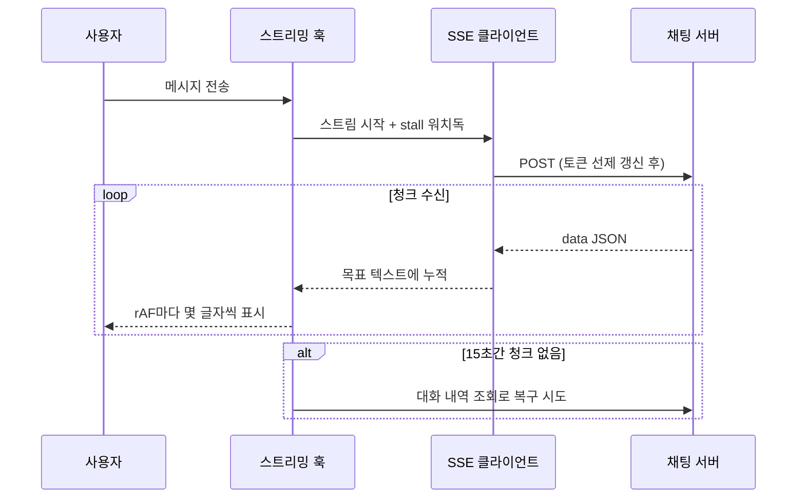

# React Native로 AI 운세·사주 상담 앱을 만들며 풀었던 문제들

> 실시간 AI 채팅(SSE), 인앱 결제, 클라이언트 사주 계산 엔진까지. 14개월 동안 모바일 앱 프론트엔드를 혼자 맡으며 겪은 문제와 해결 과정을 기술 스택별로 정리했습니다.

## 프로젝트 개요

AI 운세·사주 상담 모바일 앱입니다. 사용자가 콘텐츠(연애운, 재물운 같은 주제)와 분석 방식(타로·점성술·사주)을 고르면 서버의 AI가 결과를 만들어 주고, 결과를 본 뒤에는 AI와 채팅으로 "심층 대화"를 이어갈 수 있습니다. 코인은 인앱 결제로 충전하고, 한국어와 영어를 지원합니다.

- **기간**: 2025년 8월 ~ 2026년 10월
- **역할**: 모바일 앱 프론트엔드를 혼자 맡았고, 병합 제외 커밋 310건을 모두 제가 작성했습니다. 운영용 관리자 웹도 혼자 만들었고, 그 이야기는 [관리자 CMS 글](./fortune-app-admin-cms.md)에 있습니다. 백엔드 API와 AI 서버는 다른 팀 담당입니다.
- **규모**: 화면 46개, Zustand 스토어 12개, 커스텀 훅 16개, `src` 코드 약 4만 줄, 단위 테스트 9개 스위트 102개 케이스

| 영역 | 기술 |
|------|------|
| 프레임워크·빌드 | React Native 0.81 + Expo SDK 54, CNG + 로컬 빌드(Gradle·Xcode) |
| 상태·통신 | Zustand 5(+ `persist`), Axios 인스턴스 2개 + 인터셉터 |
| AI 채팅 | SSE(`expo/fetch` 스트림), react-native-markdown-display |
| 결제·푸시 | react-native-iap 14, Firebase Cloud Messaging |
| 사주 계산 | manseryeok + luxon |
| 운영·품질 | Sentry, i18next, Jest, ESLint, Husky, GitHub Actions |

---

## 1. React Native + Expo: 빌드 환경과 프로젝트 구조

`android/`, `ios/` 폴더는 커밋하지 않고 빌드할 때마다 `expo prebuild`로 만듭니다(CNG). 매니페스트 수정이나 Gradle 의존성 제외처럼 네이티브에 손대야 하는 작업은 모두 커스텀 config plugin에 코드로 남겼습니다.

처음부터 이렇게 한 것은 아닙니다. **첫 개발 빌드가 나오기까지 사흘, 커밋 57건이 걸렸습니다.** 원인은 세 가지였습니다.

1. AndroidX와 레거시 Support 라이브러리가 함께 들어와 `appComponentFactory` 매니페스트 병합 충돌이 났습니다. config plugin에서 `tools:replace`를 넣어 해결했습니다.
2. 일부 서드파티 패키지가 `com.android.support`를 끌고 와서 클래스가 중복됐습니다. 루트 `build.gradle`에 전역 exclude를 넣는 코드를 plugin에 추가했습니다.
3. 네이티브 폴더를 직접 고친 내용과 `app.json` 설정이 따로 관리되고 있었습니다. 그래서 `app.json`을 유일한 설정 출처로 정했습니다.

이 덕분에 나중에 EAS 클라우드 빌드에서 로컬 빌드로 옮길 때 손볼 네이티브 코드가 없었습니다. 로컬 빌드로 옮긴 이유는 빌드 비용, 긴 대기열, 그리고 실패를 로컬에서 바로 재현하는 편이 빨랐기 때문입니다. 화면이 늘어난 뒤에는 평평하던 `screens/`, `components/`를 도메인별 폴더로 바꾸고, 836줄짜리 `endpoints.js`도 도메인별 API 파일 15개로 나눴습니다.

## 2. SSE 스트리밍: AI 채팅

AI 답변은 수백 자가 넘는 경우가 많아서, 끝까지 기다렸다 보여 주면 사용자는 몇십 초 동안 빈 화면만 봅니다. 서버가 SSE로 토큰을 흘려 보내 주므로, 앱도 청크가 도착하는 대로 그려야 했습니다.



핵심은 **수신과 표시를 분리한 것**입니다. 청크는 "목표 텍스트"에 쌓기만 하고, 화면에는 `requestAnimationFrame` 루프가 프레임마다 몇 글자씩 보여 줍니다. 남은 글자가 많으면 한 번에 보여 주는 양을 늘려 따라잡습니다.

```js
// 단순화한 예시
function tick() {
  const target = state.received;
  if (state.shown < target.length) {
    const remaining = target.length - state.shown;
    const step = remaining > 240 ? 12 : remaining > 80 ? 5 : 2;
    state.shown = Math.min(target.length, state.shown + step);
    render(target.slice(0, state.shown));
  }
  if (state.ended && state.shown >= target.length) return finish();
  requestAnimationFrame(tick);
}
```

이렇게 나누고 나니 나머지 문제를 하나씩 따로 풀 수 있었습니다.

- **청크가 마지막에 한꺼번에 오는 문제.** `XMLHttpRequest`의 `onprogress`는 환경에 따라 응답을 버퍼링했습니다. `expo/fetch`의 `ReadableStream` 기반으로 클라이언트를 다시 작성했고, 스트림을 지원하지 않는 환경에서는 전체 응답을 한 번에 파싱하는 폴백을 두었습니다.
- **청크마다 화면이 깜빡이는 문제.** 청크마다 새 메시지 배열을 만들어 목록 전체가 다시 렌더링됐습니다. 업데이트를 한 프레임에 한 번으로 모으고, `MessageItem`에 넘기던 `new Set()`과 인라인 함수를 모듈 상수로 빼서 `memo`가 동작하게 했습니다.
- **스트림이 멈추거나 백그라운드로 가는 경우.** 15초 동안 청크가 없으면 대화 내역 API를 함께 조회해 먼저 오는 쪽으로 화면을 채웁니다. 백그라운드로 가면 스트림 "세대" 번호를 올려, 끊긴 스트림이 늦게 보내는 에러 콜백은 무시합니다. iOS에서 알림 센터를 잠깐 내릴 때의 `inactive` 상태는 연결이 유지되므로 중단 대상에서 뺐습니다.
- **요청 직전 토큰 만료.** 만료가 30초 이내로 남은 토큰은 SSE 요청 전에 미리 갱신하고, 여러 요청이 동시에 시작돼도 갱신은 한 번만 합니다.
- **한국어 굵게 표시가 깨지는 문제.** CommonMark 규칙에서는 `**대운(大運)**입니다`처럼 닫는 `**` 앞이 문장부호이고 뒤에 조사가 붙으면 강조가 닫히지 않습니다. markdown-it의 delimiter 판정에서 CJK 문자를 문장부호처럼 취급하도록 패치했습니다. `_`는 원래 규칙대로 두어 `파일_이름`이 기울임꼴로 바뀌지 않게 했습니다.

## 3. 인앱 결제: react-native-iap

결제 로직은 싱글턴 매니저(연결, 상품 조회, 구매 리스너)와 화면용 훅(UI 상태, 서버 검증, 에러 안내) 두 층으로 나눴습니다. 결제 결과는 전역 구매 리스너로 들어오기 때문에, "지금 요청한 상품"의 SKU를 기억해 두고 앞서 남아 있던 미완료 트랜잭션과 구분합니다.

가장 여러 번 고친 것은 **트랜잭션을 언제 끝낼지**였습니다. 끝내지 않으면 같은 상품을 다시 살 수 없고, 너무 일찍 끝내면 코인이 안 들어온 채 결제가 닫힙니다.

1. 처음에는 검증이 실패하면 무조건 종료했습니다.
2. 다음에는 5xx·네트워크 오류는 남겨 두고 4xx만 종료했습니다.
3. 그런데 일시적인 서버 오류로도 4xx가 올 수 있었습니다. 최종적으로 **409(이미 처리된 영수증)일 때만 종료**하고, 나머지는 pending으로 남겨 다시 시도할 수 있게 했습니다.

그 밖에 고친 문제들입니다.

- **iOS 영수증 불일치와 비밀번호 창이 두 번 뜨는 문제.** StoreKit 1 통합 영수증 대신 StoreKit 2 기준으로 트랜잭션 ID를 보내도록 바꿨습니다. 트랜잭션 ID를 읽던 필드가 라이브러리가 실제로 채우는 필드(`id`)와 달랐던 것도 고쳤습니다.
- **결제 응답이 오지 않는 경우.** 60초 안에 콜백이 없으면 안내를 띄우고 Promise를 끝내며, 늦게 온 콜백은 `settled` 플래그로 무시합니다.
- **결제 에러 모달이 앱을 멈추게 하던 문제.** 훅이 돌려주던 `clearError`가 렌더마다 새 함수라서 `useEffect`가 무한히 다시 실행됐습니다. `useCallback`으로 참조를 고정했습니다.

## 4. 사주 계산 엔진: manseryeok + luxon

결과 화면과 마이페이지의 일간, 대표 오행, 띠, 사주원국 표는 서버를 기다릴 필요가 없는 값이라 클라이언트에서 계산합니다. 만세력 계산(음력 변환, 24절기, 진태양시)은 직접 구현하지 않고 라이브러리를 썼습니다.

manseryeok은 입력 시각을 한국 시간(KST)으로 가정합니다. 그래서 해외 출생자는 luxon으로 출생지 시간대 기준 시각을 같은 순간의 KST로 바꿔 넘깁니다. 과거 표준시 변경과 서머타임은 luxon이, 경도와 균시차를 쓰는 진태양시 보정은 manseryeok이 맡습니다.

```js
// 단순화한 예시
function toKstWallClock(local, zone) {
  const kst = DateTime.fromObject(local, { zone }).toUTC().plus({ hours: 9 });
  return { year: kst.year, month: kst.month, day: kst.day, hour: kst.hour, minute: kst.minute };
}
```

- **임시 로직 교체.** 초기 화면에는 `생일 % 10` 같은 나머지 연산으로 일간과 띠를 정하는 임시 코드가 있었습니다. `utils/saju/` 모듈로 분리해 4기둥을 실제로 계산하게 바꿨습니다.
- **출생지 시간대 추정.** 백엔드가 출생지 시간대를 저장하지 않아서, OS 지역 코드를 먼저 보고 없으면 앱 언어로 추정합니다. 영어 폰을 쓰는 한국 거주자가 있어서 지역을 우선했습니다.
- **라이브러리 교체.** 처음 쓴 lunar-javascript와 직접 짠 서머타임·경도 보정을 지우고 manseryeok으로 바꿨습니다. 입춘 경계, 시간 미상, 음력 윤달, LA 서머타임 같은 경계 케이스를 미리 테스트로 고정해 둔 덕분에 결과를 비교하며 교체할 수 있었습니다. 달라진 곳은 LA 서머타임 하나였고, 새 라이브러리가 균시차까지 보정해서 시지가 午에서 巳로 바뀐 것을 확인했습니다.

## 5. FCM 푸시·딥링크와 분석 완료 감지

AI 분석은 서버가 백그라운드에서 처리하므로, 완료를 알리는 경로가 앱 밖(푸시)과 앱 안(인앱 알림) 두 가지 필요했습니다. 알림을 탭했을 때 화면을 정하는 처리는 `NotificationManager.navigateToScreen` 한 곳으로 모았습니다.

- **콜드 스타트에서 알림을 탭하면 이동하지 않는 문제.** 알림 데이터를 읽는 시점이 로그인 상태가 복원되기 전이었습니다. 초기 알림을 pending으로 저장해 두고, 사용자 정보가 로드된 뒤 처리하도록 순서를 바꿨습니다.
- **히스토리 탭에서만 완료 알림이 뜨던 문제.** 감지 코드가 히스토리 화면 안에 있었습니다. 루트에 한 번 마운트하는 `useAnalysisWatcher` 훅으로 옮겼습니다.
- **폴링이 5초마다 돌지 않던 문제.** 인터벌을 거는 `useEffect`가 `history` 배열을 의존성으로 두어, 조회할 때마다 인터벌이 해제되고 다시 걸렸습니다.

```js
// 배열 대신 boolean을 의존성으로
const hasPending = useHistoryStore((s) => s.items.some(isInProgress));
useEffect(() => {
  if (!hasPending) return;
  const id = setInterval(fetchHistory, 5000);
  return () => clearInterval(id);
}, [hasPending, fetchHistory]);
```

분석 중인 항목이 남은 채 로그아웃하면 이 훅이 토큰 없이 계속 조회해 401을 만들었습니다. 로그인 여부로 감지를 멈추고 로그아웃 때 히스토리 상태를 비웠습니다.

## 6. Zustand + Axios: 상태와 데이터 레이어

처음에는 `UserContext`와 `GlobalContext`로 전역 상태를 다뤘고, 2025년 9월 말에 Zustand로 옮겼습니다. 스토어 12개를 도메인별로 나누고, 설정·검색·팝업처럼 앱을 다시 켜도 남아야 하는 5개에만 `persist`를 붙였습니다. Axios 인스턴스는 일반 API용과 AI 서버용 두 개를 두고, 인터셉터에서 토큰과 언어 파라미터, 401 갱신을 처리합니다.

- **캐시가 끝없이 쌓이는 문제.** 콘텐츠 상세와 검색 캐시에 TTL만 있고 삭제가 없었습니다. 항목 수가 일정 개수를 넘으면 만료된 항목을 정리하게 했습니다.
- **토큰 갱신이 실패하면 대기 요청이 멈추는 문제.** 실패할 때도 대기 큐 전체를 reject하게 바꿨습니다.
- **렌더 무한 루프.** 마이페이지의 포커스 effect가 `user`를 의존성으로 가진 채 `user`를 갱신하는 함수를 불렀습니다. effect 안에서는 `getState()`로 값을 읽고 의존성에서 `user`를 뺐습니다.

## 7. Sentry와 통합 에러 처리

운영 빌드의 에러를 어느 화면, 어떤 기기와 버전에서 났는지 함께 보려고 Sentry를 붙였습니다. 운영 빌드에서만 전송하고, Session Replay는 세션의 1%와 에러 난 세션 100%를 기록합니다. PII 자동 전송은 끄고 `beforeSend`에서 민감할 수 있는 키를 마스킹합니다.

화면마다 제각각이던 catch 블록은 통합 에러 핸들러로 모았습니다. HTTP 상태로 에러 유형을 나누고, 5xx와 알 수 없는 에러만 Sentry로 보냅니다. 네트워크 오류나 입력 오류(4xx)는 노이즈라서 보내지 않습니다.

분석 실패 메시지도 정리했습니다. 서버 문구를 그대로 보여 주다 보니 의미 없는 인프라 오류 문구까지 노출됐습니다. 인프라성 실패면 공통 안내를, AI가 거절한 이유 같은 실패면 서버 원문을 보여 주도록 나누고, 이 판단을 한 모듈로 모았습니다.

## 8. i18n: 한국어/영어

i18next를 쓰고, 첫 언어는 OS 언어를 따릅니다. 앱 안에서 언어를 따로 고르지 않고 OS의 앱별 언어 설정을 따르게 했고, API 요청에는 인터셉터가 현재 언어를 붙입니다.

- **번역 키가 그대로 노출되는 문제.** i18next는 키가 없으면 키 문자열을 돌려주기 때문에 `t('...') || '기본값'` fallback은 동작하지 않았습니다. 이런 패턴을 찾아 키를 추가했습니다.
- **안 쓰는 키 정리.** 정적 호출과 동적 prefix를 모두 확인한 뒤 172개를 지워, 전체 키를 702개에서 509개로 줄였습니다.
- **언어를 바꾼 뒤 이전 언어 데이터가 남는 문제.** 언어 변경이나 로그인 때 언어 관련 캐시를 비우게 했습니다.

## 9. Jest · ESLint · CI: 품질 관리

혼자 개발하면 리뷰어가 없어서, 사람 대신 도구가 규칙을 지키게 만들었습니다. 커밋할 때는 Husky와 lint-staged가 바뀐 파일에 Prettier와 `eslint --max-warnings=0`을 돌리고, PR에서는 GitHub Actions가 린트를 실행합니다. 테스트는 토큰 만료 판정, 날짜 포맷, API 응답 정규화, 사주 엔진처럼 틀려도 화면에서 바로 티가 나지 않는 순수 함수 위주로 썼습니다. 현재 9개 스위트, 102개 테스트가 모두 통과하지만, CI는 아직 린트만 실행합니다.

---

## 회고

### 배운 점

- **스트리밍 UI는 수신과 표시를 분리해야 합니다.** 데이터가 오는 리듬과 화면이 그려지는 리듬은 다릅니다. 둘을 나누니 깜빡임, 버스트, 백그라운드 복구를 따로 풀 수 있었습니다.
- **결제는 "언제 트랜잭션을 끝낼지"가 핵심입니다.** 409만 종료하는 정책은 여러 번 고친 끝에 정한 기준입니다.
- **`useEffect` 의존성은 버그가 자주 숨는 곳입니다.** 폴링 주기, 결제 모달, 마이페이지 무한 루프가 모두 매번 바뀌는 참조를 의존성으로 둔 데서 생겼습니다.
- **네이티브 설정은 코드로 남겨야 합니다.** `app.json`과 config plugin만 믿는 구조로 바꾼 뒤로 빌드 문제를 추적하기가 훨씬 쉬워졌습니다.

### 아쉬운 점

- 초기에는 `a`, `plz` 같은 커밋 메시지가 많았고 한 커밋에 여러 수정이 섞여 있었습니다. 2025년 12월 말부터는 `fix:`/`feat:` 같은 접두사를 붙이고 있습니다.
- 테스트가 순수 유틸에 몰려 있습니다. 가장 복잡한 스트리밍 훅과 결제 흐름에는 자동화 테스트가 없고, CI도 테스트를 돌리지 않습니다.
- JavaScript로 시작해 TypeScript로 옮기지 못했습니다. 타입이 있었다면 더 일찍 잡았을 API 응답 문제들이 있었습니다.
- 분석 실패 원인을 문자열 매칭으로 구분하는 것처럼, 백엔드 계약이 정해지지 않아 클라이언트가 임시로 판단하는 곳이 남아 있습니다.
