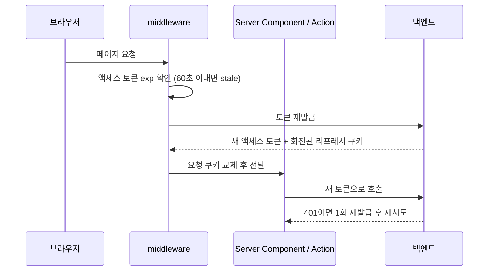

# 6주 만에 B2B 화장품 도매 플랫폼 프론트엔드를 만들며 내린 기술 결정들

> 해외 바이어와 국내 화장품 브랜드를 잇는 B2B 도매 플랫폼의 프론트엔드를 Next.js 15 App Router, Server Actions, Feature-Sliced Design으로 혼자 설계하고 구현한 기록입니다.

## 프로젝트 개요

해외 수입상·도매상(바이어)이 국내 화장품 브랜드(셀러)의 상품을 찾아 도매로 주문하는 B2B 마켓플레이스입니다. 셀러는 브랜드와 상품을 등록해 심사를 받고, 바이어는 카탈로그를 둘러보고 관심 상품과 장바구니에 담습니다. 회원 증빙서류, 상품 서류, 판매 국가별 서류처럼 B2B 특유의 서류 흐름이 많습니다.

- **기간**: 2026년 8월 10일 ~ 9월 18일(약 6주)
- **역할**: 프론트엔드 개발. 머지 제외 커밋 53개 중 52개를 작성했고, Docker 배포 구성은 팀원이 맡았습니다.
- **진행**: 초반 2주는 목업 데이터로 화면과 기획을 맞추고, 8월 21일 FSD로 구조를 재편한 뒤 9월부터 백엔드 API를 연동했습니다.
- **규모**: App Router 페이지 49개(공개 스토어프론트 18, 바이어 포털 13, 셀러 포털 16), 서버 액션 모듈 10개, 한↔영 번역 사전 998개 항목
- **범위 밖**: 결제와 주문 생성은 백엔드 준비 전이라 안내 화면만 두었고, 주문·정산 화면은 목업 데이터로 만들었습니다.

| 영역 | 기술 |
|---|---|
| 프레임워크 | Next.js 15 (App Router), React 19 |
| 데이터 변경·인증 | Server Actions + `useActionState`, httpOnly 쿠키 + `middleware.ts` 선제 갱신 |
| 구조 | Feature-Sliced Design |
| 업로드·이미지 | S3 Presigned URL, `next/image` (AVIF/WebP) |
| 다국어·스타일·테스트 | 자체 `t()`, 인라인 스타일 헬퍼 `s()`, `node:assert` |

---

## 1. Next.js 15 App Router + Server Components

해외 바이어의 검색 유입이 목표인 서비스라, 상품·브랜드 페이지는 크롤러가 완성된 HTML을 받아야 했습니다. 동시에 바이어 포털과 셀러 포털은 역할에 따라 접근을 막아야 했습니다.

- **역할별 레이아웃 가드.** 포털 레이아웃이 서버에서 역할 쿠키를 읽어, 역할이 다르면 렌더 전에 `/login`으로 보냅니다. 화면이 잠깐 보였다 사라지는 일이 없습니다.
- **SEO.** 페이지별 `generateMetadata`, 상품·브랜드·FAQ를 담는 JSON-LD, 그리고 `sitemap.ts`를 두었습니다.

```tsx
// 포털 레이아웃 (단순화)
export default async function PortalLayout({ children }) {
  if ((await getRole()) !== "seller") redirect("/login");
  const t = await getT();
  return <Shell nav={<SideNav groups={menuFor(t)} />}>{children}</Shell>;
}
```

목록 API가 페이지 단위로만 응답해서, 한 번 호출로는 사이트맵에 상품 일부만 들어갔습니다. `totalPages`까지 순회하며 ID를 모으는 함수를 만들고 상품과 브랜드를 병렬로 수집했습니다. 중간에 호출이 실패하면 그때까지 모은 만큼만 내보내서 사이트맵 생성이 통째로 깨지지 않게 했습니다. 이후 셀러가 등록한 상품별 FAQ를 상품 JSON-LD에 `FAQPage`로 넣었습니다.

## 2. Server Actions로 폼 처리

상품 등록 폼은 판매 옵션, 포장 규격, 위험물 여부, 판매 국가별 서류, FAQ까지 들어가는 긴 폼입니다. 액세스 토큰이 httpOnly 쿠키에 있으니 API 호출은 서버에서 해야 했고, 폼 제출은 Server Actions로 처리했습니다. 성공하면 `revalidatePath` 후 `redirect`하고, 실패하면 `{ error }`를 돌려줍니다.

```tsx
// 서버 액션 (단순화)
export async function createItem(_: State, form: FormData): Promise<State> {
  if (!form.getAll("option").length) return { error: t("옵션을 1개 이상 입력해 주세요") };
  const res = await apiFetch("/items", { method: "POST", body: toBody(form) });
  if (!res.ok) return { error: await failureMessage(res) };
  revalidatePath("/seller/items");
  redirect("/seller/items?done=1");
}
```

**실패하면 입력값이 전부 사라지는 문제.** `<form action={...}>`으로 제출하면 React 19가 액션이 끝난 뒤 폼을 초기화합니다. 서버가 오류를 돌려줘도 마찬가지라, 긴 상품 폼을 채운 셀러가 검증 오류 한 번에 처음부터 다시 입력해야 했습니다. `onSubmit`에서 `preventDefault` 후 `startTransition`으로 액션을 직접 호출하도록 바꿨습니다. 브라우저 기본 필수값 검사는 submit 이벤트 전에 돌기 때문에 그대로 유지됩니다.

이 처리를 공용 `ActionForm` 하나에 모았습니다.

- 실패하면 위쪽 오류 문구로 자동 스크롤합니다. 제출 버튼이 맨 아래라 오류가 보이지 않았기 때문입니다.
- 처리 중에는 다시 제출하지 못하게 막습니다.
- 비밀번호처럼 틀린 값을 남기면 안 되는 칸은 `clearOnError`로 지정한 칸만 비웁니다.

로그인, 회원가입, 계정 수정, 배송지, 브랜드, 상품 등록·수정 폼이 모두 이 컴포넌트를 써서 같은 방식으로 동작합니다.

## 3. 쿠키 기반 인증 + middleware 토큰 갱신

백엔드 리프레시 토큰 쿠키는 백엔드 도메인에 묶여 있어서, 로그인 응답의 쿠키를 프론트 서버의 httpOnly 쿠키에 담아 두고 재발급할 때 서버에서 다시 보냅니다. 갱신은 두 단계로 나눴습니다.



1. **선제 갱신(middleware).** 렌더 전에 JWT의 `exp`를 읽어 만료가 임박했으면 재발급합니다. 응답 쿠키뿐 아니라 **이번 요청의 쿠키도 바꿔서** 같은 요청 안의 서버 컴포넌트가 새 토큰을 읽게 합니다.
2. **안전망(apiFetch).** 그 사이에 401이 나면 한 번 재발급하고 다시 보냅니다. 재발급까지 실패하면 세션 쿠키를 지우고 로그인 화면으로 보냅니다.

이 구조로 오기까지 실제로 겪은 문제가 두 가지 있었습니다.

- **회전된 리프레시 토큰 유실.** 서버 컴포넌트는 렌더 중에 쿠키를 쓸 수 없어서, 렌더 중에 재발급하면 새 리프레시 토큰을 저장하지 못했고 다음 요청이 실패했습니다. 갱신 시점을 렌더 전인 middleware로 옮겨 해결했습니다.
- **병렬 요청이 서로를 로그아웃시키는 문제.** 한 페이지의 여러 API가 각자 재발급을 시도하면 첫 요청만 성공하고, 나머지는 이미 회전된 토큰을 보내 로그인 화면으로 튕겼습니다. 재발급 함수를 `React.cache`로 감싸 요청당 한 번만 실행되게 했습니다.

```ts
const refresh = cache(async () => {
  const fresh = await requestNewToken(readSessionCookie()).catch(() => null);
  if (fresh) await saveTokens(fresh);
  return fresh?.accessToken ?? null;
});
```

토큰 판정 함수는 `next/headers`에 의존하지 않게 분리해서, middleware와 서버 코드가 같은 함수를 쓰고 단위 테스트도 이 함수를 대상으로 합니다.

## 4. Feature-Sliced Design

첫 2주는 `app/` 아래에 목업 데이터, 세션, 번역, 스타일 헬퍼가 섞여 있었습니다. 바이어와 셀러가 상품·브랜드·주소·서류 같은 도메인을 공유하는데, 어느 코드를 어디서 가져다 쓰는지 점점 추적하기 어려워졌습니다. 그래서 API 연동에 들어가기 전에 FSD로 재편했습니다.

- `app/`에는 라우트 진입점만 둡니다. 49개 페이지 중 38개의 `page.tsx`는 `views`를 re-export하는 한 줄입니다.
- Next.js가 `src/pages`를 예약어로 쓰기 때문에 FSD의 pages 레이어는 `views`로 이름을 바꿨습니다.
- 슬라이스는 widgets 3개, features 11개, entities 10개이고, 엔티티끼리의 참조는 `@x` 교차 임포트 규칙으로 공개 범위를 좁혔습니다.

규칙에서 벗어난 곳도 하나 남았습니다. 상품·브랜드 수정 액션(엔티티)이 `features/document-actions`의 변경분 비교 함수를 가져다 쓰는데, 하위 레이어가 상위 레이어를 참조하는 형태라 `shared`로 내렸어야 하는 부분입니다.

## 5. S3 Presigned URL 업로드 + 이미지 규격 검증

상품 썸네일, 상세 이미지, 브랜드 로고, 서류 PDF처럼 업로드할 파일이 많고 최대 20MB까지 받습니다. 파일이 서버를 거치지 않도록 브라우저에서 S3로 직접 올립니다.

1. 파일을 고르면 클라이언트에서 용량, MIME 타입, 이미지 규격을 먼저 검사합니다.
2. 업로드 URL 발급만 서버 액션으로 처리합니다.
3. 브라우저가 S3에 `PUT`하고, 폼에는 S3 key만 담아 제출합니다.

```ts
// 이미지 규격 검사 (단순화)
async function check(file: File, spec: Spec) {
  const { w, h } = await readSize(file);
  const [rw, rh] = spec.ratio;
  if (Math.abs(w / h - rw / rh) / (rw / rh) > 0.03) return `${rw}:${rh} 비율 필요 (현재 ${w}×${h})`;
  if (w < spec.min[0] || h < spec.min[1]) return `최소 ${spec.min.join("×")}px 이상`;
  return null;
}
```

처음에는 비율과 최대 크기만 검사했습니다. 그런데 실제로 문제가 되는 쪽은 작은 이미지였습니다. 표시 크기보다 작으면 늘어나면서 흐려지기 때문입니다. 그래서 실제로 그려지는 크기(상세 이미지는 폭 860px)를 최소 크기로 추가하고, 큰 원본은 `next/image`가 변환하므로 상한은 넉넉히 풀었습니다. 규격을 어기면 현재 크기를 함께 보여 줘서 셀러가 무엇을 고칠지 바로 알 수 있습니다.

## 6. 의존성 최소화 + 자체 i18n

런타임 의존성은 `next`, `react`, `react-dom` 세 개뿐입니다. 필요한 언어는 한국어와 영어 두 개였고 복수형 같은 고급 기능은 필요 없어서, **한국어 원문 자체를 키로 쓰는** `t()` 함수를 만들었습니다.

```ts
export const makeT = (locale: Locale) => (ko: string, vars?: Record<string, string | number>) => {
  let out = locale === "en" ? (EN[ko] ?? ko) : ko;
  if (vars) for (const [k, v] of Object.entries(vars)) out = out.replaceAll(`{${k}}`, String(v));
  return out;
};
```

- 사전에 없는 문장은 원문을 그대로 돌려줘서, 번역이 빠져도 화면이 깨지지 않습니다.
- 언어는 쿠키 → `Accept-Language` → 영어 순으로 정합니다. 해외 바이어 유입이 목적이라 첫 방문과 크롤러는 영어 페이지를 받습니다.
- 원문을 키로 쓰면 번역 누락이나 치환 변수 불일치가 눈에 잘 띄지 않습니다. 그래서 사전 전체를 검사하는 테스트를 두었습니다. 키는 한국어여야 하고, 값에 한국어가 남으면 안 되며, `{n}` 같은 치환 변수가 키와 값에서 같아야 합니다.

## 7. node:assert 기반 경량 단위 테스트

깨졌을 때 피해가 큰 곳은 화면보다 순수 함수였습니다. 테스트 러너를 설치하지 않고 Node.js 내장 `node:assert`와 타입 스트리핑으로 `.ts` 파일을 바로 실행합니다. 대상은 토큰 만료 판정, 심사 요청 변경분 계산, 번역 사전입니다.

**"안 바뀐 필드"가 심사 요청에 섞이는 문제.** 셀러가 상품을 수정하면 바뀐 필드만 골라 심사 요청으로 보냅니다. 처음에는 `JSON.stringify`로 비교했는데, 조회 응답과 폼의 **키 순서가 다르면** 같은 값도 "변경됨"으로 판정됐습니다. 응답에만 있는 `id`나 숫자를 문자열로 주는 경우도 오판의 원인이었습니다.

```ts
function sameValue(now: unknown, prev: unknown): boolean {
  if (Array.isArray(now)) return Array.isArray(prev) && now.length === prev.length && now.every((x, i) => sameValue(x, prev[i]));
  if (Array.isArray(prev)) return false;
  if (now && typeof now === "object") {
    if (!prev || typeof prev !== "object") return false;
    return Object.entries(now).every(([k, v]) => sameValue(v, (prev as Record<string, unknown>)[k]));
  }
  return String(now ?? "") === String(prev ?? "");
}
```

객체는 키 순서와 응답에만 있는 필드를 무시하고, 배열은 순서가 곧 노출 순서이므로 순서까지 비교합니다. 이 규칙들을 테스트 케이스로 고정했습니다.

---

## 회고

### 배운 점

- **프레임워크의 제약을 알아야 코드의 위치가 정해집니다.** "렌더 중에는 쿠키를 쓸 수 없다", "React 19 폼 액션은 끝나면 폼을 초기화한다"를 정확히 알고 나서야 토큰 갱신은 middleware로, 폼 제출은 `onSubmit`으로 옮길 수 있었습니다. 증상을 고치는 것보다 코드가 적었습니다.
- **공용 컴포넌트 하나가 정책이 됩니다.** `ActionForm`, 업로드 컴포넌트, `t()`에 규칙을 모아 두니 입력 보존, 중복 제출 방지, 업로드 규격을 화면마다 챙기지 않아도 됐습니다.
- **의존성은 나중에 더해도 됩니다.** 2개 언어, 인라인 스타일, 내장 assert만으로 6주 동안 막히는 일은 없었습니다.

### 아쉬운 점

- **결제와 주문 생성은 연동하지 못했습니다.** 백엔드 일정상 주문·정산 화면은 목업 데이터에 머물렀습니다.
- **테스트 실행이 자동화되지 않았습니다.** 테스트 스크립트가 없어 직접 실행해야 하고, 초기에 만든 목업 가격 계산 테스트는 지금 방식으로는 실행되지 않습니다.
- **인라인 스타일의 트레이드오프.** 미디어 쿼리나 hover는 인라인으로 표현할 수 없어 `globals.css`와 나눠 관리해야 했고, 모바일 대응을 마지막 주에 몰아서 했습니다.
