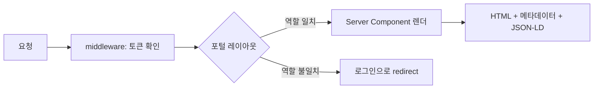
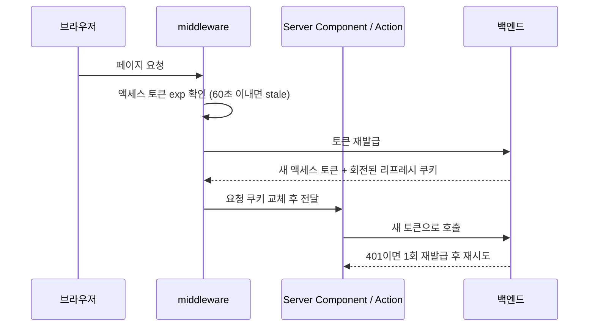
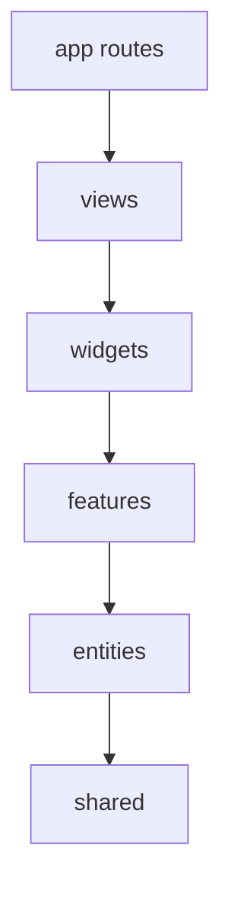

# 6주 만에 B2B 화장품 도매 플랫폼 프론트엔드를 만들며 내린 기술 결정들

> 해외 바이어와 국내 화장품 브랜드를 잇는 B2B 도매 플랫폼의 프론트엔드를 Next.js 15 App Router와 Server Actions, Feature-Sliced Design으로 혼자 설계·구현한 기록입니다.

## 프로젝트 개요

해외 수입상·도매상(바이어)이 국내 화장품 브랜드(셀러)의 상품을 찾아 도매로 주문하는 B2B 마켓플레이스의 웹 프론트엔드입니다. 셀러는 브랜드와 상품을 등록해 심사를 받고, 바이어는 카탈로그를 둘러보고 관심 상품·장바구니에 담습니다. 회원 증빙서류, 상품 서류, 판매 국가별 서류 같은 B2B 특유의 서류 흐름이 많은 것도 특징입니다.

- **기간**: 2026-08-10 ~ 2026-09-18 (약 6주)
- **역할**: 프론트엔드 개발. 저장소의 머지 커밋을 제외한 53개 커밋 중 52개를 제가 작성했습니다. Docker 배포 구성은 팀원이 맡았습니다.
- **진행 흐름**: 초반 2주는 목업 데이터로 화면과 기획을 맞췄고, 8월 21일 FSD로 구조를 재편한 뒤 9월부터 백엔드 API를 연동했습니다.
- **규모 (코드 기준)**
  - App Router 페이지 49개: 공개 스토어프론트 18개, 바이어 포털 13개, 셀러 포털 16개, 개발용 2개
  - 역할 2종(buyer / seller). 포털마다 레이아웃에서 역할을 확인합니다.
  - `src/` 아래 TypeScript 파일 229개, `"use server"` 서버 액션 모듈 10개
  - 한↔영 번역 사전 998개 항목
- **범위 밖**: 결제(PG)와 주문 생성은 백엔드 준비 전이라 안내 화면만 두었고, 주문·정산 화면은 목업 데이터로 만들었습니다.

## 기술 스택 한눈에

| 영역 | 기술 | 선택 이유(한 줄) |
|---|---|---|
| 프레임워크 | Next.js 15 (App Router), React 19 | 카탈로그 SEO에 필요한 서버 렌더링과 역할별 레이아웃을 한 구조 안에서 처리 |
| 데이터 변경 | Server Actions + `useActionState` | 토큰을 브라우저에 노출하지 않고 폼 제출을 서버에서 처리 |
| 인증 | httpOnly 쿠키 + `middleware.ts` 선제 갱신 | 서버 컴포넌트 렌더 중에는 쿠키를 쓸 수 없는 제약을 우회 |
| 아키텍처 | Feature-Sliced Design | 바이어·셀러 두 포털이 같은 도메인을 공유하는 구조를 정리 |
| 파일 업로드 | S3 Presigned URL + 클라이언트 이미지 규격 검증 | 파일이 백엔드를 거치지 않게 하고, 잘못된 이미지는 업로드 전에 차단 |
| 이미지 최적화 | `next/image` (AVIF/WebP) | 원본 한 장만 올리고 표시 크기별 변환은 프레임워크에 맡김 |
| 다국어 | 자체 `t()` 함수 (한국어 원문 = 키) | 라이브러리 없이 한/영 2개 언어 지원 |
| 스타일 | 인라인 스타일 헬퍼 `s()` | CSS 프레임워크 없이 런타임 의존성을 `next`·`react`·`react-dom` 3개로 유지 |
| 테스트 | `node:assert` + Node.js 타입 스트리핑 | 테스트 프레임워크 설치 없이 순수 함수 검증 |
| 배포 | Docker 멀티스테이지 + `output: "standalone"` | 팀원 담당 (이 글에서는 다루지 않음) |

## 목차

1. [Next.js 15 App Router + Server Components](#nextjs-15-app-router--server-components)
2. [Server Actions로 폼 처리](#server-actions로-폼-처리)
3. [쿠키 기반 인증 + middleware 토큰 갱신](#쿠키-기반-인증--middleware-토큰-갱신)
4. [Feature-Sliced Design](#feature-sliced-design)
5. [S3 Presigned URL 업로드 + 이미지 규격 검증](#s3-presigned-url-업로드--이미지-규격-검증)
6. [의존성 최소화 + 자체 i18n](#의존성-최소화--자체-i18n)
7. [node:assert 기반 경량 단위 테스트](#nodeassert-기반-경량-단위-테스트)
8. [회고](#회고)

---

## Next.js 15 App Router + Server Components

### 왜 선택했나

해외 바이어의 검색 유입을 노리는 서비스라, 상품·브랜드 페이지는 크롤러가 완성된 HTML을 받아야 했습니다. 동시에 바이어 포털과 셀러 포털은 역할에 따라 접근을 막아야 했습니다. App Router의 Server Components와 중첩 레이아웃으로 두 요구를 같은 구조 안에서 처리할 수 있다고 판단했습니다. **[확인 필요: Next.js 15 채택이 본인 결정이었는지, 프로젝트 시작 전에 정해진 스택이었는지]**

### 어떻게 적용했나

- **역할별 레이아웃 가드**: 바이어·셀러 포털 레이아웃(`views/buyer/layout`, `views/seller/layout`)이 서버에서 역할 쿠키를 읽어, 역할이 다르면 렌더 전에 `/login`으로 보냅니다. 클라이언트에서 화면이 잠깐 보였다 사라지는 일이 없습니다.
- **SEO**: 페이지별 `generateMetadata`, 상품·브랜드 ID를 페이지 단위로 끝까지 모으는 `sitemap.ts`, 상품·브랜드·FAQ를 담는 JSON-LD 컴포넌트를 두었습니다.



```tsx
// 포털 레이아웃 (단순화)
export default async function PortalLayout({ children }) {
  if ((await getRole()) !== "seller") redirect("/login");
  const t = await getT();
  return <Shell nav={<SideNav groups={menuFor(t)} />}>{children}</Shell>;
}
```

### 해결한 문제

**페이지네이션 API로 사이트맵 만들기**: 목록 API가 페이지 단위로만 응답해서, 한 번 호출하면 상품·브랜드 일부만 사이트맵에 들어갑니다. 그래서 `totalPages`까지 순회하며 ID를 모으는 함수를 만들고, 상품과 브랜드를 병렬로 수집했습니다. 중간에 API 호출이 실패하면 그때까지 모은 만큼만 내보내서, 사이트맵 생성이 통째로 깨지지 않게 했습니다. 상품·브랜드 JSON-LD도 같은 커밋에서 함께 붙였습니다(커밋 `4721dd1`, "seo 메타데이터, ssr 설정"). 이어서 `fca055e`("SEO/GEO")에서 셀러가 등록한 상품별 FAQ를 상품 JSON-LD에 `FAQPage`로 넣고, 사이트맵의 정적 경로를 카탈로그 페이지로 줄였습니다.

### 결과

- 49개 페이지 중 38개의 `page.tsx`는 `views`를 re-export하는 한 줄입니다. `generateMetadata`는 공개 페이지 9곳과 루트 레이아웃 1곳, 모두 10곳에 구현했습니다.
- 사이트맵에는 정적 카탈로그 경로 6개와 상품·브랜드 상세 전체가 들어갑니다.
- **[수치 입력: 검색 노출/색인된 페이지 수, Lighthouse SEO 점수 등]**

---

## Server Actions로 폼 처리

### 왜 선택했나

상품 등록 폼은 판매 옵션, 포장 규격, 위험물 여부, 판매 국가별 서류, FAQ까지 들어가는 긴 폼입니다. 액세스 토큰이 httpOnly 쿠키에 있으므로 API 호출은 서버에서 해야 했습니다. 이를 위해 별도 API 라우트를 만드는 것보다 Server Actions가 코드가 적고, 폼과도 바로 연결된다고 봤습니다. **[확인 필요: API 라우트와 비교해 Server Actions를 고른 실제 이유]**

### 어떻게 적용했나

서버 액션은 성공하면 `revalidatePath` 후 `redirect`하고, 실패하면 `{ error }`를 돌려줍니다. 클라이언트 쪽은 공용 `ActionForm` 컴포넌트 하나가 `useActionState`로 결과를 받아 오류 문구를 보여줍니다.

```tsx
// 서버 액션 (단순화)
export async function createItem(_: State, form: FormData): Promise<State> {
  if (!form.getAll("option").length) return { error: t("옵션을 1개 이상 입력해 주세요") };
  const res = await apiFetch("/items", { method: "POST", body: toBody(form) });
  if (!res.ok) return { error: await failureMessage(res) };
  revalidatePath("/seller/items");
  redirect("/seller/items?done=1");
}
```

### 해결한 문제

**실패하면 입력값이 전부 사라지는 문제**: `<form action={...}>`으로 제출하면 React 19가 액션이 끝난 뒤 폼을 자동으로 초기화합니다. 서버가 오류를 돌려줘도 마찬가지여서, 긴 상품 폼을 채운 셀러가 검증 오류 한 번에 처음부터 다시 입력해야 했습니다. 그래서 `onSubmit`에서 `preventDefault` 후 `startTransition`으로 직접 액션을 호출하도록 바꿨습니다. 브라우저 기본 필수값 검사는 submit 이벤트 전에 돌기 때문에 그대로 유지됩니다(커밋 `1b35a13`). `ActionForm`에 함께 모아 둔 처리는 다음과 같습니다.

- 실패하면 위쪽 오류 문구로 자동 스크롤합니다. 제출 버튼이 맨 아래에 있어 오류가 보이지 않았기 때문입니다(이 부분은 바로 전 커밋 `a1a80cd`에서 먼저 넣었습니다).
- `pending` 중에는 다시 제출하지 못하게 막아 같은 요청이 두 번 가지 않게 했습니다.
- 비밀번호처럼 틀린 값을 남기면 안 되는 칸은 `clearOnError`로 지정한 칸만 비웁니다.

### 결과

로그인·회원가입·계정 수정·배송지·브랜드·상품 등록/수정 폼이 모두 같은 `ActionForm`을 씁니다. 그래서 오류 표시, 중복 제출 방지, 입력 보존이 폼마다 같은 방식으로 동작합니다.
**[수치 입력: 셀러 상품 등록 완료율이나 등록 소요 시간 변화가 있다면]**

---

## 쿠키 기반 인증 + middleware 토큰 갱신

### 왜 선택했나

백엔드 리프레시 토큰 쿠키는 백엔드 도메인에 묶여 있어 브라우저가 프론트 도메인에서 들고 있을 수 없었습니다. 그래서 로그인 응답의 쿠키를 프론트 서버의 httpOnly 쿠키에 담아 두고, 재발급할 때 서버에서 다시 보내는 방식을 택했습니다.

### 어떻게 적용했나

갱신은 두 단계로 나눴습니다.



1. **선제 갱신 (middleware)**: 렌더 전에 JWT의 `exp`만 읽어 만료가 임박했으면 재발급합니다. 응답 쿠키뿐 아니라 **이번 요청의 쿠키도 바꿔서** 같은 요청 안의 서버 컴포넌트가 새 토큰을 읽게 합니다.
2. **안전망 (apiFetch)**: 그 사이에 401이 나면 한 번 재발급하고 같은 요청을 다시 보냅니다. 재발급까지 실패하면 세션 쿠키를 지우고 로그인 화면으로 보냅니다.

### 해결한 문제

`fc3bb03`("로그인 리프레시 토큰") 커밋에서 실제로 겪은 문제 두 가지를 해결했습니다.

- **회전된 리프레시 토큰 유실**: 서버 컴포넌트 렌더 중에는 쿠키를 쓸 수 없습니다. 그래서 렌더 중에 재발급하면 백엔드가 새로 준 리프레시 토큰을 저장하지 못했고, 다음 요청이 실패했습니다. 갱신 시점을 렌더 전인 middleware로 옮겨 해결했습니다.
- **병렬 요청이 서로 로그아웃시키는 문제**: 한 페이지에서 여러 API를 병렬로 부르면 각자 재발급을 시도했습니다. 첫 요청만 성공하고, 나머지는 이미 회전된 토큰을 보내 401을 받고 로그인 화면으로 튕겼습니다. 재발급 함수를 `React.cache`로 감싸 요청당 한 번만 실행되게 했습니다.

```ts
// 요청 단위로 한 번만 재발급 (단순화)
const refresh = cache(async () => {
  const fresh = await requestNewToken(readSessionCookie()).catch(() => null);
  if (fresh) await saveTokens(fresh);
  return fresh?.accessToken ?? null;
});
```

### 결과

토큰 판정 로직(`tokenExp`, `isStale`)은 `next/headers`에 의존하지 않게 분리했습니다. 그래서 middleware와 서버 코드가 같은 함수를 쓰고, 단위 테스트도 이 함수를 대상으로 합니다. 재발급이 실패하면 세션 관련 쿠키를 모두 지우므로, 헤더만 로그인 상태로 남는 어중간한 상태도 생기지 않습니다.

---

## Feature-Sliced Design

### 왜 선택했나

첫 2주는 `app/` 아래에 목업 데이터, 세션, 번역, 스타일 헬퍼가 함께 섞여 있었습니다. 바이어와 셀러가 상품·브랜드·주소·서류 같은 도메인을 공유하는데, 어느 화면의 코드를 어디서 가져다 쓰는지 점점 추적하기 어려워졌습니다. 그래서 API 연동에 들어가기 전에 FSD를 도입해 경계를 정리했습니다(커밋 `a718af6`, 2026-08-21). **[확인 필요: FSD를 고른 계기와 다른 구조와 비교했는지]**

### 어떻게 적용했나



- `app/`에는 라우트 진입점만 둡니다. 대부분의 `page.tsx`는 `views`의 컴포넌트를 re-export하는 한 줄입니다.
- Next.js가 `src/pages`를 예약어로 쓰기 때문에 FSD의 pages 레이어는 `views`로 이름을 바꿨습니다.
- `views/buyer/**`, `views/seller/**`가 App Router 경로 구조를 그대로 따릅니다.
- 현재 슬라이스는 widgets 3개(header·footer·banner), features 11개, entities 10개입니다.
- 엔티티끼리 참조가 필요한 곳은 FSD의 `@x` 교차 임포트 규칙으로 공개 범위를 좁혔습니다.

### 해결한 문제

**도메인 로직의 위치가 흩어지는 문제**: API 연동 단계에서 서버 액션을 엔티티(`entities/product/api/actions.ts` 등)와 기능(`features/auth`, `features/document-actions` 등)으로 나눴습니다. 다만 심사 요청용 유틸(`features/document-actions/lib/changes.ts`)은 예외로 남았습니다. 상품·브랜드 수정 액션(엔티티)이 이 파일의 변경분 비교(`sameValue`)를, 증빙서류 수정 액션이 날짜 변환(`toIsoDate`)을 함께 쓰는데, 엔티티가 상위 레이어인 features를 참조하는 형태라 레이어 규칙에 어긋납니다. `shared`로 내렸어야 하는 부분입니다.

### 결과

FSD 전환 이후 API 연동은 각 슬라이스의 `api/` 폴더(서버 액션·조회 함수)와 `ui/` 폴더를 채우는 방식으로 진행했습니다. 레이어 규칙은 `src/README.md`에 문서로 남겼습니다.
**[수치 입력: FSD 전환 전후로 기능 추가에 걸린 시간 체감 등, 본인만 아는 비교가 있다면]**

---

## S3 Presigned URL 업로드 + 이미지 규격 검증

### 왜 선택했나

상품 썸네일, 상세 이미지, 브랜드 로고, 제품 라벨, 서류 PDF처럼 업로드할 파일이 많고 최대 20MB까지 받습니다. 파일이 프론트 서버나 백엔드를 거치지 않도록, 브라우저에서 S3로 직접 올리는 Presigned URL 방식을 썼습니다. **[확인 필요: Presigned 방식이 본인 선택인지, 백엔드 업로드 API 설계에 맞춘 것인지]**

### 어떻게 적용했나

1. 파일을 선택하면 클라이언트에서 용량·MIME 타입·이미지 규격을 먼저 검사합니다.
2. 업로드 URL 발급만 서버 액션으로 처리합니다. 토큰이 httpOnly 쿠키라 서버에서만 발급할 수 있기 때문입니다.
3. 브라우저가 S3에 `PUT`하고, 폼에는 S3 key만 담아 제출합니다.

용도(purpose)별 허용 타입은 백엔드 업로드 정책과 같은 표로 맞췄습니다. 같은 표로 파일 선택 창의 `accept` 값도 만들고, 드래그&드롭으로 들어온 파일도 같은 표로 거릅니다. 공개 이미지는 CDN 주소로 바로 보여주고, 비공개 서류는 열람할 때마다 presigned 열람 URL을 새로 받습니다.

```ts
// 이미지 규격 검사 (단순화)
const SPEC = { THUMBNAIL: { ratio: [4, 5], min: [800, 1000] }, LOGO: { ratio: [2, 1], min: [400, 200] } };

async function check(file: File, spec: Spec) {
  const { w, h } = await readSize(file); // new Image() + naturalWidth/Height
  const [rw, rh] = spec.ratio;
  if (Math.abs(w / h - rw / rh) / (rw / rh) > 0.03) return `${rw}:${rh} 비율 필요 (현재 ${w}×${h})`;
  if (w < spec.min[0] || h < spec.min[1]) return `최소 ${spec.min.join("×")}px 이상`;
  return null;
}
```

### 해결한 문제

**업로드 후에야 드러나는 규격 불일치**: 화면과 비율이 다른 이미지는 잘려 보이고, 표시 크기보다 작은 이미지는 늘어나며 흐려집니다. 이런 이미지를 업로드 단계에서 막아야 했습니다. `7b5c0d4`에서 규격표를 한 곳(`IMG_SPEC`)에 모았고, 처음에는 비율과 최대 크기(표시 폭의 2배)만 두었습니다. 그런데 정말 문제가 되는 쪽은 작은 이미지였습니다. 그래서 `12e9d44`("이미지 사이즈 설정")에서 실제로 그려지는 크기(상세 이미지는 폭 860px)를 최소 크기로 추가하고, 최대 크기는 실수 방지용 상한으로 넉넉히 풀었습니다. `next/image`가 표시 폭에 맞춰 변환하므로 큰 원본은 문제가 되지 않고, 실질적인 제한은 업로드 용량 20MB가 맡습니다. `a9ba59d`("상품카테고리 이미지 사이즈")에서는 44px 원형으로 보이는 카테고리 아이콘용 규격(최소 88×88)을 더했습니다. 비율은 3%까지 오차를 허용합니다. 규격을 어기면 현재 크기를 함께 보여줘서 셀러가 무엇을 고쳐야 할지 바로 알 수 있게 했습니다.

### 결과

허용 타입과 규격을 업로드 전에 검사하므로, 백엔드 400 응답이나 규격에 맞지 않는 이미지가 등록되는 경우를 미리 걸러냅니다. 표시는 `next/image`가 AVIF/WebP로 변환해 처리하고, key에 uuid가 들어가 URL이 매번 바뀌므로 캐시 TTL을 31일로 길게 잡았습니다.
**[수치 입력: 이미지 규격 문제로 인한 상품 반려/재업로드 감소 등]**

---

## 의존성 최소화 + 자체 i18n

### 왜 선택했나

런타임 의존성은 `next`, `react`, `react-dom` 세 개뿐입니다. 필요한 다국어는 한국어와 영어 두 개였고, 복수형이나 날짜 포맷 같은 고급 기능은 필요하지 않았습니다. i18n 라이브러리를 들이는 것보다 작은 함수 하나가 유지보수하기 쉽다고 판단했습니다. **[확인 필요: 라이브러리를 검토하고 제외한 것인지, 스타일 헬퍼까지 포함해 의존성을 줄이는 것이 의도된 방침이었는지]**

### 어떻게 적용했나

**한국어 원문 자체를 키로 쓰는** `t()` 함수를 만들었습니다(커밋 `3056ecb`, "영어 추가").

```ts
export const makeT = (locale: Locale) => (ko: string, vars?: Record<string, string | number>) => {
  let out = locale === "en" ? (EN[ko] ?? ko) : ko;
  if (vars) for (const [k, v] of Object.entries(vars)) out = out.replaceAll(`{${k}}`, String(v));
  return out;
};
// t("총 {n}건", { n: 3 })
```

- 사전에 없는 문장은 원문을 그대로 돌려줍니다. 번역이 빠져도 화면이 깨지지 않고, 코드만 읽어도 어떤 문구인지 보입니다.
- 영어 사전은 영역별(공통·공개·인증·바이어·셀러·상품 폼) 파일로 나누고 하나로 합칩니다.
- 언어는 쿠키(사용자 선택) → `Accept-Language` → 영어 순으로 정합니다. 해외 바이어 유입이 목적이라, 쿠키가 없는 첫 방문과 크롤러는 영어 페이지를 받습니다.
- 언어를 바꾸면 서버 액션이 쿠키만 바꾸고, 클라이언트가 `router.refresh()`로 그 자리에서 다시 그립니다.

### 해결한 문제

**사전 관리 실수**: 원문을 키로 쓰면 번역 누락이나 치환 변수 불일치가 눈에 잘 띄지 않습니다. 그래서 사전 전체를 검사하는 테스트를 같은 커밋에 넣었습니다. 키는 한국어여야 하고, 값에 한국어가 남아 있으면 안 되며, `{n}` 같은 치환 변수 목록이 키와 값에서 같아야 합니다.

### 결과

커밋 시점 기준 998개 항목이 이 검사를 통과합니다. 스타일도 CSS 프레임워크 없이 인라인 스타일 문자열을 객체로 바꾸는 작은 헬퍼 `s()`로 처리해서, `package.json`의 dependencies는 3개를 유지했습니다.

---

## node:assert 기반 경량 단위 테스트

### 왜 선택했나

화면보다 깨졌을 때 피해가 큰 곳은 순수 함수였습니다. 토큰 만료 판정, 심사 요청에 담을 변경분 계산, 번역 사전이 그렇습니다. 테스트 러너를 설치하지 않고 Node.js 내장 `node:assert`와 타입 스트리핑으로 `.ts` 파일을 바로 실행하는 방식을 택했습니다.

### 어떻게 적용했나

| 테스트 파일 | 검증 대상 |
|---|---|
| `refresh.test.ts` | JWT `exp` 파싱, 만료 60초 전 갱신 판정, 형식을 모르는 토큰은 건드리지 않음 |
| `changes.test.ts` | 변경분 비교·날짜 변환·표시 포맷 |
| `en.test.ts` | 번역 사전 무결성 |

### 해결한 문제

**"안 바뀐 필드"가 심사 요청에 섞이는 문제**: 셀러가 상품을 수정하면 바뀐 필드만 골라 심사 요청으로 보냅니다. 처음에는 `JSON.stringify`로 비교했는데, 같은 포장 규격이라도 조회 응답과 폼의 **키 순서가 다르면** "변경됨"으로 판정됐습니다. 응답에만 있는 `id` 같은 필드나 백엔드가 숫자를 문자열로 주는 경우도 오판의 원인이었습니다. `7b5c0d4` 커밋에서 `sameValue`를 따로 만들어 바꿨습니다.

```ts
function sameValue(now: unknown, prev: unknown): boolean {
  if (Array.isArray(now)) return Array.isArray(prev) && now.length === prev.length && now.every((x, i) => sameValue(x, prev[i]));
  if (Array.isArray(prev)) return false;
  if (now && typeof now === "object") {
    if (!prev || typeof prev !== "object") return false;
    return Object.entries(now).every(([k, v]) => sameValue(v, (prev as Record<string, unknown>)[k]));
  }
  return String(now ?? "") === String(prev ?? "");
}
```

객체는 키 순서와 응답에만 있는 필드를 무시합니다. 배열은 순서가 곧 노출 순서이므로 순서까지 비교합니다. 이 규칙들을 테스트 케이스로 고정했습니다.

### 결과

위 세 파일은 `node <파일>`로 바로 실행되고, 현재 모두 통과합니다.
**[수치 입력: 심사 요청 오판으로 인한 운영 문의 감소 등이 있다면]**

---

## 회고

### 배운 점

- **프레임워크의 제약을 알아야 위치가 정해집니다.** "서버 컴포넌트 렌더 중에는 쿠키를 쓸 수 없다", "React 19 폼 액션은 끝나면 폼을 초기화한다". 이 두 가지를 정확히 알고 나서야 토큰 갱신은 middleware로, 폼 제출은 `onSubmit`으로 옮길 수 있었습니다. 증상을 고치는 대신 제약이 생기는 지점을 바꾸는 쪽이 코드가 더 적었습니다.
- **공용 컴포넌트 하나가 정책이 됩니다.** `ActionForm`, `FilePick`, `t()`처럼 한 곳에 규칙을 모아 두니, 입력 보존·중복 제출 방지·업로드 규격 같은 정책을 화면마다 따로 챙기지 않아도 됐습니다.
- **의존성은 나중에 더해도 됩니다.** 2개 언어, 인라인 스타일, 내장 assert만으로 6주 동안 막히는 일은 없었습니다.

### 아쉬운 점

- **결제·주문 생성은 연동하지 못했습니다.** 백엔드 준비 일정상 주문·정산 화면은 목업 데이터에 머물렀고, 결제 화면은 안내 문구만 있습니다.
- **테스트 실행이 자동화되지 않았습니다.** `package.json`에 테스트 스크립트가 없어 직접 실행해야 하고, 초기에 만든 목업 가격 계산 테스트는 확장자 없는 import(`./data`) 때문에 지금 방식으로는 실행되지 않습니다. CI에 묶었어야 했습니다.
- **인라인 스타일의 트레이드오프**: 의존성은 줄었지만 미디어 쿼리나 hover 같은 스타일은 인라인 객체로 표현할 수 없어 `globals.css`와 나눠 관리해야 했습니다. 모바일 대응도 마지막 주(`bd6c469`)에 몰아서 했습니다. 처음부터 반응형 기준을 잡았다면 더 나았을 것입니다.
- **[수치 입력: 실제 오픈 이후 지표(가입 바이어 수, 등록 상품 수 등)가 있다면 회고에 추가]**
