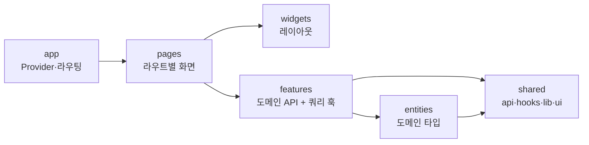
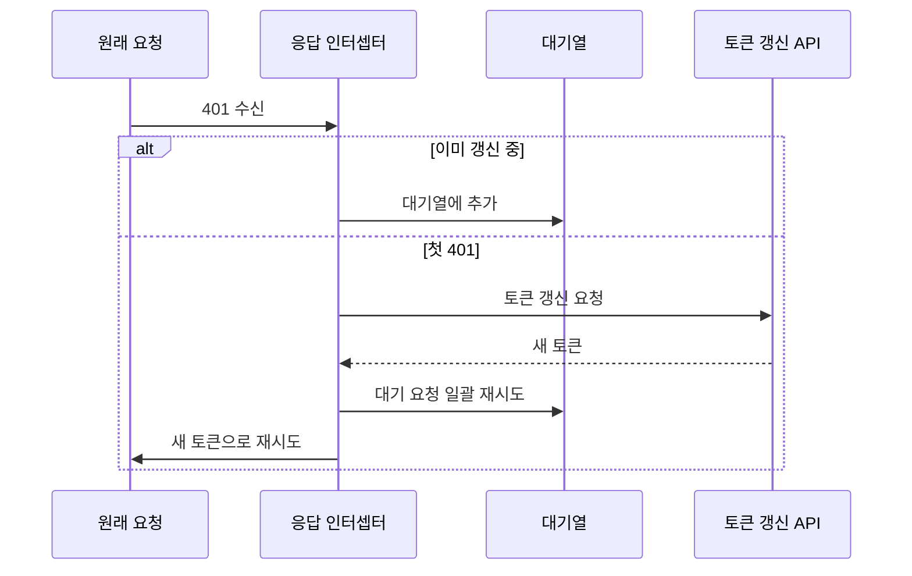

# 운영자가 매일 쓰는 관리자 웹을 혼자 만들고 고쳐 온 6개월

> AI 운세 상담 앱의 운영자용 관리자 웹(CMS)을 React 19 + TypeScript로 혼자 만들면서, FSD 구조, React Query, 토큰 갱신 인터셉터, 공통 CRUD 패턴, 이미지·엑셀 검증을 어떻게 설계했고 실제 운영 이슈를 어떻게 고쳤는지 정리했습니다.

## 프로젝트 개요

운영자가 앱에 노출되는 운세 콘텐츠, AI 상담 캐릭터(페르소나), 카테고리, 배너·팝업, 푸시 알림, 공지·FAQ, 1:1 문의 답변, 코인 충전 상품, 회원 조회를 처리하는 관리자 웹입니다. 같은 서비스의 앱 이야기는 [AI 운세 앱 글](./ai-fortune-app.md)에 있습니다.

- **기간**: 2026년 1월 19일 ~ 7월 27일(저장소 기준)
- **역할**: 혼자 개발했습니다. 비머지 커밋 42개가 모두 제 커밋이고, `feature/* → develop → main → deploy/prod` 순서로 PR을 머지하며 배포했습니다. 백엔드 API는 다른 팀 담당입니다.
- **규모**: 라우트 화면 17개, `features` 슬라이스 19개, `entities` 13개, 테스트 19개 스위트 119개

| 영역 | 기술 |
|------|------|
| 프레임워크 | React 19 + TypeScript (CRA), React Router 7 |
| 아키텍처 | Feature-Sliced Design |
| 서버 상태·HTTP | TanStack Query 5, Axios |
| 스타일·기타 | Tailwind CSS 3, SheetJS(xlsx) |
| 테스트 | Jest + React Testing Library |

---

## 1. Feature-Sliced Design 아키텍처

관리자 웹은 "목록 + 등록/수정 모달" 화면이 계속 늘어나는 구조라, 코드를 어디에 둘지 규칙으로 정해 두고 싶었습니다. 상위 레이어가 하위 레이어만 가져다 쓰는 단방향 규칙을 따릅니다.



- `entities/<도메인>/model.ts`에는 API 응답 타입만 둡니다.
- `features/<도메인>/api`에는 엔드포인트 함수와 React Query 훅을 함께 둡니다.
- `shared`에는 도메인을 모르는 코드(Axios 인스턴스, 공통 UI, 이미지 규격 유틸)만 남깁니다.

첫 커밋 때는 도메인 API 파일이 모두 `shared/api`에 섞여 있었습니다. 2월 초 리팩터링(44개 파일)에서 이를 도메인별 `features`로 옮겼습니다. 이후 문의하기, 추가 질문 템플릿, 채팅 모드 같은 기능은 새 폴더만 만들면 들어갔습니다. 다만 일부 도메인은 `entities` 없이 타입을 `features`에 두는 등 규칙이 완전히 일관되지는 않습니다.

## 2. TanStack Query와 도메인별 API 훅

관리자 화면의 데이터는 거의 전부 서버 상태입니다. 목록 조회, 저장 후 재조회, 필터별 캐시를 화면마다 `useEffect`로 짜는 대신 TanStack Query에 맡겼습니다. 운영자가 탭을 오가며 작업해도 다시 요청하지 않도록 `refetchOnWindowFocus: false`, `staleTime` 5분으로 두고, 대시보드 통계만 들어올 때마다 새로 받습니다.

```ts
export const useItems = (params: ListParams) =>
  useQuery({ queryKey: [...KEY, params], queryFn: () => getItems(params) });

export const useUpdateItem = () => {
  const qc = useQueryClient();
  return useMutation({
    mutationFn: updateItem,
    onSuccess: () => qc.invalidateQueries({ queryKey: KEY }),
  });
};
```

`queryKey`에 필터와 페이지 파라미터를 그대로 넣었기 때문에 서버 페이지네이션도 별도 캐시 로직 없이 동작합니다.

**필터를 걸면 영어 필드가 비던 문제.** 콘텐츠는 언어별로 따로 조회하고, 백엔드에 단건 조회가 없어서 수정 모달은 반대 언어 목록을 한 번 더 조회해 같은 `id`끼리 짝짓습니다. 그런데 두 번째 쿼리에 필터 파라미터를 빠뜨려서, 카테고리 필터를 걸면 두 목록이 서로 다른 페이지를 가져왔습니다. 반대 언어 쿼리에도 같은 필터를 넣고 이유를 주석으로 남겼습니다.

## 3. Axios 인터셉터 기반 인증·토큰 갱신

관리자 웹은 오래 켜 두고 쓰는 도구라, 토큰이 만료될 때마다 로그인 화면으로 튕기면 작성 중인 폼을 잃습니다. 토큰 갱신은 모든 요청이 지나가는 Axios 인스턴스 한 곳에서 처리합니다.



로그인 요청의 401은 갱신하지 않고 호출부로 넘깁니다. 갱신이 실패하거나 재시도 후에도 401이면 토큰과 쿼리 캐시를 비우고 로그인 화면으로 보냅니다.

이 예외는 처음엔 없었습니다. 초기 버전은 로그인 실패의 401도 "토큰 만료"로 처리해서, 갱신할 토큰이 없으니 곧바로 `/login`을 다시 불러왔습니다. 그래서 운영자는 비밀번호를 틀려도 에러 메시지를 볼 수 없었습니다. 로그인·가입 요청의 401을 인터셉터에서 제외하고, 실패하면 비밀번호 칸을 비우고 포커스를 옮기도록 고쳤습니다.

## 4. 공통 CRUD UI 패턴

화면 대부분이 "목록 + 필터 + 페이지네이션 + 등록/수정 모달 + 저장/삭제" 모양인데, 처음에는 화면마다 모달 상태와 `try-catch + alert`를 각자 썼습니다.

첫 `useCrudModal`은 로컬 배열을 직접 수정하는 구조(`Date.now()`로 id 생성)여서 서버 API 기반 화면에는 맞지 않았고, 실제로 쓰는 화면이 하나도 없었습니다. 1월 말 리팩터링에서 다시 짰습니다.

- `useCrudModal`: 모달 열림, 수정 대상, 폼 데이터, 폼 에러 상태만 관리합니다. API 호출은 화면이 합니다.
- `executeMutation`: 뮤테이션 실행, 응답 검증, 실패 안내, 성공 콜백을 하나로 묶은 헬퍼입니다.
- `Modal`, `FormField`, `FilterBar`, `Pagination` 같은 공통 UI 컴포넌트를 두었습니다.

```ts
const ok = await executeMutation({
  mutationFn: () => update.mutateAsync(payload),
  actionLabel: '저장',
  validateResponse: (res) => (res.data.success ? true : `저장 실패: ${res.data.message}`),
  onSuccess: () => { refetch(); modal.closeModal(); },
});
```

그러자 콘텐츠·페르소나·배너·공지·FAQ 5개 화면에 바로 적용됐고, 지금은 `useCrudModal` 6개 화면, `executeMutation` 12개 화면이 씁니다. 공통 컴포넌트로 모아 두니 수정도 한 곳에서 끝났습니다.

- **드래그하다 모달이 닫히는 문제.** 입력창에서 텍스트를 드래그하다 마우스가 모달 바깥에서 떨어지면 오버레이에서 `click`이 발생해 모달이 닫혔습니다. `mousedown`이 시작된 대상까지 오버레이일 때만 닫히도록 고쳤습니다.
- **페이지 번호가 끝없이 늘어나는 문제.** 전체 페이지 번호를 모두 그리고 있어서, 10개 단위 블록만 보여 주도록 바꿨습니다.

## 5. 다국어(ko/en) 콘텐츠 입력

콘텐츠·페르소나·카테고리는 한 레코드에 두 언어를 함께 저장합니다. 운영자는 모달 상단의 한국어/영어 탭으로 두 언어를 한 번에 입력하고, 저장할 때 `translations: { ko?, en? }`로 보냅니다. 최소 한 언어는 입력해야 하고, 입력을 시작한 언어는 필수 필드를 모두 채워야 저장됩니다. 공지·FAQ·배너는 언어별로 별도 레코드라서 언어 선택 필드로 한 언어만 고르게 했습니다.

**영어에만 있는 카테고리가 사라지던 문제.** 카테고리는 한국어/영어 목록을 각각 조회해 합치는데, 초기 코드는 한국어 목록 기준으로만 병합했습니다. 두 언어의 id를 합집합으로 모아 병합하고, 선택지 라벨도 현재 입력 언어에 맞춰 보여 주도록 고쳤습니다. 2절의 "영어 필드 빈칸" 문제와 마찬가지로, 서버 구조를 프론트에서 메우며 두 데이터를 짝짓는 곳에서 난 버그였습니다.

## 6. 이미지 업로드와 규격 검증

앱은 썸네일과 캐릭터 이미지를 정해진 크기로 리사이징해 쓰기 때문에, 규격이 다른 이미지가 올라가면 앱 화면이 의도와 다르게 보입니다. 업로드한 뒤에야 알게 하지 않고, 파일을 고르는 순간 알려 주고 싶었습니다.

규격은 `IMAGE_SIZES` 한 곳에 모으고, 업로드는 공통 컴포넌트 `ImageUpload` 하나로 처리합니다. 4개 화면의 6개 업로드 칸이 모두 이 컴포넌트를 쓰고, 칸마다 `sizeType`만 다르게 넘깁니다. 파일을 고르면 실제 가로·세로를 읽어 규격과 비교하고, 맞지 않으면 필요한 크기와 현재 크기를 함께 보여 줍니다. 콘텐츠·페르소나·카테고리는 크기가 틀리면 저장을 막고, 배너는 표시만 합니다.

이미 올린 이미지를 한 번에 내려받는 "일괄 다운로드"는 `fetch`로 받아 저장하는 방식이라, 캐시된 응답을 받지 않도록 요청 URL에 타임스탬프 파라미터를 붙였습니다.

## 7. SheetJS로 엑셀 데이터 검증

AI 캐릭터의 말투를 정의하려면, 운영자가 기준 문장 50개를 캐릭터 말투로 바꿔 쓴 "말투 예시"를 언어별로 등록해야 했습니다. 문장을 나란히 놓고 고쳐 쓰는 데이터라 엑셀 템플릿을 내려받아 채워 올리게 했고, 형식 오류는 브라우저에서 먼저 잡으려고 SheetJS를 썼습니다.

파서는 헤더 위치를 고정하지 않고 1열이 `번호`인 행을 찾아 그다음 행부터 읽습니다. 파싱을 먼저 하고, 통과한 경우에만 파일을 업로드한 뒤 미리보기를 보여 줍니다. 처음에는 빈 행이 있어도 경고만 띄우고 통과시켰는데, 이를 에러로 바꿔 모든 행을 채우기 전에는 올라가지 않게 했습니다.

같은 방식으로 7월에는 콘텐츠 **일괄 등록**도 만들었습니다. 한/영 두 시트를 번호로 묶어 병합하고, 파일명 규칙으로 썸네일을 매칭한 뒤 검증 리포트를 보여 주는 약 1,000줄짜리 기능이었지만, 18일 뒤 추가 질문 기능을 붙이면서 통째로 제거했습니다.

## 8. Jest + React Testing Library

리뷰어 없이 혼자 배포하는 구조라, API 요청 형태와 인증 흐름이 리팩터링 중에 깨지지 않는 안전망이 필요했습니다. 5월에 테스트 1,600여 줄을 한 번에 추가했습니다.

- **도메인 API 10개**: `apiClient`를 모킹해 요청 경로, 파라미터, 응답 매핑을 검증합니다.
- **인증 컨텍스트**: 로그인, 세션 복원, 로그아웃 때의 상태 변화를 검증합니다.
- **공통 훅과 유틸**: `renderHook`으로 `useCrudModal`, `useImageUpload`의 상태 전이를 확인합니다.

다만 그 뒤에 붙인 큰 기능(말투 예시, 추가 질문, 문의하기)에는 테스트가 따라가지 못했습니다. 반대로 테스트까지 써 둔 범용 훅 일부는 실제 화면에서 쓰이지 않습니다.

---

## 회고

### 배운 점

- **공통화는 실제 화면 두세 개를 만든 다음에 하는 편이 맞았습니다.** "있으면 좋겠다"로 먼저 만든 훅은 아무 화면도 쓰지 않았고, 반복되는 부분만 뽑아 다시 만들었을 때 비로소 쓰였습니다.
- **다국어 버그는 두 데이터를 짝짓는 곳에서 나왔습니다.** 이런 곳에는 "왜 이렇게 했는지"를 주석으로 남기게 됐습니다.
- **요청 타입과 실제 전송 필드를 함께 봐야 합니다.** 코인 상품을 수정해도 반영되지 않던 문제는 요청 타입과 전송 데이터에 보너스 코인 필드가 빠져 있던 것이 원인이었습니다.
- **폼 입력값은 문자열로 들고 있다가 보낼 때 변환해야 합니다.** 숫자 상태로 들고 있으니 칸을 비우면 0이 되어 지울 수 없었습니다.

### 아쉬운 점

- **만들어 두고 쓰지 않는 공통 모듈이 남아 있습니다.** Zustand UI 스토어, 범용 CRUD API와 `useResource` 훅, 클라이언트 페이지네이션 훅 등이 어떤 화면에서도 쓰이지 않습니다. 지금이라면 실제로 필요해질 때 만들었을 것입니다.
- **일괄 등록 기능을 만들고 바로 걷어냈습니다.** 요구사항이 확정되기 전에 크게 만든 것이 원인인지 돌아볼 필요가 있습니다.
- **숨김 화면이 3개 있습니다.** 메뉴에서만 숨기고 라우트와 코드는 남겨 두었습니다. 기능 플래그나 제거 중 하나로 정리하는 편이 낫습니다.
- **페이지 컴포넌트가 큽니다.** 콘텐츠 관리 화면 하나가 1,341줄입니다.
- **테스트와 CI.** 페이지 단위 로직, 엑셀 파서, 토큰 갱신 인터셉터에 테스트가 없고, 테스트를 자동으로 돌리는 CI도 없습니다.
