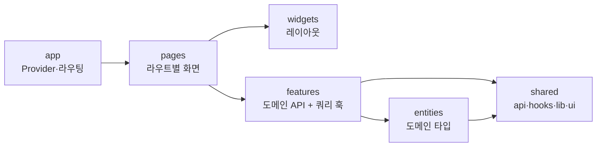
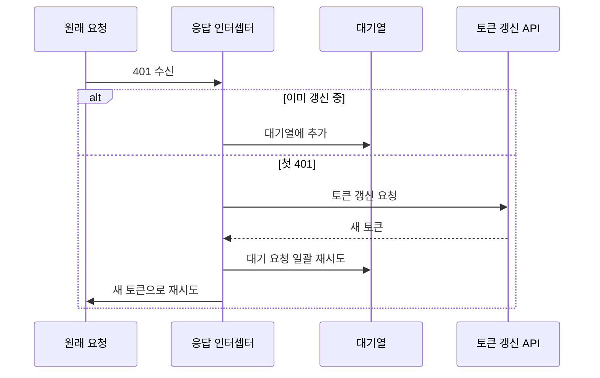
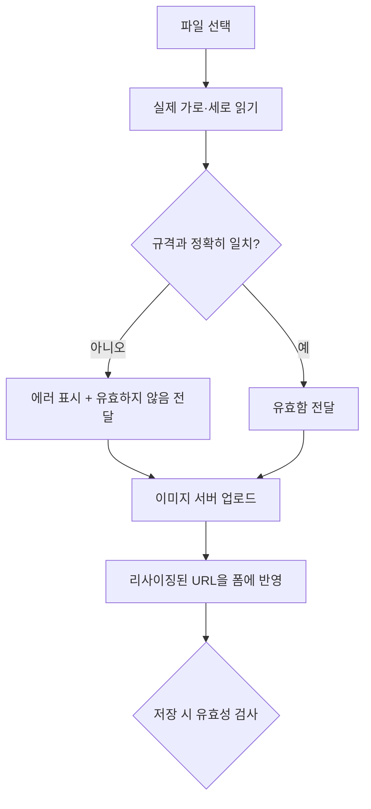

# 운영자가 매일 쓰는 관리자 웹을 혼자 만들고 고쳐 온 6개월

> AI 운세 상담 앱의 운영자용 관리자 웹(CMS)을 React 19 + TypeScript로 1인 개발하면서, FSD 구조·React Query·토큰 갱신 인터셉터·공통 CRUD 패턴·이미지/엑셀 검증을 어떻게 설계하고 실제 운영 이슈를 어떻게 고쳤는지 정리한 회고입니다.

## 프로젝트 개요

**무엇을 만들었나.** AI 운세 상담 앱의 운영자용 관리자 웹(CMS)입니다. 운영자가 앱에 노출되는 운세 콘텐츠, AI 상담 캐릭터(페르소나), 카테고리, 배너·팝업, 푸시 알림, 공지·FAQ, 1:1 문의 답변, 인앱 재화(코인) 충전 상품, 회원 조회를 이 화면 하나에서 처리합니다. 백엔드 API는 별도 팀이 제공했고, 저는 프런트엔드 전체를 맡았습니다.

**기간.** 저장소 기준 2026-01-19(첫 커밋) ~ 2026-07-27(마지막 커밋)입니다. 첫 커밋에 이미 128개 파일이 들어 있어, 저장소를 만들기 전의 초기 개발 기간은 커밋으로 확인되지 않습니다. **[수치 입력: 저장소 생성 이전 초기 개발 시작 시점]**

**역할.** 1인 개발입니다. 저장소의 비머지 커밋 42개(머지 포함 66개)가 모두 제 커밋이고, `feature/* → develop → main → deploy/prod` 순서로 PR을 머지하며 배포했습니다.

**규모 (코드로 확인 가능한 숫자)**

| 항목 | 수치 |
|------|------|
| 라우트 화면 | 17개 (로그인·사용 가이드 포함, 이 중 3개는 메뉴에서 숨김) |
| `features` 슬라이스 | 19개 (도메인 API + 인증 + 공통 기능) |
| `entities` 도메인 모델 | 13개 |
| 페이지 컴포넌트 코드 | 약 8,000줄 (가장 큰 콘텐츠 관리 화면 1,341줄) |
| 테스트 | 19개 스위트 / 119개 테스트, 전부 통과 |
| 커밋 | 비머지 42개, PR 머지 24건 |

## 기술 스택 한눈에

| 영역 | 기술 | 선택 이유(한 줄) |
|------|------|------------------|
| 프레임워크 | React 19 + TypeScript 4.9 (CRA) | 혼자 유지보수하는 만큼 타입으로 API 응답과 폼 구조를 고정하고 싶었습니다 |
| 아키텍처 | Feature-Sliced Design | 화면이 계속 늘어나는 관리자 웹에서 "어디에 둘지" 고민을 규칙으로 없애려고 |
| 서버 상태 | TanStack Query 5 | 목록 조회·캐시·뮤테이션 후 재조회를 직접 짜지 않으려고 |
| HTTP | Axios | 인터셉터로 인증 헤더와 401 토큰 갱신을 한 곳에서 처리하려고 |
| 라우팅 | React Router 7 | 보호 라우트 + 공통 레이아웃 중첩 라우트 구성 |
| 스타일 | Tailwind CSS 3 | 일관된 관리자 UI를 빠르게 만들려고 **[확인 필요: 디자이너 없이 진행했는지 등 실제 선택 배경]** |
| 스프레드시트 | SheetJS(xlsx) | 운영자가 엑셀로 준비한 데이터를 브라우저에서 바로 검증하려고 |
| 클라이언트 상태 | Zustand 5 | 전역 UI 상태용으로 넣었지만 결국 쓰지 않았습니다 (회고 참고) |
| 테스트 | Jest + React Testing Library | CRA 기본 러너로 API 함수·훅·인증 컨텍스트를 단위 테스트 |

## 목차

1. Feature-Sliced Design 아키텍처
2. TanStack Query와 도메인별 API 훅
3. Axios 인터셉터 기반 인증·토큰 갱신
4. 공통 CRUD UI 패턴
5. 다국어(ko/en) 콘텐츠 입력
6. 이미지 업로드와 규격 검증
7. SheetJS로 엑셀 데이터 검증
8. Jest + React Testing Library
9. 회고

---

## 1. Feature-Sliced Design 아키텍처

### 왜 선택했나

관리자 웹은 "목록 + 등록/수정 모달" 화면이 계속 추가되는 구조입니다. 혼자 개발하더라도 몇 달 뒤의 제가 헤매지 않으려면 "이 코드는 어느 레이어에 두는가"를 규칙으로 정해 둘 필요가 있다고 봤습니다. **[확인 필요: FSD를 고른 실제 이유 — 레이어 폴더(`entities`/`features`/`widgets`)는 첫 커밋부터 있어 코드로는 선택 배경이 확인되지 않음]** 다만 첫 커밋 시점에는 도메인별 API 파일이 전부 `shared/api` 아래에 있어, 공통 인프라(Axios 인스턴스, 쿼리 클라이언트)와 특정 도메인 코드가 같은 폴더에 섞여 있었습니다.

### 어떻게 적용했나

상위 레이어가 하위 레이어만 가져다 쓰는 단방향 의존 규칙을 따랐습니다.



- `entities/<도메인>/model.ts`에는 API 응답 타입만 둡니다.
- `features/<도메인>/api/<도메인>Api.ts`에 실제 엔드포인트 함수와 React Query 훅을 함께 둡니다.
- `shared`에는 도메인을 모르는 코드(Axios 인스턴스, 공통 모달·폼·페이지네이션, 이미지 규격 유틸)만 남깁니다.
- 각 슬라이스는 `index.ts`로 공개 API를 export하고, 화면은 그 배럴을 통해서만 가져옵니다.

### 해결한 문제

2026-02-03 리팩터링 커밋(`fsd 구조에 맞게 파일 이동`, 44개 파일 변경)에서 `shared/api` 아래에 있던 배너·카테고리·코인·콘텐츠·페르소나·푸시·유저 API를 각각 `features/<도메인>/api`로 옮기고, `shared/api`의 두 파일에 섞여 있던 관리자·공지·FAQ·대시보드 API도 도메인별 슬라이스로 분리했습니다. 이후 문의하기, 추가 질문 템플릿, 채팅 모드 설정 같은 기능을 추가할 때는 `features` → `pages`(문의하기·추가 질문 템플릿은 `entities`까지) 순서로 새 폴더만 만들면 되었습니다.

### 결과

- 이후 추가된 도메인(문의하기, 추가 질문 템플릿, 채팅 모드, 분석 응답 길이 프리셋)이 모두 `features/<도메인>/api` + `pages/<도메인>/ui` 구조로 들어갔습니다.
- 다만 `admin`·`chat-mode`·`analysis-length-preset`은 `entities` 없이 타입을 `features` 안에 두는 등 규칙이 완전히 일관되지는 않습니다. 이 부분은 회고에 적었습니다.

---

## 2. TanStack Query와 도메인별 API 훅

### 왜 선택했나

관리자 화면의 데이터는 거의 전부 서버 상태입니다. 목록을 불러오고, 저장하면 목록을 다시 불러오고, 필터·페이지가 바뀌면 다른 결과를 캐시하는 일이 화면마다 반복됩니다. 이를 `useEffect` + `useState`로 매번 짜는 대신 TanStack Query에 맡기기로 했습니다.

### 어떻게 적용했나

전역 기본값은 관리자 웹 특성에 맞췄습니다. 운영자가 탭을 오가며 작업해도 불필요하게 다시 요청하지 않도록 `refetchOnWindowFocus: false`, `staleTime` 5분, `retry` 1회로 두었습니다. 반대로 홈 대시보드 통계는 들어올 때마다 최신이어야 하므로 그 훅만 `staleTime: 0`, `refetchOnMount: 'always'`로 덮어썼습니다.

도메인 API 파일에는 아래처럼 요청 함수와 훅을 나란히 둡니다(단순화한 예시).

```ts
const KEY = ['items'];

export const getItems = (params: ListParams) => apiClient.get('/items', { params });
export const updateItem = (body: ItemUpdate) => apiClient.put('/items', body);

export const useItems = (params: ListParams) =>
  useQuery({ queryKey: [...KEY, params], queryFn: () => getItems(params) });

export const useUpdateItem = () => {
  const qc = useQueryClient();
  return useMutation({
    mutationFn: updateItem,
    onSuccess: () => qc.invalidateQueries({ queryKey: KEY }),
  });
};
```

`queryKey`에 필터·페이지 파라미터를 그대로 넣었기 때문에, 서버 페이지네이션(`page`/`limit` 전달 → 응답의 전체 건수로 페이지 수 계산)도 별도 캐시 로직 없이 동작합니다.

### 해결한 문제

콘텐츠는 한국어/영어 데이터를 `language` 파라미터로 따로 조회해야 했고, 백엔드에 단건 조회 API가 없어 수정 모달에서 "반대 언어" 값을 채우려면 반대 언어 목록을 한 번 더 조회해 같은 `id`끼리 짝지어야 했습니다. 그런데 카테고리 필터를 걸면 수정 모달의 영어 필드가 빈칸으로 뜨는 문제가 생겼습니다. 원인은 두 번째 쿼리에 필터 파라미터를 빠뜨려, 두 목록이 서로 다른 페이지 결과를 가져오고 있었던 것입니다. 2026-07-01 커밋에서 반대 언어 쿼리에도 카테고리·검색어·추천 여부 필터를 동일하게 넣고, 이유를 주석으로 남겨 해결했습니다.

### 결과

- 화면 코드에서 로딩·캐시·재조회 로직이 사라지고, 화면은 훅 호출과 렌더링에 집중하게 되었습니다.
- 현재 모든 화면이 이 "도메인 API + 쿼리 훅" 패턴 하나로 데이터를 다룹니다.

---

## 3. Axios 인터셉터 기반 인증·토큰 갱신

### 왜 선택했나

관리자 웹은 오래 켜 두고 작업하는 도구라, 액세스 토큰이 만료될 때마다 로그인 화면으로 튕기면 작성 중인 폼을 잃게 됩니다. **[확인 필요: 실제 운영자 사용 패턴(장시간 사용 여부)]** 토큰 갱신을 화면마다 처리하지 않고, 모든 요청이 지나가는 Axios 인스턴스 한 곳에서 처리하고 싶었습니다.

### 어떻게 적용했나

요청 인터셉터는 인증 헤더를 붙이고, 응답 인터셉터는 401을 받으면 토큰을 갱신한 뒤 원래 요청을 다시 보냅니다. 화면 진입 시 여러 API가 동시에 401을 받는 경우를 위해, 갱신 중에는 나머지 요청을 대기열에 넣었다가 새 토큰으로 한꺼번에 재시도합니다.



예외도 명시적으로 나눴습니다. 로그인 요청의 401은 갱신하지 않고 호출부로 넘기고, 권한 부족 메시지는 로그아웃 없이 에러만 전달하며, 갱신 자체가 실패하거나 재시도 후에도 401이면 토큰과 React Query 캐시를 비우고 로그인 화면으로 보냅니다. 앱 시작 시에는 `AuthProvider`가 저장된 토큰으로 내 정보를 조회하고, 토큰이 만료됐으면 갱신한 뒤 다시 조회해 세션을 복원합니다.

### 해결한 문제

초기 버전에서는 로그인 실패도 401로 내려오는데, 인터셉터가 이를 다른 401과 똑같이 "토큰 만료"로 처리했습니다. 로그인 전이라 갱신할 토큰이 없으니 곧바로 `/login`으로 페이지를 다시 불러왔고, 그 과정에서 화면 상태가 초기화되어 운영자는 비밀번호를 틀려도 에러 메시지를 볼 수 없었습니다(당시 코드 흐름 기준). 2026-02-03 커밋에서 로그인·가입 요청의 401은 인터셉터가 건드리지 않도록 예외를 추가했고, 실패 시 비밀번호 칸을 비우고 포커스를 옮기도록 함께 고쳤습니다.

### 결과

- 갱신 로직이 `apiClient` 한 파일에만 있어, 이후 추가된 도메인 API는 인증을 신경 쓰지 않고 작성했습니다.
- 로그인·세션 복원·로그아웃 흐름은 `AuthContext` 테스트로 고정해 두었습니다.
- **[수치 입력: 토큰 갱신 도입 전후 "작업 중 강제 로그아웃" 관련 운영 문의 건수 등]**

---

## 4. 공통 CRUD UI 패턴

### 왜 선택했나

화면 대부분이 "목록 + 필터 + 페이지네이션 + 등록/수정 모달 + 저장/삭제"라는 같은 모양입니다. 처음에는 화면마다 모달 상태와 `try-catch + console.error + alert`를 각자 썼습니다. 예를 들어 공지사항 화면에만 같은 모양의 `alert` 호출이 3개 있었고, 다른 화면도 비슷했습니다.

### 어떻게 적용했나

세 가지를 공통화했습니다.

- `useCrudModal`: 모달 열림, 수정 대상, 폼 데이터, 폼 에러 상태만 관리하는 훅입니다. API 응답을 폼으로 바꾸는 `apiToFormData`만 화면에서 넘겨 줍니다.
- `executeMutation`: 뮤테이션 실행, 응답 검증, 실패 시 `console.error` + `alert`, 성공 콜백을 하나로 묶은 헬퍼입니다.
- `Modal`, `FormField`, `FilterBar`, `Pagination`, `Panel` 같은 공통 UI 컴포넌트입니다.

```ts
const ok = await executeMutation({
  mutationFn: () => update.mutateAsync(payload),
  actionLabel: '저장',
  validateResponse: (res) => (res.data.success ? true : `저장 실패: ${res.data.message}`),
  onSuccess: () => { refetch(); modal.closeModal(); },
});
```

### 해결한 문제

- **설계를 실제 데이터 흐름에 맞춰 다시 짰습니다.** 첫 버전 `useCrudModal`은 로컬 배열을 직접 수정하는 구조(`Date.now()`로 id 생성)여서 서버 API 기반 화면에는 맞지 않았고, 실제로 이 훅을 쓰는 화면이 하나도 없었습니다. 2026-01-30 리팩터링에서 "상태만 관리하고 API는 화면이 호출"하도록 바꾸고 `executeMutation`을 도입해, 이 훅을 5개 화면(콘텐츠·페르소나·배너·공지·FAQ)에 적용했습니다. 이후 추가 질문 템플릿 화면(2026-05-28)도 같은 훅으로 만들어 현재 6개 화면이 쓰고, `executeMutation`은 도입 당시 8개에서 현재 12개 화면으로 늘었습니다.
- **모달이 의도치 않게 닫히는 문제.** 입력창에서 텍스트를 드래그해 선택하다가 마우스가 모달 바깥에서 떨어지면 `click`이 오버레이에서 발생해 모달이 닫혔습니다. 작성 중인 내용을 잃는 문제여서, `mousedown`이 시작된 대상까지 오버레이일 때만 닫히도록 고쳤습니다(2026-01-28).
- **페이지 번호가 끝없이 늘어나는 문제.** 페이지네이션이 전체 페이지 번호를 모두 그리는 구조여서, 데이터가 쌓일수록 버튼 줄이 끝없이 길어질 수 있었습니다. 10개 단위 블록만 보여 주도록 바꿨습니다(2026-06-10).

### 결과

- 모달 닫힘·페이지네이션 같은 수정은 공통 컴포넌트 한 곳만 고치면 전 화면에 반영됩니다.
- **[수치 입력: 공통화 이후 신규 관리 화면 하나를 추가하는 데 걸린 시간]**

---

## 5. 다국어(ko/en) 콘텐츠 입력

### 왜 선택했나

앱이 한국어와 영어를 함께 서비스하기 때문에, 콘텐츠·페르소나·카테고리는 한 레코드에 두 언어를 함께 저장해야 했습니다. 운영자가 언어별로 화면을 따로 오가지 않고 한 모달에서 두 언어를 입력하도록 만드는 것이 목표였습니다.

### 어떻게 적용했나

- 모달 상단의 `ModalTabs`(한국어/영어)로 입력 언어를 전환하고, 저장 시 `translations: { ko?, en? }` 형태로 보냅니다.
- 최소 한 언어는 입력해야 하며, 어떤 언어든 입력을 시작했다면 그 언어의 필수 필드를 모두 채워야 저장됩니다.
- 공지·FAQ·배너는 언어별로 별도 레코드여서, 탭 대신 언어 선택 필드로 한 언어를 골라 저장합니다. 도메인 성격에 따라 두 방식을 나눴습니다.
- 콘텐츠에는 "추가 질문"(최대 5개, 언어별)과 "상대방 정보 입력" 설정이 있습니다. 상대방 정보를 켜면 추가 질문이 강제로 켜지고 최소 1개 질문이 필요하며, 비어 있는 질문은 "N번 질문을 입력해주세요"처럼 위치를 알려 줍니다.

### 해결한 문제

카테고리는 한국어/영어 목록을 각각 조회해 합쳐 쓰는데, 초기 코드는 한국어 목록을 기준으로만 병합해서 영어에만 있는 카테고리가 사라졌고, 콘텐츠 수정 시 영어 카테고리가 보이지 않았습니다. 2026-01-27 커밋에서 두 언어의 id를 합집합으로 모아 병합하고, 선택지 라벨도 현재 입력 언어에 맞춰 보여 주도록 고쳤습니다. 2절의 "반대 언어 필드 빈칸" 문제도 같은 다국어 구조에서 나온 이슈였습니다.

### 결과

- 운영자는 한 모달에서 두 언어를 입력하고, 덜 채운 언어가 있으면 저장 전에 어느 필드인지 바로 확인합니다.
- **[수치 입력: 다국어 동시 입력 도입 후 콘텐츠 1건 등록 시간 또는 번역 누락 건수 변화]**

---

## 6. 이미지 업로드와 규격 검증

### 왜 선택했나

앱은 썸네일·캐릭터 이미지를 정해진 크기·비율로 리사이징해 쓰기 때문에(규격 정의 주석 기준), 규격과 다른 이미지가 올라가면 앱 화면에서 의도와 다르게 보일 수 있습니다. 운영자가 업로드한 뒤에야 문제를 아는 대신, 고르는 순간 알려 주고 싶었습니다.

### 어떻게 적용했나

이미지 업로드는 공통 컴포넌트 `ImageUpload` 하나로 처리합니다. 4개 화면의 6개 업로드 칸이 모두 이 컴포넌트를 쓰고, 칸마다 `sizeType`만 다르게 넘깁니다(배너는 상단·하단·팝업 위치에 따라 규격을 바꿔 넘김). 규격은 `IMAGE_SIZES` 한 곳에 모았습니다.



- 업로드 칸 위에 "업로드 사이즈: W × H px"를 항상 보여 주고, 불일치하면 필요한 크기와 현재 크기를 함께 표시합니다.
- 콘텐츠·페르소나·카테고리는 크기가 맞지 않으면 저장을 막고, 배너는 업로드 칸에 불일치만 표시하고 저장은 막지 않습니다.
- 이미지 서버가 돌려준 여러 크기의 URL(홈/카드/리스트, 전신/아이콘 등)을 `onUploadComplete`로 받아 각 필드에 나눠 담습니다.

### 해결한 문제

운영자가 이미 올린 콘텐츠 썸네일·페르소나 이미지를 한 번에 내려받는 "일괄 다운로드" 기능도 손봤습니다. 이미지를 `fetch`로 받아 파일로 저장하는 방식이라, 같은 URL을 캐시된 응답으로 받는 경우를 피해야 했습니다. 2026-01-20 커밋에서 다운로드 요청 URL에 타임스탬프 쿼리 파라미터(`_t`)를 붙여 스토리지 캐시를 우회하도록 했고, 같은 커밋에서 목록의 개별 이미지 링크는 긴 URL 대신 "990x555 (16:9) 보기"처럼 크기를 적은 문구로 바꿔 새 탭에서 열리게 했습니다.

또 규격을 `IMAGE_SIZES` 한 곳에 모아 두었기 때문에, 업로드 칸의 안내 문구·크기 검증·업로드 타입 매핑이 모두 같은 키를 봅니다. 업로드 화면 기준으로는 규격이 바뀌면 이 객체 하나만 고치면 됩니다. 다만 사용 가이드 페이지에는 같은 규격이 문자열로 따로 적혀 있어 함께 고쳐야 합니다.

### 결과

- 규격 정의 1곳, 업로드 컴포넌트 1개로 6개 업로드 칸(8가지 규격)을 관리합니다.
- **[수치 입력: 규격 검증 도입 전후 "이미지가 깨져 보인다"는 앱 화면 이슈 건수]**

---

## 7. SheetJS로 엑셀 데이터 검증

### 왜 선택했나

AI 캐릭터(페르소나)의 말투를 정의하기 위해, 운영자가 템플릿의 기준 문장(템플릿 기준 1~50번)을 캐릭터 말투로 바꿔 쓴 "말투 예시"를 언어별로 등록해야 했습니다. 50개 문장을 나란히 놓고 고쳐 쓰는 데이터라 엑셀이 편하다고 판단해, 템플릿을 내려받아 채우고 그대로 올리는 방식을 택했습니다. **[확인 필요: 엑셀 방식이 운영자 요청이었는지 직접 판단이었는지]** 형식 오류를 서버까지 보내지 않고 브라우저에서 먼저 잡으려고 SheetJS를 썼습니다.

### 어떻게 적용했나

- 작성 템플릿(`ko`/`en` 두 개)을 `public/templates`에 두고 화면에서 내려받게 했습니다.
- 파서는 `변형 입력` 시트를 우선 읽고, 없으면 첫 시트를 씁니다(CSV 등 단일 시트 대응).
- 헤더 위치를 고정하지 않고 1열이 `번호`인 행을 찾아 그 다음 행부터 읽습니다. 템플릿 상단의 안내 행 개수가 바뀌어도 동작하게 하려는 의도였습니다.
- **파싱을 먼저 하고, 실패하면 업로드하지 않습니다.** 통과한 경우에만 파일을 업로드하고, 원문/변형 문장을 미리보기 모달로 보여 줍니다. 업로드 중에는 저장 버튼을 막습니다.

### 해결한 문제

처음에는 일부 행이 비어 있어도 "N개 중 M개만 채워졌습니다"라는 경고만 띄우고 통과시켰습니다. 덜 채운 파일도 그대로 올라가는 구조였습니다. 2026-05-28 커밋(`미리보기 오류 수정`)에서 이를 경고가 아니라 에러로 바꿔, 모든 행을 채우기 전에는 업로드되지 않도록 했습니다. 에러 메시지에는 몇 행 중 몇 행이 채워졌는지와 어느 열을 채워야 하는지를 함께 적었습니다.

같은 방식으로 2026-07-06에는 콘텐츠 **일괄 등록** 기능도 만들었습니다. 한/영 두 시트를 같은 번호로 묶어 한 콘텐츠로 병합하고, 열을 위치가 아닌 헤더 이름으로 찾고, 파일명 규칙(`1.png`, `1-.png`)으로 썸네일을 매칭한 뒤 등록 전 검증 리포트를 보여 주는 구조였습니다(파서 테스트 포함, 약 1,000줄). 하지만 18일 뒤 추가 질문 기능을 붙이는 커밋에서 이 기능을 통째로 제거했습니다. **[수치 입력/사유 입력: 일괄 등록을 제거한 실제 이유 — 예: 콘텐츠 스키마 변경, 운영 방식 변경 등]**

### 결과

- 말투 예시는 형식이 맞지 않으면 브라우저 단계에서 막히고, 운영자는 어느 행이 비었는지 메시지로 확인합니다.
- **[수치 입력: 등록된 페르소나 말투 예시 파일 수 또는 형식 오류로 인한 재요청 감소]**

---

## 8. Jest + React Testing Library

### 왜 선택했나

리뷰어 없이 혼자 배포하는 구조라, 최소한 API 요청 형태와 인증 흐름이 리팩터링 중에 깨지지 않는다는 안전망이 필요했습니다. CRA에 기본 포함된 Jest와 React Testing Library를 그대로 활용했습니다.

### 어떻게 적용했나

2026-05-12 커밋에서 테스트 1,600여 줄을 한 번에 추가했습니다. 테스트는 대상 옆 `__tests__/`에 둡니다.

- **도메인 API 10개**: `apiClient`를 모킹해 요청 경로·파라미터·응답 매핑을 검증합니다.
- **인증 컨텍스트**: 로그인, 세션 복원, 로그아웃 시 저장소와 상태 변화를 검증합니다.
- **공통 훅**: `renderHook`으로 `useCrudModal`, `useImageUpload` 등의 상태 전이를 확인합니다.
- **공통 유틸**: 삭제 확인, 이미지 다운로드, 이미지 규격, 라벨 변환.

현재 `CI=true npm test` 기준 19개 스위트, 119개 테스트가 모두 통과합니다.

### 해결한 문제

테스트 도입 이후에도 페르소나 말투 예시, 추가 질문, 문의하기 같은 큰 기능을 계속 붙였지만, 기존 19개 테스트 파일은 2026-05-12 이후 한 번도 수정되지 않았습니다(일괄 등록 파서 테스트는 기능과 함께 추가됐다가 제거). 그래서 문의하기처럼 새로 생긴 도메인 API나 기존 API에 새로 붙은 함수는 테스트 대상에 들어가지 않았습니다. 반대로 범용 CRUD 훅·클라이언트 페이지네이션 훅은 테스트까지 작성했지만 실제 화면에서는 쓰지 않는 코드로 남았습니다. 테스트 대상을 "실제로 쓰이는 코드" 기준으로 고르지 못한 점은 회고에 적었습니다.

### 결과

- 테스트가 있는 도메인 API 10개·인증 컨텍스트·공통 훅은 기존 동작이 바뀌면 테스트가 먼저 깨집니다.
- 반면 페이지 컴포넌트, 공통 UI 컴포넌트, 엑셀 파서, 토큰 갱신 인터셉터에는 테스트가 없고, 테스트를 자동으로 돌리는 CI 단계도 없어 테스트는 로컬에서 수동으로 돌립니다.

---

## 회고

### 배운 점

- **공통화는 실제 화면 두세 개를 만든 다음에 하는 편이 맞았습니다.** 첫 `useCrudModal`은 "있으면 좋겠다"로 먼저 만든 탓에 실제 데이터 흐름(서버 API)과 맞지 않아 아무 화면도 쓰지 않았습니다. 화면을 여러 개 만든 뒤 반복되는 부분만 뽑아 다시 만들었을 때 비로소 5개 화면에 적용됐고, 이후 추가된 화면까지 포함해 지금은 6개 화면이 씁니다.
- **다국어 버그는 "두 데이터를 짝짓는 곳"에서 나왔습니다.** 한/영 카테고리 병합, 반대 언어 목록 매칭처럼 서버 구조(단건 조회 없음, 언어별 분리 조회)를 프런트에서 메우는 코드가 반복해서 깨졌습니다. 이런 곳에는 "왜 이렇게 했는지"를 주석으로 남기게 되었습니다.
- **요청 타입과 실제 전송 필드를 함께 봐야 합니다.** 코인 충전 상품을 수정해도 반영되지 않던 문제는, 수정 요청 타입과 전송 데이터에 기본·보너스 코인 필드가 빠져 있던 것이 원인이었습니다(2026-03-03).
- **폼 입력값은 문자열로 들고 있다가 보낼 때 변환해야 합니다.** 숫자 입력을 숫자 상태로 바로 들고 있으니 칸을 비우면 0이 되어 지울 수 없었습니다. 상태를 문자열로 바꾸고 전송 직전에 `Number()`로 변환하도록 고쳤습니다(2026-04-10).
- **운영자의 실제 손동작을 봐야 보이는 버그가 있습니다.** 드래그 중 모달이 닫히는 문제나 끝없이 늘어나는 페이지 번호는 처음 구현할 때는 놓쳤다가 나중에 고친 문제입니다. **[확인 필요: 두 문제가 운영자 제보나 실사용 중에 발견된 것인지]**

### 아쉬운 점

- **만들어 두고 쓰지 않는 공통 모듈이 남아 있습니다.** Zustand UI 스토어, 범용 CRUD API와 `useResource` 훅, 클라이언트 페이지네이션 훅, 링크 편집기, 노출 토글 기능, 토픽 API가 export만 되고 어떤 화면에서도 쓰이지 않습니다. 특히 범용 CRUD API는 실제 백엔드 규칙(`PUT`/`DELETE` + body의 id)과 경로 규칙이 다릅니다. 처음 구조를 잡을 때 "언젠가 쓸 것"을 미리 만든 결과여서, 지금이라면 실제로 필요해질 때 만들었을 것입니다. 다음 정리 대상 1순위입니다.
- **일괄 등록 기능을 만들고 바로 걷어냈습니다.** 약 1,000줄 규모의 기능이 18일 만에 제거됐습니다. 요구사항이 확정되기 전에 크게 만든 것이 원인인지 돌아볼 필요가 있습니다. **[사유 입력: 제거 배경과 그때 다르게 했으면 좋았을 점]**
- **숨김 화면이 3개 있습니다.** 추가 질문 템플릿(콘텐츠별 추가 질문으로 대체), 채팅 모드 설정, 분석 응답 길이 프리셋은 메뉴에서만 숨기고 라우트·코드는 남겨 두었습니다(채팅 모드·프리셋은 요청에 따른 임시 숨김). 숨김 상태가 길어질수록 기능 플래그나 제거 중 하나로 정리하는 편이 낫습니다.
- **페이지 컴포넌트가 큽니다.** 콘텐츠 관리 화면 하나가 1,341줄입니다. 공통 훅으로 상태는 덜어냈지만, 폼 검증·요청 데이터 변환·모달 UI가 한 파일에 남아 있어 `features` 쪽으로 더 나눌 여지가 있습니다.
- **FSD 규칙이 완전히 일관되지는 않습니다.** 일부 도메인은 `entities` 없이 `features` 안에 타입을 두고, 사용 가이드 문서에는 최신 기능(상대방 정보·추가 질문)이 아직 반영되지 않았습니다.
- **테스트와 CI.** fix 커밋이 가장 많이 몰린 페이지 단위 로직과 엑셀 파서, 토큰 갱신 인터셉터에 테스트가 없고, 자동으로 테스트를 돌리는 CI도 없습니다.

**[수치 입력: CMS 도입 후 운영팀의 콘텐츠 등록·수정 소요 시간, 월간 등록 건수 등 운영 지표]**
