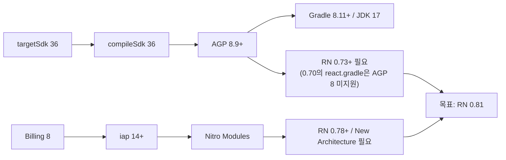

# 2년 멈춰 있던 React Native 앱을 0.70에서 0.81 New Architecture로 올린 기록

> 스토어 정책 마감(targetSdk 36, Google Play Billing 8)을 맞추려고 RN 0.70 앱을 하루 동안 세 단계로 0.81까지 올렸습니다. 그 뒤 석 달 동안 결제, 뷰어, 분석 기능을 붙였습니다. 업그레이드 순서를 정한 근거, 빌드는 되는데 실행하면 깨진 버그들, 그 위에 올린 기능을 정리했습니다.

## 프로젝트 개요

**무엇을 만들었나.** 웹툰·웹소설 플랫폼의 모바일 앱입니다. 작품 목록과 상세, 웹툰 뷰어(WebView), 웹소설 뷰어(EPUB), 코인 인앱 결제, 보상형 광고가 있습니다. 같은 서비스의 웹사이트와 관리자 웹도 함께 손봤고, 그 이야기는 [웹·관리자 글](./webtoon-platform-web-cms.md)에 따로 정리했습니다.

**기간.** 2026년 7월 31일 ~ 10월 29일

**역할.** 이 앱의 저장소는 2023년 5월에 시작됐고, 2024년 4월 이후로는 커밋이 없었습니다. 2026년 7월 31일부터는 제가 혼자 맡았고, 이 기간의 커밋 53건(병합·stash 제외)은 모두 제 커밋입니다. 그 전의 코드는 다른 개발자들이 작성했습니다. 이 글은 제가 맡은 이후의 작업만 다룹니다. 백엔드 API는 다른 팀 담당입니다.

**규모.**

| 항목 | 수치 |
|------|------|
| 업그레이드 경로 | RN 0.70.2 → 0.73.9 → 0.77.2 → 0.81.4 (New Architecture) |
| 업그레이드 변경 규모 | 39개 파일, +8,946 / −13,565줄 (삭제 대부분은 JNI 글루 코드) |
| 함께 올린 주요 라이브러리 | 인앱 결제 11 → 16, reanimated 2.17 → 3.19, WebView 11 → 13, screens 3 → 4, safe-area 4 → 5 |
| release AAB | 72.2MB, 16KB 페이지 정렬 검증 통과 |
| 커밋 | 53건 |

## 기술 스택 한눈에

| 영역 | 기술 | 이 프로젝트에서의 용도 |
|------|------|------------------|
| 프레임워크 | React Native 0.81 (New Architecture), React 19 | targetSdk 36과 Billing 8을 동시에 맞추기 위해 |
| 내비게이션·상태 | React Navigation 6, Redux + thunk | 기존 구조를 유지 |
| 인앱 결제 | react-native-iap 16 (Nitro Modules) | Billing 8, StoreKit 2 대응 |
| 뷰어 | WebView 13 (웹툰), 레포에 포함한 epub.js 계열 소스 (웹소설) | 드래그 스크롤바, 목차 이동 |
| 네이티브 모듈 | 직접 작성한 Java·Objective-C 모듈 | 광고 SDK 브리지, 화면 캡처 방지 |
| 분석 | Firebase Analytics (GA4) | 웹과 같은 GA4 속성으로 앱 화면·이벤트 수집 |
| 빌드 | Gradle 8.14, AGP 8.11, R8 / CocoaPods, Xcode | 난독화, versionCode 자동 증가, Privacy Manifest |

## 목차

1. [단계별 업그레이드: 0.70 → 0.81](#1-단계별-업그레이드-070--081)
2. [Android 16 대응](#2-android-16-대응)
3. [인앱 결제: iap 11 → 16, StoreKit 2](#3-인앱-결제-iap-11--16-storekit-2)
4. [소셜 로그인을 웹 계정과 연결하기](#4-소셜-로그인을-웹-계정과-연결하기)
5. [뷰어: 스크롤바, EPUB 목차, 캡처 방지](#5-뷰어-스크롤바-epub-목차-캡처-방지)
6. [탐색 UX와 GA4](#6-탐색-ux와-ga4)

---

## 1. 단계별 업그레이드: 0.70 → 0.81

### 왜 해야 했나

Google Play 정책으로 2026년 8월 31일까지 두 가지를 맞춰야 했습니다. 하나는 targetSdk 36이고, 다른 하나는 Play Billing Library 8입니다. 둘 다 따라가 보니 결국 RN 버전 문제였습니다.



0.81을 목표로 고른 이유는 `newArchEnabled=false`로 되돌릴 수 있는 마지막 버전이기 때문입니다. 문제가 생겼을 때 New Architecture 탓인지 아닌지를 나눠 볼 수 있습니다. 작업 전에 이 의존성 사슬과 단계별 계획을 문서로 먼저 정리해 레포에 커밋했습니다(`b6da3fe`, `8dffb3a`).

### 어떻게 적용했나

원칙은 "한 번에 0.81로 뛰지 않는다"였습니다. 단계마다 커밋해서 되돌릴 지점을 남기고, 디버그 빌드가 실제로 뜨는지 확인한 뒤 다음 단계로 넘어갔습니다.

| 단계 | 커밋 | 내용 |
|---|---|---|
| 1 | `f33c8a8`, `3f7d582` | RN 0.73.9, AGP 8.1, Gradle 8.3. 템플릿에서 사라진 JNI/C++ 스캐폴딩과 Flipper 제거 |
| 2 | `894790f`, `e2c372b` | RN 0.77.2, Kotlin 2.0, NDK 27. reanimated 2.17 → 3.16 |
| 3+4 | `bf4482c`, `75bdb81` | RN 0.81.4, React 19.1, compile/targetSdk 36, AGP 8.11, Gradle 8.14, New Architecture 켜기. iap 16, WebView 13 |

2단계의 reanimated는 빌드 오류로는 알 수 없는 경우였습니다. 2.17은 빌드는 통과하지만, 0.77에서 제거된 내부 클래스(`ChoreographerCompat$FrameCallback`)를 참조해서 실행하자마자 죽었습니다. 3+4단계에서는 WebView 11이 TurboModule interop 규칙에 맞지 않아 모듈 로드에 실패했고, 13으로 올렸습니다. bridgeless 모드에서 루트 뷰가 null이 되는 크래시는 `MainApplication`에 `getReactHost()`를 구현해서 해결했습니다(`75bdb81`).

### 해결한 문제: 빌드는 되는데 실행하면 깨진 것들

- **당겨서 새로고침이 앱을 죽이던 문제.** RN 0.81의 ScrollView는 `refreshControl`이 있는지를 truthy가 아니라 `!= null`로 판단하도록 바뀌었습니다. 그래서 기존 코드의 `Boolean(refresh) && <RefreshControl/>`이 `false`를 넘기면, 이 값을 엘리먼트로 복제하려다 "Element type is invalid"로 크래시가 났습니다. 삼항 연산자로 `undefined`를 넘기게 고쳤습니다(`49d5ee2`).
- **약관 화면 높이가 0이 되던 문제.** WebView 13의 `postMessage`는 문자열만 받습니다. 그런데 페이지가 높이를 숫자로 보내고 있었습니다. `String(document.body.scrollHeight)`로 감쌌습니다(`6db1f6c`).
- **React 19에서 팝업 메뉴 크래시.** 메뉴 라이브러리 0.16이 React 19에서 `optionsContainer of undefined`로 죽었습니다. 순수 JS 라이브러리라서 0.19로 올리기만 하면 됐습니다(`9740a32`).
- **SafeAreaView 크래시 우회.** targetSdk 36부터는 edge-to-edge가 강제되는데, RN 기본 `SafeAreaView`는 Android에서 동작하지 않습니다. safe-area-context의 `SafeAreaView`로 바꾸자 이번에는 RN 0.81.4의 Yoga와 충돌해 네이티브 assertion(SIGABRT)으로 죽었습니다. 그래서 `SafeAreaInsetsContext.Consumer`로 inset 값만 읽고, 일반 `View`에 padding으로 넣는 방식으로 우회했습니다(`79a6c27`).

```jsx
<SafeAreaInsetsContext.Consumer>
  {(insets) => (
    <View style={{ flex: 1, paddingTop: insets?.top ?? 0, paddingBottom: insets?.bottom ?? 0 }}>
      {children}
    </View>
  )}
</SafeAreaInsetsContext.Consumer>
```

### 결과

- 하루 동안 0.70에서 0.81까지 올리고, 실기기에서 New Architecture로 화면이 뜨는 것까지 확인했습니다(`75bdb81`).
- 나흘 뒤 release AAB(72.2MB)를 만들었습니다. 64비트 `.so` 36개가 모두 16KB 페이지로 정렬된 것을 bundletool로 확인했고, Billing 8 실결제도 실기기에서 확인했습니다(`47d3d4d`).
- 작업이 끝날 때마다 버전표, 구조 변경, 런타임 버그, 남은 일을 문서로 남겼습니다(`f99ad6a`, `47d3d4d`). 앱 밖의 문제(광고 서버 쪽 배정)로 남은 일도 문서에 따로 기록했습니다.

## 2. Android 16 대응

### 어떻게 적용했나

- **예측형 뒤로가기.** 이 기능이 켜지면 RN의 `BackHandler`가 호출되지 않아서, 뒤로가기로 종료 광고를 띄우는 기존 흐름이 깨집니다. 매니페스트에서 `enableOnBackInvokedCallback="false"`로 끄고(`0e277ed`), 나중에 플랫폼이 이 옵션을 무시하게 되면 `OnBackInvokedCallback`을 네이티브에서 받아 RN으로 넘겨야 한다는 점을 주석으로 남겼습니다(`1137c34`).
- **광고 SDK 화면의 inset.** 보상형 광고 SDK의 화면(오퍼월)이 시스템 바 아래로 깔렸습니다. 처음에는 테마에 `fitsSystemWindows`를 넣었지만 화면 안 모든 뷰에 적용돼 흰 띠가 생겼습니다(`0e277ed`). 그래서 `ActivityLifecycleCallbacks`로 SDK의 액티비티를 클래스 이름으로 찾고, 그 액티비티의 `android.R.id.content` 하나에만 시스템 바 inset만큼 padding을 주도록 바꿨습니다(`d0f3114`).
- **R8 켜기.** Play 정책상 DEX 난독화 비율을 맞춰야 해서 release 빌드에 R8을 켰습니다. keep 규칙에는 두 가지를 넣었습니다. 하나는 직접 작성한 네이티브 브리지 패키지이고, 다른 하나는 C++에서 클래스 이름으로 찾는 Nitro 모듈 패키지입니다. 크래시 스택에서 줄 번호가 보이도록 `LineNumberTable`도 유지했습니다(`9034474`).
- **versionCode 자동 증가.** 마지막 번호를 `version.properties`에 저장하고, Gradle 태스크 이름에 `release`가 들어 있을 때만 1을 올립니다(`6cf8963`).

### 해결한 문제: 종료 광고가 뜨지 않던 문제

앱을 끌 때 전면 광고가 뜨지 않았습니다. 원인은 두 가지였습니다.

1. **네이티브.** 앱이 마운트되는 시점에는 `getCurrentActivity()`가 아직 null이라 광고 인스턴스 생성이 실패하는데, 빈 `catch`가 이 실패를 삼키고 있었습니다. 인스턴스를 처음 쓸 때 만드는 `getOrCreate`로 바꾸고, 액티비티가 없을 때 들어온 로드 요청은 `pendingLoad` 집합에 보관했다가 액티비티가 붙은 뒤 실행하게 했습니다(`0e277ed`). 생성 실패는 앱을 죽이지 않되 로그로 남기게 바꿨습니다(`1137c34`).
2. **JS.** 광고를 열지 못하면 `OnInterstitialOpenFailed` 이벤트를 받아 바로 종료합니다. 이벤트조차 오지 않는 경우를 대비해 1.5초 폴백 타이머를 두고, 광고가 열리면 타이머를 취소합니다(`0e277ed`).

그 밖에 광고가 없다는 응답이 오면 무한히 다시 요청하던 문제도 고쳤습니다. 화면당 최대 5회, 1·2·4·8·16초 간격의 지수 백오프로 바꿨습니다(`1484a2e`).

### 결과

광고 SDK를 3.3에서 3.11로 올리는 작업은 브리지 9개를 다시 써야 할 수도 있다고 예상했습니다. 실제로는 컴파일 오류가 1건(콜백 인터페이스에 추가된 메서드)뿐이어서 그것만 구현하고 끝났습니다(`54d9008`).

## 3. 인앱 결제: iap 11 → 16, StoreKit 2

### 어떻게 적용했나

Billing 8을 쓰려면 iap 16이 필요했고, API가 거의 다 바뀌었습니다(`8c8fbf6`). 서버로 보내는 payload 형식은 그대로 두고, 앱 안에서 필드만 새 API에 맞게 매핑했습니다. 그래서 백엔드는 고칠 필요가 없었습니다.

| iap 11 | iap 16 |
|---|---|
| `getProducts(skus)` | `fetchProducts({ skus, type: 'in-app' })` |
| `requestPurchase(sku)` | `requestPurchase({ request: { google: { skus }, apple: { sku } }, type })` |
| `transactionReceipt`, `transactionId` | `purchaseToken`, `id` |

### 해결한 문제

- **iOS 영수증이 갱신되지 않던 문제.** StoreKit 2는 결제를 해도 기기의 영수증 파일을 바로 갱신하지 않습니다. 또 소모성 상품은 `finishTransaction` 뒤에는 영수증에서 빠집니다. 그래서 두 가지를 고쳤습니다. 하나는 완료 처리 전에 영수증을 받도록 순서를 바꾼 것이고(`b5ff563`), 다른 하나는 매번 영수증을 새로 요청하고 실패할 때만 기기 파일을 쓰게 한 것입니다(`8a4996b`, `e8f0743`). 최종적으로는 영수증 방식을 버리고, StoreKit 2가 주는 서명된 트랜잭션(JWS)을 새 검증 API로 바로 보내도록 바꿨습니다(`7faaa54`).
- **결제는 됐는데 코인이 안 들어온 경우를 놓치던 문제.** 충전 화면은 서버가 응답만 하면 성공으로 처리하고 있었습니다. 그래서 HTTP 오류이거나 응답의 성공 플래그가 false면 "결제는 완료됐지만 지급에 실패했다"는 안내를 주문번호와 함께 띄우게 했습니다. 기존 오류 안내는 조건으로 쓰던 state가 항상 null이라 한 번도 뜨지 않았던 것도 함께 고쳤습니다. 결제창을 띄우기 전 단계의 실패도 잡고, 라이브러리 버전마다 다른 취소 코드 두 가지를 모두 처리했습니다(`1bef364`).

### 결과

- iap 16으로 Android 실기기 결제를 확인했습니다(`47d3d4d`).
- 결제 성공, 지급 실패, 사용자 취소를 서로 다른 안내로 나눴습니다.

## 4. 소셜 로그인을 웹 계정과 연결하기

### 왜 필요했나

이어서 붙일 태그 검색(`605dee9`)과 회차 목록(`ae7bc30`)은 웹사이트용 API를 앱에서 직접 불러야 했습니다. 그런데 앱의 소셜 로그인은 앱 서버의 계정만 만들고 있어서, 웹 API를 부를 토큰이 없었습니다.

### 어떻게 적용했나

WebView나 딥링크를 거치지 않고 API 수준에서 연결했습니다(`0410da7`, `b18f485`, `62cc095`). 네이티브 SDK로 로그인한 직후, 각 플랫폼이 주는 1회용 자격증명을 웹 API의 로그인으로 보냅니다.

- Apple: authorization code (1회용, 5분 유효)
- Kakao: access token
- Google: `offlineAccess`로 발급받은 server auth code

웹 로그인을 앱 로그인보다 **먼저** 호출합니다. 앱 로그인이 계정을 먼저 만들면 웹 쪽에서 이메일 중복이 날 수 있기 때문입니다(코드 주석). 웹 로그인이 실패해도 앱 로그인은 그대로 진행합니다.

받은 웹 토큰은 만료 1분 전에 미리 재발급합니다. 여러 요청이 동시에 재발급을 시도해도 실제 요청은 하나만 나가도록 진행 중인 Promise를 공유하고, 401을 받으면 재발급 후 한 번만 재시도합니다.

```js
let refreshing = null
function ensureFreshToken() {
  if (!isExpiringSoon(getToken())) return Promise.resolve(getToken())
  refreshing ??= refresh().finally(() => { refreshing = null })
  return refreshing
}
```

## 5. 뷰어: 스크롤바, EPUB 목차, 캡처 방지

### 어떻게 적용했나

- **드래그 스크롤바.** 긴 웹툰과 웹소설에서 원하는 위치로 바로 이동할 수 있게, `PanResponder`와 `Animated`로 만든 공용 스크롤바를 두 뷰어에 붙였습니다(`7b7e7df`, `a9851f1`).
  - 웹툰: WebView의 스크롤 위치로 손잡이 위치를 계산하고, 드래그하면 `window.scrollTo`를 주입합니다.
  - 웹소설: EPUB 컨테이너의 scroll 이벤트를 `requestAnimationFrame`으로 프레임당 한 번만 묶어 비율로 RN에 보내고, 드래그하면 `scrollToRatio(r)`를 주입합니다.
- **화면 캡처 방지.** 외부 라이브러리 없이 네이티브 모듈을 직접 만들었습니다(`a58c5e5`).
  - Android: `FLAG_SECURE`를 켜고 끕니다.
  - iOS: 스크린샷 자체는 막을 수 없습니다. 그래서 녹화·미러링이 감지되면 화면을 검게 가리고, 스크린샷을 찍으면 경고를 띄웁니다.
  - 뷰어 위에 뷰어가 또 열릴 수 있어서, 참조 카운트로 마지막 뷰어가 닫힐 때까지 보호를 유지합니다.

### 해결한 문제

- **EPUB 목차로 이동하면 위치가 밀리던 문제.** 연속 스크롤 모드는 목적지 앞의 섹션을 뒤늦게 끼워 넣기 때문에, 이동한 뒤에 위치가 밀립니다. 기존 코드는 이를 보정하려고 `display()`를 조건 없이 재귀 호출해서, 사용자가 스크롤해도 계속 원위치로 끌려가는 문제가 있었습니다. 300ms 뒤에 위치를 확인하고 최대 5번까지만 재시도하도록 바꿨습니다(`68761d6`).
- **웹소설 마지막 줄이 화면 밖으로 밀리던 문제.** 뷰어 높이로 쓰던 값이 안전 영역까지 포함해 실제보다 컸습니다. `onLayout`으로 실제 보이는 영역을 재서 뷰어 높이로 쓰고, 본문 아래에 48px 여백을 두었습니다(`b5ff563`).

## 6. 탐색 UX와 GA4

### 어떻게 적용했나

- **태그 검색과 별점.** 검색어를 `#태그` 형식으로 보내면 서버가 해시태그 검색으로 처리합니다. 앱의 페이지 번호(0부터)를 웹 API의 페이지 번호(1부터)로 바꿔 보내고, 검색어와 정확히 같은 태그만 강조합니다. 별점은 터치 위치(`locationX`)로 반 별 단위까지 입력받아 10점 만점으로 저장합니다(`605dee9`).
- **요일별 좌우 스와이프.** 처음에는 `PanResponder`로 만들었습니다. 가로 이동이 20px을 넘고 세로 이동의 2배 이상일 때만 제스처를 잡아서 세로 스크롤과 겹치지 않게 했습니다(`d0f3114`). 이후 레포에 있던 Swiper 컴포넌트로 바꿔 움직임을 자연스럽게 하고, 요일별 목록을 캐시하고, 옆 요일 화면은 미리보기 6개만 그리게 했습니다(`1ffde40`).
- **내 별점 캐시.** `사용자|타입|회차`를 키로 하는 Map에 결과를 캐시하고, 조회 중인 Promise도 Map에 두어 같은 요청이 겹치지 않게 했습니다. 별점을 등록하면 성공한 값으로 바로 갱신하고, 뷰어를 나가면 캐시를 비웁니다(`1484a2e`).
- **GA4.** 웹과 같은 GA4 속성에 앱 데이터를 모았습니다(`3c87f0a`).
  - 자동 화면 수집은 끄고, 내비게이션의 `onStateChange`에서 현재 라우트를 직접 기록합니다. 첫 화면에서는 `onStateChange`가 불리지 않아서 `onReady`에서 따로 기록합니다.
  - 라우트 이름 22개를 한글 화면 이름으로 매핑했습니다. 작품 상세와 뷰어는 화면 이름에 작품명을 붙여, 리포트에서 작품별로 볼 수 있게 했습니다(`a43879a`).
  - 이벤트는 GA4 추천 이벤트(login, search, view_item, purchase)를 따르고, 추천 이벤트가 없는 회차 열람만 `episode_view`로 직접 정의했습니다.

### 해결한 문제

- **분석 코드가 출시 빌드를 죽이던 문제.** `logEvent`는 Promise가 아니라 void를 돌려주는데, 여기에 `.catch`를 붙이면 TypeError가 납니다. 분석 호출이 앱을 죽이지 않도록 전부 `try`로 감쌌습니다(`3c87f0a`).
- **iOS에서 중복 심볼로 빌드가 막히던 문제.** Firebase를 Swift Package Manager와 static framework로 함께 쓰자 중복 심볼 오류가 났습니다. SPM을 끄고 CocoaPods로만 연결했습니다(`112e0c8`).

## 회고

### 배운 점

- **업그레이드는 정책에서 거꾸로 따라가야 합니다.** "최신으로 올린다"가 아니라 "targetSdk 36과 Billing 8에 필요한 최소 조건이 무엇인가"에서 출발하니, 목표 버전(0.81)과 단계가 저절로 정해졌습니다.
- **빌드 통과는 시작일 뿐입니다.** 이번에 만난 크래시(reanimated, refreshControl, SafeAreaView, popup-menu)는 모두 빌드 단계에서는 보이지 않았습니다. 단계마다 실제로 앱을 실행해 본 덕분에 어느 단계에서 깨졌는지 바로 좁힐 수 있었습니다.
- **조용한 실패가 가장 비쌉니다.** 종료 광고와 결제 지급 실패는 둘 다 예외를 삼키거나, 항상 null인 조건 때문에 아무 신호 없이 실패하고 있었습니다. 그 뒤로는 실패하면 최소한 로그나 사용자 안내가 남도록 짜고 있습니다.

### 아쉬운 점

- 이 앱에는 자동화된 테스트가 없습니다. 업그레이드 검증을 실기기 수동 확인에 의존했습니다.
- 예측형 뒤로가기는 끄는 방식으로 대응했을 뿐입니다. 플랫폼이 이 옵션을 무시하게 되면 네이티브에서 직접 처리해야 합니다.
- 일부 커밋은 여러 수정을 한 번에 담고 있고, 줄바꿈 문자 변경까지 섞여 있어 diff를 읽기 어렵습니다.
