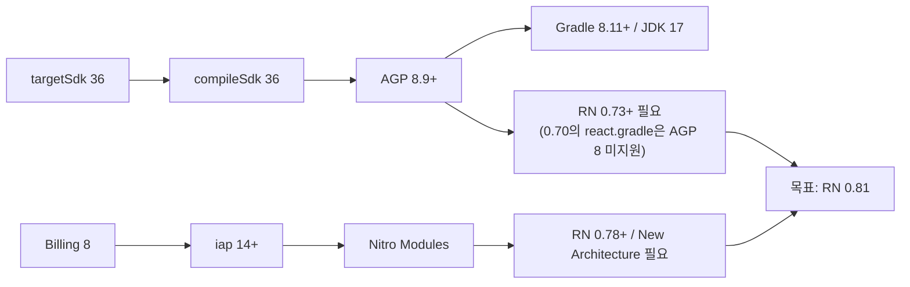

# 2년 멈춰 있던 React Native 앱을 0.70에서 0.81 New Architecture로 올린 기록

> 스토어 정책 마감(targetSdk 36, Google Play Billing 8)에 맞춰 RN 0.70 앱을 하루 동안 세 단계로 0.81까지 올렸습니다. 그 뒤 석 달 동안 결제, 뷰어, 분석 기능을 붙였습니다.

## 프로젝트 개요

웹툰·웹소설 플랫폼의 모바일 앱입니다. 작품 목록과 상세, 웹툰 뷰어(WebView), 웹소설 뷰어(EPUB), 코인 인앱 결제, 보상형 광고가 있습니다. 같은 서비스의 웹과 관리자 웹 이야기는 [웹·관리자 글](./webtoon-platform-web-cms.md)에 있습니다.

- **기간**: 2026년 7월 31일 ~ 10월 29일
- **역할**: 2023년에 시작돼 2024년 4월 이후 커밋이 없던 저장소를 혼자 맡았습니다. 이 기간의 커밋 53건은 모두 제 작업이고, 백엔드 API는 다른 팀 담당입니다.
- **업그레이드 경로**: RN 0.70.2 → 0.73.9 → 0.77.2 → 0.81.4 (New Architecture). 39개 파일, +8,946 / −13,565줄이 바뀌었고 삭제의 대부분은 JNI 글루 코드입니다.
- **함께 올린 라이브러리**: 인앱 결제 11 → 16, reanimated 2.17 → 3.19, WebView 11 → 13, screens 3 → 4

---

## 1. 단계별 업그레이드: 0.70 → 0.81

Google Play 정책으로 2026년 8월 31일까지 targetSdk 36과 Play Billing Library 8을 맞춰야 했습니다. 둘 다 따라가 보니 결국 RN 버전 문제였습니다.



0.81을 고른 이유는 `newArchEnabled=false`로 되돌릴 수 있는 마지막 버전이기 때문입니다. 문제가 생기면 New Architecture 탓인지 아닌지 나눠 볼 수 있습니다. 작업 전에 이 의존성 사슬과 단계별 계획을 문서로 먼저 정리했습니다.

원칙은 "한 번에 0.81로 뛰지 않는다"였습니다. 단계마다 커밋해서 되돌릴 지점을 남기고, 디버그 빌드가 실제로 뜨는지 확인한 뒤 다음 단계로 넘어갔습니다.

| 단계 | 내용 |
|---|---|
| 1 | RN 0.73.9, AGP 8.1, Gradle 8.3. 템플릿에서 사라진 JNI/C++ 스캐폴딩과 Flipper 제거 |
| 2 | RN 0.77.2, Kotlin 2.0, NDK 27. reanimated 3.16 |
| 3+4 | RN 0.81.4, React 19.1, targetSdk 36, AGP 8.11, New Architecture 켜기. iap 16, WebView 13 |

### 빌드는 되는데 실행하면 깨진 것들

이번에 만난 크래시는 모두 빌드 단계에서는 보이지 않았습니다.

- **reanimated 2.17.** 빌드는 통과했지만, 0.77에서 제거된 내부 클래스(`ChoreographerCompat$FrameCallback`)를 참조해 실행하자마자 죽었습니다.
- **bridgeless 모드의 루트 뷰.** 루트 뷰가 null이 되는 크래시는 `MainApplication`에 `getReactHost()`를 구현해 해결했습니다.
- **당겨서 새로고침.** RN 0.81의 ScrollView는 `refreshControl`의 유무를 `!= null`로 판단합니다. 기존 코드의 `Boolean(refresh) && <RefreshControl/>`이 넘긴 `false`를 엘리먼트로 복제하려다 크래시가 났습니다. 삼항 연산자로 `undefined`를 넘기게 고쳤습니다.
- **약관 화면 높이 0.** WebView 13의 `postMessage`는 문자열만 받는데 페이지가 높이를 숫자로 보내고 있었습니다.
- **SafeAreaView.** targetSdk 36부터 edge-to-edge가 강제되는데, safe-area-context의 `SafeAreaView`로 바꾸자 RN 0.81.4의 Yoga와 충돌해 네이티브 assertion으로 죽었습니다. inset 값만 읽어 일반 `View`의 padding으로 넣는 방식으로 우회했습니다.

```jsx
<SafeAreaInsetsContext.Consumer>
  {(insets) => (
    <View style={{ flex: 1, paddingTop: insets?.top ?? 0, paddingBottom: insets?.bottom ?? 0 }}>
      {children}
    </View>
  )}
</SafeAreaInsetsContext.Consumer>
```

결과적으로 하루 만에 0.81까지 올리고 실기기에서 New Architecture로 화면이 뜨는 것까지 확인했습니다. 나흘 뒤에는 release AAB(72.2MB)를 만들어 64비트 `.so` 36개가 모두 16KB 페이지로 정렬된 것을 확인했고, Billing 8 실결제도 실기기에서 확인했습니다.

## 2. Android 16 대응

- **예측형 뒤로가기.** 이 기능이 켜지면 RN의 `BackHandler`가 호출되지 않아 뒤로가기로 종료 광고를 띄우는 흐름이 깨집니다. 매니페스트에서 끄고, 플랫폼이 이 옵션을 무시하게 되면 네이티브에서 직접 받아야 한다는 점을 주석으로 남겼습니다.
- **광고 SDK 화면의 inset.** 보상형 광고 SDK의 화면이 시스템 바 아래로 깔렸습니다. 테마에 `fitsSystemWindows`를 넣자 모든 뷰에 적용돼 흰 띠가 생겨서, SDK 액티비티를 클래스 이름으로 찾아 그 콘텐츠 뷰 하나에만 padding을 주도록 바꿨습니다.
- **R8.** Play 정책상 release 빌드에 난독화를 켜고, 직접 작성한 네이티브 브리지와 Nitro 모듈 패키지를 keep 규칙에 넣었습니다.

**종료 광고가 뜨지 않던 문제.** 앱이 마운트될 때는 `getCurrentActivity()`가 아직 null이라 광고 인스턴스 생성이 실패했고, 빈 `catch`가 이를 삼키고 있었습니다. 인스턴스를 처음 쓸 때 만드는 `getOrCreate`로 바꾸고, 액티비티가 없을 때 들어온 로드 요청은 보관했다가 액티비티가 붙은 뒤 실행하게 했습니다. JS 쪽에는 광고가 열리지 않을 때를 대비해 1.5초 폴백 타이머를 두었습니다. 광고가 없다는 응답에 무한히 재요청하던 문제도 지수 백오프(최대 5회)로 바꿨습니다.

## 3. 인앱 결제: iap 11 → 16, StoreKit 2

Billing 8을 쓰려면 iap 16이 필요했고 API가 거의 다 바뀌었습니다. 서버로 보내는 payload 형식은 그대로 두고 앱 안에서 필드만 매핑해서, 백엔드는 고칠 필요가 없었습니다.

- **iOS 영수증이 갱신되지 않던 문제.** StoreKit 2는 결제를 해도 기기의 영수증 파일을 바로 갱신하지 않고, 소모성 상품은 `finishTransaction` 뒤 영수증에서 빠집니다. 순서를 바꾸고 영수증을 새로 요청하는 방식을 거쳐, 최종적으로는 StoreKit 2의 서명된 트랜잭션(JWS)을 새 검증 API로 바로 보내도록 바꿨습니다.
- **결제는 됐는데 코인이 안 들어온 경우를 놓치던 문제.** 충전 화면은 서버가 응답만 하면 성공으로 처리했고, 기존 오류 안내는 조건으로 쓰던 state가 항상 null이라 한 번도 뜨지 않았습니다. HTTP 오류이거나 성공 플래그가 false면 "결제는 완료됐지만 지급에 실패했다"는 안내를 주문번호와 함께 띄우게 했습니다. 버전마다 다른 취소 코드 두 가지도 모두 처리했습니다.

## 4. 소셜 로그인을 웹 계정과 연결하기

이어서 붙일 태그 검색과 회차 목록은 웹사이트용 API를 앱에서 직접 불러야 했는데, 앱의 소셜 로그인은 앱 서버 계정만 만들고 있었습니다. 네이티브 SDK로 로그인한 직후, 각 플랫폼의 1회용 자격증명(Apple authorization code, Kakao access token, Google server auth code)을 웹 API 로그인으로 보냈습니다. 앱 로그인이 계정을 먼저 만들면 웹 쪽에서 이메일 중복이 날 수 있어서 웹 로그인을 **먼저** 호출합니다.

웹 토큰은 만료 1분 전에 미리 재발급하고, 여러 요청이 동시에 재발급을 시도해도 실제 요청은 하나만 나가도록 진행 중인 Promise를 공유합니다.

```js
let refreshing = null
function ensureFreshToken() {
  if (!isExpiringSoon(getToken())) return Promise.resolve(getToken())
  refreshing ??= refresh().finally(() => { refreshing = null })
  return refreshing
}
```

## 5. 뷰어와 탐색 UX

- **드래그 스크롤바.** `PanResponder`와 `Animated`로 공용 스크롤바를 만들어 두 뷰어에 붙였습니다. 웹소설 쪽은 EPUB 컨테이너의 scroll 이벤트를 프레임당 한 번으로 묶어 RN에 보냅니다.
- **화면 캡처 방지.** 네이티브 모듈을 직접 만들었습니다. Android는 `FLAG_SECURE`를 켜고, iOS는 녹화가 감지되면 화면을 가리고 스크린샷에는 경고를 띄웁니다. 뷰어 위에 뷰어가 열릴 수 있어서 참조 카운트로 보호를 유지합니다.
- **EPUB 목차 이동.** 이동 뒤 위치가 밀리는 것을 보정하려고 기존 코드가 `display()`를 조건 없이 재귀 호출해서, 스크롤해도 계속 원위치로 끌려갔습니다. 300ms 뒤 위치를 확인하고 최대 5번까지만 재시도하게 했습니다.
- **태그 검색, 별점, 요일별 스와이프.** 별점은 터치 위치로 반 별 단위까지 받고, 요일별 목록은 캐시하면서 옆 요일 화면은 미리보기만 그리게 했습니다.
- **GA4.** 웹과 같은 속성에 앱 데이터를 모았습니다. 화면 이름은 직접 기록하고, `logEvent`의 반환값에 `.catch`를 붙인 코드가 출시 빌드를 죽이던 문제도 고쳤습니다.

---

## 회고

### 배운 점

- **업그레이드는 정책에서 거꾸로 따라가야 합니다.** "최신으로 올린다"가 아니라 "targetSdk 36과 Billing 8에 필요한 최소 조건이 무엇인가"에서 출발하니, 목표 버전과 단계가 저절로 정해졌습니다.
- **빌드 통과는 시작일 뿐입니다.** 단계마다 실제로 앱을 실행해 본 덕분에 어느 단계에서 깨졌는지 바로 좁힐 수 있었습니다.
- **조용한 실패가 가장 비쌉니다.** 종료 광고와 결제 지급 실패는 둘 다 아무 신호 없이 실패하고 있었습니다. 그 뒤로는 실패하면 최소한 로그나 사용자 안내가 남도록 짭니다.

### 아쉬운 점

- 자동화된 테스트가 없어서 업그레이드 검증을 실기기 수동 확인에 의존했습니다.
- 예측형 뒤로가기는 끄는 방식으로만 대응했습니다.
- 일부 커밋은 여러 수정을 한 번에 담고 줄바꿈 변경까지 섞여 있어 diff를 읽기 어렵습니다.
