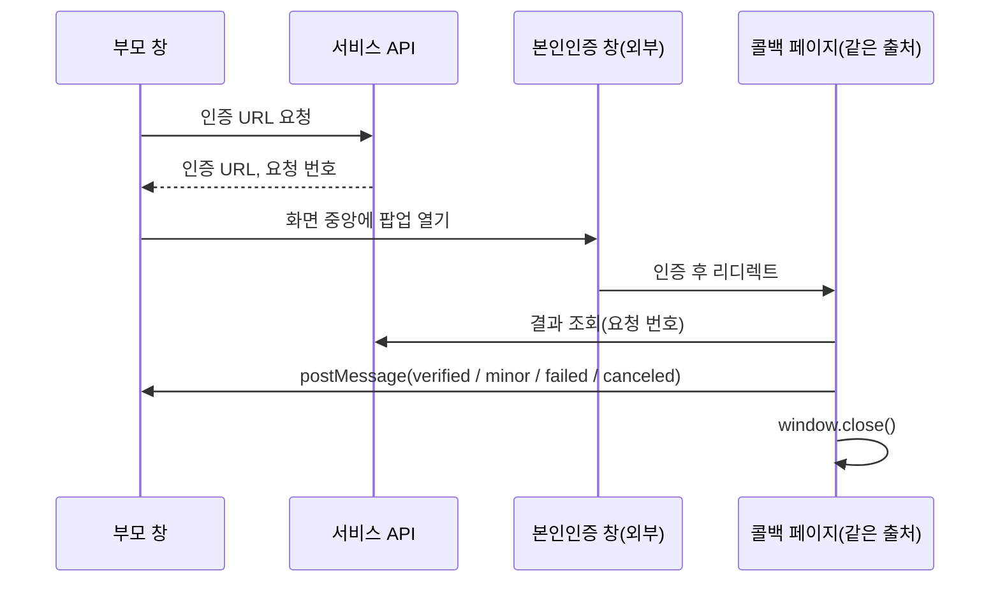

# 웹툰 플랫폼의 웹과 관리자 웹에서 결제, 성인 인증, SEO를 맡으며 풀었던 문제들

> 같은 웹툰·웹소설 서비스의 웹사이트(Next.js 15)와 운영자용 관리자 웹(Vue 2)에서 맡은 기능을 정리했습니다. 웹에서는 결제 폴링, 성인 모드와 본인인증, 서버 렌더링 SEO를, 관리자 웹에서는 연재 일괄 예약과 공용 컴포넌트 리팩터링을 맡았습니다.

## 프로젝트 개요

웹툰·웹소설 플랫폼의 웹사이트와, 운영자가 작품·회차·배너를 관리하는 관리자 웹입니다. 같은 서비스의 모바일 앱 이야기는 [앱 업그레이드 글](./webtoon-app-rn-upgrade.md)에 있습니다.

| | 웹사이트 | 관리자 웹 |
|---|---|---|
| 스택 | Next.js 15 App Router, React 19, TypeScript, Redux Toolkit + RTK Query, Tailwind | Vue 2.6, Vuex, Element UI |
| 기간·커밋 | 2025년 12월 ~ 2026년 10월, 43건 | 2026년 9월 22일 ~ 10월 28일, 21건 |
| 역할 | 결제, 성인 모드, SEO, 분석. 2026년 8월 이후 커밋 39건 중 36건이 제 작업 | 9월 22일 이후 커밋 21건 모두 제 작업 |

기존 코드는 다른 개발자가 만들었고, 백엔드 API는 다른 팀 담당입니다.

---

## 1. 웹 결제: 콜백이 없는 결제를 폴링으로 끝내기

새로 붙인 외부 지갑 결제는 결제가 끝났다고 알려 주는 콜백이 없어서, 상태를 직접 물어봐야 했습니다.

- **팝업 차단 피하기.** 결제 준비 API를 기다린 뒤 창을 열면 클릭과 창 열기 사이가 끊겨 브라우저가 팝업을 막습니다. 클릭 즉시 이름 붙은 빈 창을 먼저 열고, 응답이 오면 그 창의 주소를 바꿉니다.
- **2단계 폴링.** 결제사에서 결제가 끝나도 우리 서버의 지급 처리는 따로 끝납니다. 결제사 상태를 3초 간격으로 묻다가 서버 상태 확인으로 넘어가게 했고, 이후에는 결제사 결과와 상관없이 항상 서버 단계를 거쳐 최종 상태를 서버 기준으로 맞췄습니다.

| 서버 상태 | 처리 |
|---|---|
| 결제 완료 | 결제·사용자 캐시를 무효화해 코인 잔액을 다시 불러옴 |
| 취소됨 | 자동 환불되었다고 안내 |
| 취소 대기 | 환불 실패, 고객센터 안내 |
| 실패, 응답 없음 | 환불 처리 중인 중간 상태로 보고 계속 폴링 |
| 100회 초과 | 시간 초과 안내 |

- **확인 버튼 없애기.** 사용자가 "결제 완료" 버튼을 눌러야 넘어가던 흐름을, 모달 안에서 폴링하다가 완료되면 팝업을 닫고 결과 페이지로 자동 이동하게 바꿨습니다.
- **도메인별 결제 수단.** 같은 코드를 여러 도메인(앱 연동용, 일반, 제휴 카드사 전용)으로 배포하므로, 도메인에 따라 지갑 결제와 국내 PG 결제를 고르게 했습니다.

## 2. 성인 모드와 본인인증

성인 작품을 추가하면서 19세 모드 토글이 필요했습니다. 켤 때는 로그인과 본인인증을 확인하고, 인증이 없으면 성인 작품의 상세와 뷰어를 막아야 했습니다.

**상태는 최소한으로, 판단은 서버에.** 클라이언트에는 "토글이 켜져 있는가" 하나만 sessionStorage에 두고, 인증 여부와 필터링은 모두 서버가 판단합니다. 성인 기능이 없는 도메인에서는 파라미터를 아예 보내지 않습니다.

**본인인증은 팝업과 postMessage로 처리했습니다.**



팝업은 외부 사이트를 거쳐 돌아온 새 문서라 부모 창의 상태를 볼 수 없어서, 요청 번호를 저장소에 잠시 맡기고 콜백 페이지가 꺼낸 즉시 지웁니다. 부모 창은 메시지의 출처와 종류를 확인한 뒤에만 결과를 받습니다. 사용자가 인증 창을 X로 닫으면 콜백이 오지 않으므로 `popup.closed`를 주기적으로 확인해 취소로 처리합니다.

상세와 뷰어 API가 성인 인증 사유로 403을 주면 차단 화면을 띄우고, 같은 인증 훅으로 인증하면 바로 다시 불러옵니다. 성인 기능이 없는 도메인에서는 일반 "이용할 수 없는 작품" 화면을 띄워 성인 작품이라는 사실도 드러내지 않습니다.

이 기능을 붙이며 생긴 버그들입니다.

- **썸네일을 가렸더니 무한 스크롤이 멈춘 문제.** 목록은 "불러온 이미지 수 = 목록 길이"일 때만 다음 페이지를 요청하는데, 성인 작품 이미지를 그리지 않으니 이 조건이 맞지 않았습니다. 19 표시가 마운트될 때 이미지 로드 콜백을 대신 호출하게 했습니다.
- **로그아웃해도 19 토글이 켜져 보이던 문제.** 로그아웃 지점마다 상태를 지우는 대신, 화면에 쓰는 값을 `on = enabled && on && !!user`로 파생시켰습니다. 로그아웃 경로가 늘어나도 빠뜨릴 곳이 없습니다.
- **403의 이유를 추측하던 문제.** 처음에는 403을 받으면 클라이언트에서 인증 여부를 덮어썼는데, 403의 이유는 여러 가지일 수 있습니다. 토글만 끄고 계정 정보를 서버에서 다시 받아 맞추도록 바꿨습니다.

## 3. SEO: 클라이언트 전용 앱을 크롤러에게 보여주기

앱 전체가 redux-persist의 `PersistGate loading={null}` 아래에 있어서, 서버가 보내는 HTML은 사실상 비어 있었습니다.

- **메인 페이지 서버 렌더링.** Parallel Route 슬롯 `app/@seo/[contentTypeParam]`을 만들고, 루트 레이아웃이 이 슬롯을 `PersistGate`의 fallback으로 넘기게 했습니다. 상태를 복원하기 전까지는 서버에서 그린 인기·신작 목록이 보이고, 복원이 끝나면 실제 앱으로 바뀝니다. 하이드레이션 불일치가 나지 않도록 슬롯에는 스토어를 읽지 않는 컴포넌트만 씁니다.

```tsx
// app/layout.tsx (단순화)
export default function RootLayout({ children, seo }) {
  return (
    <StoreProvider>
      <PersistGate loading={seo} persistor={persistor}>{children}</PersistGate>
    </StoreProvider>
  )
}
```

- **사이트맵과 메타데이터.** `app/sitemap.ts`로 정적 경로와 작품 목록을 합쳐 내보내고(성인 작품 제외), 작품 상세에는 `generateMetadata`로 제목, 설명, canonical, Open Graph를 넣었습니다. `next/head`로 넣었던 검색엔진 소유 확인 메타는 App Router에서 반영되지 않아 `metadata.verification`으로 옮겼습니다.
- **루트 리디렉트.** 페이지 안에서 `redirect()`를 쓰면 스트리밍 중이라 상태 코드가 200으로 나갑니다. `next.config`의 `redirects`로 옮겨 308로 보내게 했습니다.

## 4. 웹에서 고친 버그들과 GA4

- **토큰 재발급이 항상 실패하던 문제.** 재발급 요청의 body를 `JSON.stringify(token)`으로 바꾼 뒤부터 실패했습니다. RTK Query의 `fetchBaseQuery`는 body가 일반 객체일 때만 직렬화하면서 `Content-Type: application/json`을 붙이고, 이미 문자열이면 그대로 보내서 `text/plain`이 됩니다. 객체를 그대로 넘기는 한 줄로 고치고 이유를 주석으로 남겼습니다.
- **내 커밋이 만든 배너 회귀.** 도메인 enum에 값을 끼워 넣자, 그 숫자를 배너 조회에 그대로 쓰던 코드에서 카테고리가 한 칸씩 밀렸습니다. 배너용 enum과 변환 함수를 따로 만들었습니다.
- **카드 안의 `<a>` 중첩.** 카드 전체를 감싼 링크 안에 태그 링크가 또 있어 하이드레이션 오류가 났습니다. 투명한 링크를 `absolute inset-0`으로 깔고 태그만 위로 올렸습니다.
- **GA4.** 상세 보기, 회차 열람, 결제 시작, 구매 등을 이벤트로 보냅니다. PG 리디렉트로 돌아온 페이지에는 결제 금액이 없을 수 있어서, 시작할 때 금액을 sessionStorage에 두었다가 구매 이벤트에서 꺼냅니다. 메신저나 SNS 인앱 브라우저는 User-Agent로 구분해 첫 페이지뷰부터 값을 붙였습니다.

이 저장소에는 테스트 러너가 없어서, 고친 로직은 함수로 분리하고 `node:assert` 테스트 16개를 `npx tsx`로 실행해 검증했습니다.

## 5. 관리자 웹: 연재 일괄 예약

운영자가 회차마다 공개 일시를 하나씩 입력하고 있었습니다. "시작 일시 + 연재 요일 + 하루 공개 수"로 공개 일시를 계산하게 했습니다.

```js
const d = moment(startAt)
return episodes.filter(isUnpublished).map((ep, i) => {
  if (i > 0 && i % perDay === 0) d.add(1, 'day')
  while (!days.includes(DAY_KEYS[d.day()])) d.add(1, 'day')
  return { ep, validFrom: d.format(FMT) }
})
```

- 다이얼로그에 회차별 미리보기와 "N화~M화, K개, 마지막 공개 일시" 요약을 보여 주고 확인을 받은 뒤 적용합니다. 이후 목록에서 체크한 회차만 배정하도록 바꿨습니다.
- 일괄 API가 없어서 회차마다 순서대로 요청하고, 진행률과 실패한 회차를 알려 줍니다.
- 목록이 20개씩 페이지로 나뉘어 있어, 다이얼로그를 열 때 전 회차를 다시 받아 정렬합니다.
- 회차 썸네일 zip 업로드도 같은 때 API에 연결했습니다. 업로드 전에 JSZip으로 형식, 파일명, 중복, 이미지 크기를 검사해 하나라도 걸리면 올리지 않습니다.

## 6. 관리자 웹: 쌍둥이 화면을 공용 컴포넌트로

웹툰과 웹소설의 목록·등록·수정 화면이 각각 따로 있었는데, 두 목록 파일은 공백을 빼면 +26/−27줄만 달랐습니다. 실제로 일괄 예약 기능도 웹소설 쪽에 그대로 붙여 넣어야 했습니다.

목록은 `ContentList.vue` 하나로, 등록·수정은 `ContentRegister.vue`와 `ContentEdit.vue`로 합쳤습니다. 컴포넌트는 `type: 'webtoon' | 'novel'` prop 하나만 받고, 라벨, id 필드 이름, API 함수, 웹소설 전용 필드 여부는 `types.js` 설정에서 꺼냅니다.

```js
// types.js
export const CONTENT_TYPES = {
  webtoon: { label: '웹툰', idKey: 'webtoon_id', hasVolume: false, api: webtoonApi },
  novel:   { label: '웹소설', idKey: 'novel_id', hasVolume: true, api: novelApi, extraGenres: [...] },
}
```

두 커밋으로 약 880줄이 줄었고, 효과는 바로 다음 작업에서 나타났습니다. 출판사, ISBN, 완결 여부, 대여가 필드를 추가할 때 공용 파일 두 개만 고치면 됐고, 웹소설 전용 장르는 `extraGenres`에 한 줄 추가로 끝났습니다.

---

## 회고

### 배운 점

- **상태는 파생시키는 편이 안전합니다.** 로그아웃 버그는 지우는 코드를 늘리는 대신 값을 계산하게 바꾸자, 같은 종류의 버그가 생길 자리가 없어졌습니다.
- **라이브러리의 기본 동작을 알아야 합니다.** 토큰 버그는 "문자열이면 손대지 않는다"는 `fetchBaseQuery`의 규칙 하나 때문이었습니다.
- **공통화는 세 번째 복사 전에 해야 합니다.** 일괄 예약을 복사한 날 오후에 목록부터 공용화했고, 그다음 필드 추가부터 효과를 봤습니다.

### 아쉬운 점

- 일괄 예약은 회차마다 요청을 보내서, 회차가 많으면 느리고 중간에 실패하면 일부만 적용됩니다. 일괄 API가 생기면 바꿔야 합니다.
- 배너 회귀는 숫자 enum을 API 값으로 직접 쓰지 않는 규칙이 처음부터 있었다면 막을 수 있었습니다.
- 관리자 웹의 19 뱃지 디자인은 하루 동안 커밋 9개를 거치며 계속 바뀌었습니다. 시안을 먼저 확인받았으면 커밋이 깔끔했을 것입니다.
