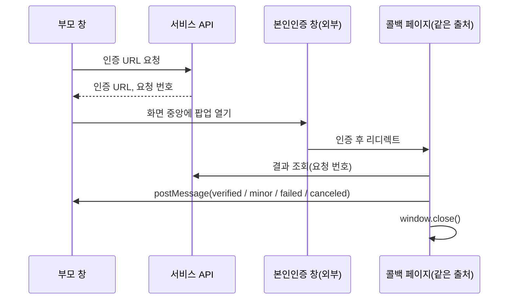

# 웹툰 플랫폼의 웹과 관리자 웹에서 결제, 성인 인증, SEO를 맡으며 풀었던 문제들

> 같은 웹툰·웹소설 서비스의 웹사이트(Next.js 15)와 운영자용 관리자 웹(Vue 2)에서 맡은 기능을 정리했습니다. 웹에서는 결제 폴링, 성인 모드와 본인인증, 서버 렌더링 SEO를 맡았고, 관리자 웹에서는 연재 일괄 예약과 공용 컴포넌트 리팩터링을 맡았습니다.

## 프로젝트 개요

**무엇을 만들었나.** 웹툰·웹소설 플랫폼의 웹사이트와, 운영자가 작품·회차·배너를 관리하는 관리자 웹입니다. 같은 서비스의 모바일 앱 이야기는 [앱 업그레이드 글](./webtoon-app-rn-upgrade.md)에 따로 정리했습니다.

**기간과 역할.**

| | 웹사이트 | 관리자 웹 |
|---|---|---|
| 스택 | Next.js 15 App Router, React 19, TypeScript, Redux Toolkit + RTK Query, Tailwind | Vue 2.6, Vuex, Element UI, axios |
| 내 커밋 | 43건 (2025년 12월 ~ 2026년 10월) | 21건 (2026년 9월 22일 ~ 10월 28일) |
| 역할 | 저장소 전체 커밋의 대부분은 다른 개발자 작업입니다. 저는 결제, 성인 모드, SEO, 분석을 맡았습니다. 2026년 8월 이후의 커밋 39건 중 36건이 제 커밋입니다. | 기존 코드는 다른 개발자가 만들었습니다. 9월 22일 이후의 커밋 21건은 모두 제 커밋입니다. |

백엔드 API는 다른 팀 담당이고, 이 글은 제 커밋으로 확인되는 작업만 다룹니다.

## 기술 스택 한눈에

| 영역 | 기술 | 이 프로젝트에서의 용도 |
|------|------|------------------|
| 웹 프레임워크 | Next.js 15 App Router | `sitemap.ts`, `generateMetadata`, Parallel Routes로 SEO |
| 웹 상태·데이터 | Redux Toolkit, redux-persist, RTK Query | 성인 모드 상태, 결제 후 캐시 무효화, 토큰 재발급 |
| 웹 구조 | Feature-Sliced Design | `app / _pages / widgets / features / entities / shared` |
| 웹 테스트 | `node:assert` + `tsx` | 테스트 러너 없이 로직 테스트 파일 16개 |
| 분석 | GA4 (gtag) | 페이지뷰, 전자상거래 이벤트, 인앱 브라우저 구분 |
| 관리자 웹 | Vue 2, Element UI, JSZip, moment | 일괄 예약, zip 업로드 사전 검사, 공용 폼 |

## 목차

1. [웹 결제: 콜백이 없는 결제를 폴링으로 끝내기](#1-웹-결제-콜백이-없는-결제를-폴링으로-끝내기)
2. [성인 모드와 본인인증](#2-성인-모드와-본인인증)
3. [SEO: 클라이언트 전용 앱을 크롤러에게 보여주기](#3-seo-클라이언트-전용-앱을-크롤러에게-보여주기)
4. [웹에서 고친 버그들과 GA4](#4-웹에서-고친-버그들과-ga4)
5. [관리자 웹: 연재 일괄 예약](#5-관리자-웹-연재-일괄-예약)
6. [관리자 웹: 쌍둥이 화면을 공용 컴포넌트로](#6-관리자-웹-쌍둥이-화면을-공용-컴포넌트로)

---

## 1. 웹 결제: 콜백이 없는 결제를 폴링으로 끝내기

### 왜 이렇게 했나

새로 붙인 외부 지갑 결제는 결제가 끝났다는 것을 우리 쪽에 알려 주는 콜백이 없었습니다. 결제가 끝났는지 알려면 상태를 직접 물어봐야 했습니다.

### 어떻게 적용했나

- **팝업 차단 피하기.** 결제 준비 API를 기다린 뒤에 창을 열면, 사용자 클릭과 창 열기 사이가 끊겨 브라우저가 팝업을 막습니다. 그래서 클릭 즉시 이름 붙은 빈 창을 먼저 열고, API 응답이 오면 그 창의 주소를 바꿉니다. 결제가 끝나면 같은 이름으로 창 핸들을 다시 얻어 닫습니다(`1c91fc9`, `5488822`).
- **2단계 폴링.** 처음에는 결제사 상태만 3초 간격으로 최대 100회(약 5분) 물었습니다. 그런데 결제사에서 결제가 끝나도 우리 서버의 지급 처리는 따로 끝납니다. 그래서 결제사 단계(`pg`)가 끝나면 상점 서버 단계(`server`)로 넘어가 다시 묻도록 바꿨습니다(`0009bc8`). 이후에는 결제사 결과와 상관없이 항상 서버 단계를 거치게 해서, 최종 상태를 서버 기준으로 하나로 맞췄습니다(`4ac2eac`).

| 서버 상태 | 처리 |
|---|---|
| 결제 완료 | 결제·사용자 캐시를 무효화해 코인 잔액을 다시 불러옴 |
| 취소됨 | 자동 환불되었다고 안내 |
| 취소 대기 | 환불 실패, 고객센터 안내 |
| 실패, 응답 없음 | 환불 처리 중인 중간 상태로 보고 계속 폴링 |
| 100회 초과 | 시간 초과 안내 |

- **확인 버튼 없애기.** 사용자가 "결제 완료" 버튼을 눌러야 다음으로 넘어가던 흐름을 바꿨습니다. 확인 모달 안에서 폴링하다가 완료되면 팝업을 닫고 결과 페이지로 자동 이동합니다. 모바일 브라우저에서 실패할 수 있는 `popup.close()`는 `try`로 감쌌습니다(`ffa290e`).
- **도메인별 결제 수단 분리.** 서비스는 같은 코드를 여러 도메인(앱 연동용, 일반, 제휴 카드사 전용)으로 배포합니다. 도메인 enum을 나누고, 도메인에 따라 지갑 결제와 국내 PG 결제를 고르게 했습니다. 제휴 카드사 도메인에서는 그 카드사로 바로 가는 결제창을, 나머지 도메인에서는 통합 결제창을 엽니다(`fdb643b`, `127f845`, `fbae385`).

### 결과

결제 성공, 자동 환불, 환불 실패, 시간 초과를 사용자에게 각각 다른 안내로 보여 줍니다. 결제가 끝나면 RTK Query 태그 무효화로 잔액이 바로 갱신됩니다.

## 2. 성인 모드와 본인인증

### 왜 필요했나

성인 작품을 추가하면서 웹에 19세 모드를 켜고 끄는 기능이 필요했습니다. 켤 때는 로그인과 본인인증을 확인해야 하고, 인증이 없으면 성인 작품의 상세와 뷰어를 막아야 했습니다.

### 어떻게 적용했나

**상태는 최소한으로, 판단은 서버에.** 클라이언트에는 "토글이 켜져 있는가" 하나만 둡니다. 인증 여부와 유효기간, 실제 필터링은 모두 서버가 판단합니다(`2d9bf94`).

- 토글 상태는 Redux 슬라이스에 두고 sessionStorage에 저장합니다. 브라우저를 닫으면 꺼집니다.
- `useAdultParam()`은 모드가 켜져 있으면 `1`, 꺼져 있으면 `0`을 돌려줍니다. 성인 기능이 없는 도메인에서는 `undefined`를 돌려줘서 파라미터를 아예 보내지 않습니다.
- 토글을 켤 때만 검사합니다. 로그인하지 않았으면 로그인 모달을, 인증하지 않았으면 인증 모달을 띄웁니다.

**본인인증은 팝업과 postMessage로 처리했습니다**(`f0ae4cf`).



팝업은 외부 사이트를 거쳐 돌아온 새 문서라서 부모 창의 메모리 상태를 볼 수 없습니다. 그래서 요청 번호를 브라우저 저장소에 잠시 맡기고, 콜백 페이지가 꺼낸 즉시 지웁니다. 부모 창은 메시지의 출처(origin)와 메시지 종류를 확인한 뒤에만 결과를 받습니다.

사용자가 외부 인증 창을 X 버튼으로 닫으면 콜백이 오지 않습니다. 그래서 500ms 간격으로 `popup.closed`를 확인해 취소로 처리하고, 결과가 두 번 처리되지 않도록 ref로 막았습니다.

- **차단 화면.** 상세와 뷰어 API가 성인 인증 사유로 403을 주면 차단 화면을 띄웁니다. 차단 화면에서 같은 인증 훅을 재사용하고, 인증에 성공하면 상세는 `router.refresh()`로, 뷰어는 새로고침으로 다시 불러옵니다(`7540661`). 성인 기능이 없는 도메인에서는 "이용할 수 없는 작품"이라는 일반 화면을 띄워, 성인 작품이라는 사실도 드러내지 않습니다(`c7ead20`).
- **썸네일 가리기.** 찜 목록이나 최근 본 목록에는 성인 작품이 섞여 내려옵니다. 모드가 꺼져 있으면 이미지를 흐리게 하는 대신 아예 렌더하지 않고 19 표시로 바꿨습니다(`99bd155`).

### 해결한 문제

- **썸네일을 가렸더니 무한 스크롤이 멈춘 문제.** 목록은 "불러온 이미지 수 = 목록 길이"일 때만 다음 페이지를 요청하고 있었습니다. 이미지를 렌더하지 않으면 이 조건이 영원히 맞지 않습니다. 19 표시가 마운트될 때 이미지 로드 콜백을 대신 호출하게 했습니다(`99bd155`).
- **로그아웃해도 19 토글이 켜져 보이던 문제.** 토글 값이 sessionStorage에 남아 있었기 때문입니다. 로그아웃 지점마다 상태를 지우는 대신, 화면에 쓰는 값을 `on = enabled && on && !!user`로 파생시켰습니다. 로그아웃 경로가 늘어나도 빠뜨릴 곳이 없습니다(`1831c31`).
- **403의 이유를 추측하던 문제.** 처음에는 성인 목록 요청이 403을 받으면 클라이언트에서 인증 여부를 0으로 덮어썼습니다(`f0ae4cf`). 그런데 403의 이유는 여러 가지일 수 있습니다. 그래서 토글만 끄고 계정 정보를 서버에서 다시 받아 맞추도록 바꿨습니다(`7540661`).

## 3. SEO: 클라이언트 전용 앱을 크롤러에게 보여주기

### 왜 필요했나

앱 전체가 redux-persist의 `PersistGate loading={null}` 아래에 있었습니다. 저장된 상태를 복원하기 전에는 아무것도 그리지 않으니, 서버가 보내는 HTML은 사실상 비어 있었습니다. JS를 실행하지 않는 크롤러에게는 빈 문서로 보입니다.

### 어떻게 적용했나

- **사이트맵.** App Router의 `app/sitemap.ts`로 정적 경로(타입별 홈, 랭킹, 연재, 카테고리)와 작품 목록 API 결과를 합쳐 내보냅니다. 하루 단위로 다시 생성하고, 성인 작품은 뺍니다. API가 실패해도 정적 경로는 내보냅니다(`2090029`).
- **작품 상세 메타데이터.** `generateMetadata`로 제목, 설명(150자), canonical, Open Graph 이미지를 넣었습니다. 성인 작품은 `noindex`로 둡니다(`d5da4b1`).
- **검색엔진 소유 확인 메타.** 처음에는 `next/head`로 넣었는데 App Router에서는 반영되지 않았습니다. `metadata.verification`으로 옮겼습니다(`d33bc79`, `e594c26`).
- **메인 페이지 서버 렌더링.** Parallel Route 슬롯 `app/@seo/[contentTypeParam]`을 만들고, 루트 레이아웃이 이 슬롯을 `PersistGate`의 `loading` fallback으로 넘기게 했습니다(`4864a8b`). 상태를 복원하기 전까지는 서버에서 그린 인기·신작 목록이 보이고, 복원이 끝나면 실제 앱으로 바뀝니다. 슬롯은 `generateStaticParams`와 1시간 재생성으로 만들고, 하이드레이션 불일치가 나지 않게 스토어를 읽지 않는 컴포넌트만 씁니다.

```tsx
// app/layout.tsx (단순화)
export default function RootLayout({ children, seo }) {
  return (
    <StoreProvider>
      <PersistGate loading={seo} persistor={persistor}>{children}</PersistGate>
    </StoreProvider>
  )
}
```

- **루트 리디렉트.** `/`는 meta refresh 페이지로 `/webtoon`에 보내고 있었습니다. 페이지 안에서 `redirect()`를 쓰면 스트리밍 중이라 상태 코드가 200으로 나갑니다(코드 주석). 그래서 `next.config`의 `redirects`로 옮겨 308로 보내게 했습니다(`4864a8b`).

### 결과

메인 페이지의 서버 HTML에 작품 목록이 들어가도록 바꿨고, 크롤러가 사이트맵, 작품별 메타데이터, 영구 리디렉트를 받게 됐습니다.
## 4. 웹에서 고친 버그들과 GA4

- **토큰 재발급이 항상 실패하던 문제.** 재발급 요청의 body를 `JSON.stringify(token)`으로 바꾼 뒤부터 재발급이 실패했습니다(`669fb72`). RTK Query의 `fetchBaseQuery`는 body가 일반 객체일 때만 직렬화하면서 `Content-Type: application/json`을 붙입니다. 이미 문자열이면 그대로 보내므로 브라우저 기본값인 `text/plain`이 됩니다. 서버는 본문을 읽지 못하고 400을 돌려줬습니다. 객체를 그대로 넘기는 한 줄로 고치고, 이유를 주석으로 남겼습니다(`a3b9ee6`).
- **내 커밋이 만든 배너 회귀.** 도메인 enum에 값을 끼워 넣은 뒤(`fdb643b`), 배너 조회에 그 enum 숫자를 그대로 쓰던 코드에서 카테고리가 한 칸씩 밀렸습니다. 일반 도메인에 제휴사 배너가 뜨는 식이었습니다. 배너용 enum을 따로 만들고 `getBannerCategory(domain, adultOn)`으로 변환하게 했습니다(`1ebfdd5`, `56e8575`). 같은 날 오전에는 배너가 빈 배열일 때 `items[0]`을 읽어 페이지 전체가 흰 화면이 되던 문제도 막았습니다(`008a2fc`).
- **카드 안의 `<a>` 중첩.** 카드 전체를 `<Link>`로 감싼 안에 태그 링크가 또 있어, `<a>` 안에 `<a>`가 생겼습니다. 무효한 HTML이라 하이드레이션 오류가 납니다. 카드를 `relative` div로 바꾸고, 투명한 링크를 `absolute inset-0`으로 깔고(aria-label 포함), 태그만 `z-10`으로 올렸습니다(`8722313`).
- **GA4.** `next/script`로 gtag를 넣고, 로그인 상태가 바뀌면 `user_id`를 페이지뷰 없이 갱신합니다. 상세 보기, 회차 열람, 찜, 검색, 결제 시작, 구매를 이벤트로 보내고, 각 이벤트는 ref로 한 번만 보냅니다. PG 리디렉트로 돌아온 페이지에는 결제 금액이 없을 수 있어서, 결제를 시작할 때 금액을 sessionStorage에 두었다가 구매 이벤트에서 꺼내고 바로 지웁니다(`953d387`).
- **인앱 브라우저 구분.** 메신저나 SNS 앱 안에서 링크를 열면 유입 경로가 비어 Direct로 잡힙니다. User-Agent 토큰 12개를 순서대로 매칭하고, `config` 전에 `gtag('set', { in_app_browser })`를 보내 첫 페이지뷰부터 값이 붙게 했습니다. 일부 앱은 UA에 다른 앱의 토큰이 섞여 있어서 매칭 순서가 중요합니다(`3a99b9b`).

이 저장소에는 테스트 러너가 없습니다. 그래서 고친 로직은 함수로 분리하고, `node:assert` 기반 테스트 파일 16개를 `npx tsx`로 실행해 검증했습니다. 검증한 로직은 성인 인증 흐름, 배너 카테고리 변환, 로그인 리디렉트 대상, 중첩 링크, 태그 강조 등입니다.

## 5. 관리자 웹: 연재 일괄 예약

### 왜 필요했나

운영자가 회차마다 공개 일시를 하나씩 입력하고 있었습니다. 수십 화를 연재 요일에 맞춰 예약하려면 날짜를 직접 계산해야 했습니다.

### 어떻게 적용했나

"시작 일시 + 작품의 연재 요일 + 하루 공개 수"로 공개 일시를 계산합니다(`a3c3308`).

```js
const d = moment(startAt)
return episodes.filter(isUnpublished).map((ep, i) => {
  if (i > 0 && i % perDay === 0) d.add(1, 'day')
  while (!days.includes(DAY_KEYS[d.day()])) d.add(1, 'day')
  return { ep, validFrom: d.format(FMT) }
})
```

- 이미 공개된 회차는 빼서, 시작일만 바꿔 다시 적용할 수 있습니다.
- 시작일이 연재 요일이면 그날부터 배정합니다.
- 연재 요일이 없거나, 첫 공개 일시가 직전 회차보다 이르면 경고합니다.
- 다이얼로그에 회차별 미리보기 표와 "N화~M화, K개, 마지막 공개 일시" 요약을 보여 주고, 확인을 받은 뒤 적용합니다.
- 일괄 API가 없어서 회차마다 수정 요청을 순서대로 보냅니다. 진행률을 "i / N"으로 보여 주고, 실패한 회차는 모았다가 마지막에 알려 줍니다.

이후 "공개 전 회차 전체"가 아니라 **체크한 회차만** 배정하도록 바꿨습니다. 목록에서 체크해 둔 회차가 다이얼로그에 미리 체크되어 들어옵니다(`0fe4454`).

### 해결한 문제

- 목록이 20개씩 페이지로 나뉘어 있어서, 화면에 보이는 회차만으로는 예약을 계산할 수 없었습니다. 다이얼로그를 열 때 100개 단위로 전 회차를 다시 받아 정렬합니다(`a3c3308`).
- 기존 판매 예약 기능에서 직전 회차의 예약 값이 미예약(`'None'`)이면 비교가 실패하던 버그도 함께 고쳤습니다(`a3c3308`).
- 회차 썸네일 zip 업로드도 같은 커밋에서 실제 API에 연결했습니다. 업로드 전에 JSZip으로 미리 검사해서, 하나라도 걸리면 아예 올리지 않습니다. 검사 항목은 jpg/png 여부, 파일명이 회차 번호인지, 중복·없는 회차, 이미지 크기(720×1030)이고, 숨김 파일은 제외합니다.

## 6. 관리자 웹: 쌍둥이 화면을 공용 컴포넌트로

### 왜 필요했나

웹툰과 웹소설의 목록, 등록, 수정 화면이 각각 따로 있었습니다. 웹툰 목록과 웹소설 목록 파일을 비교하면 공백을 무시한 차이가 +26/−27줄뿐이었습니다. 사실상 같은 파일을 복사해 쓰고 있었던 셈입니다. 실제로 일괄 예약 기능도 웹소설 쪽에 같은 코드를 그대로 붙여 넣어야 했습니다(`eeac5a5`).

### 어떻게 적용했나

- **목록**: `ContentList.vue` 하나와 타입별 설정 파일 `types.js`로 합쳤습니다(`8c15e63`, +344/−621).
- **등록·수정**: `ContentRegister.vue`와 `ContentEdit.vue`로 합쳤습니다(`28fb468`, +766/−1367).

컴포넌트는 `type: 'webtoon' | 'novel'` prop 하나만 받습니다. 라벨, id 필드 이름, 기본 경로, API 함수, 웹소설에만 있는 필드(권/화 구분) 여부는 모두 `types.js`의 설정 객체에서 꺼냅니다. 기존 화면 파일은 4줄짜리 래퍼로 남겼는데, 라우트와 keep-alive가 컴포넌트 이름으로 묶여 있기 때문입니다(코드 주석).

```js
// types.js
export const CONTENT_TYPES = {
  webtoon: { label: '웹툰', idKey: 'webtoon_id', hasVolume: false, api: webtoonApi },
  novel:   { label: '웹소설', idKey: 'novel_id', hasVolume: true, api: novelApi, extraGenres: [...] },
}
```

### 결과

- 두 커밋으로 약 880줄이 줄었습니다.
- 바로 다음 작업에서 효과가 나타났습니다. 출판사, ISBN, 완결 여부, 대여가 필드를 추가할 때, 등록·수정은 공용 파일 두 개만 고치면 됐습니다(`d7ba281`). 웹소설에만 있는 무협 장르는 `types.js`의 `extraGenres`에 한 줄을 추가해 넣었습니다.
- 대여가와 소장가는 둘 중 하나만 있어도 되게 했습니다. 빈 칸은 0(무료)이 아니라 `null`로 보내서 "그 방식으로는 팔지 않음"을 뜻하게 했습니다(`d7ba281`).

## 회고

### 배운 점

- **상태는 파생시키는 편이 안전합니다.** 로그아웃 버그는 "지워야 할 곳에서 안 지웠다"가 원인이었습니다. 지우는 코드를 늘리는 대신 화면에 쓰는 값을 다른 상태에서 계산하게 바꾸니, 같은 종류의 버그가 생길 자리가 없어졌습니다.
- **라이브러리의 기본 동작을 알아야 합니다.** 토큰 버그는 "문자열이면 손대지 않는다"는 `fetchBaseQuery`의 규칙 하나 때문이었습니다. 고친 뒤에는 같은 실수를 반복하지 않도록 이유를 주석으로 남겼습니다.
- **공통화는 세 번째 복사 전에 해야 합니다.** 일괄 예약을 웹소설 쪽에 복사한 날 오후에 목록부터 공용화했고, 열흘 뒤 등록·수정까지 합쳤습니다. 그다음 필드 추가부터 효과를 봤습니다.

### 아쉬운 점

- 관리자 웹의 일괄 예약은 회차마다 요청을 보내서, 회차가 많으면 느리고 중간에 실패하면 일부만 적용됩니다. 일괄 API가 생기면 바꿔야 합니다.
- 배너 회귀는 enum 값을 바꿀 때 그 숫자를 쓰는 곳을 모두 찾지 않아서 생겼습니다. 숫자 enum을 API 값으로 직접 쓰지 않는 규칙을 처음부터 두었으면 좋았을 것입니다.
- 관리자 웹의 19 뱃지 디자인은 하루 동안 커밋 9개를 거치며 체크박스, 라디오, 뱃지로 계속 바뀌었습니다. 먼저 시안을 확인받고 구현했으면 커밋이 깔끔했을 것입니다.
